# Open-K2 Firmware

Open-source bare-metal C++23 firmware for the **WITRN K2 USB-PD Analyzer / Power Meter** (Artery AT32F403A). It is flashed through the K2's own bootloader, which it never touches.

Not affiliated: WITRN is a trademark of its owner, and this project is independent of it. See
[`PROVENANCE.md`](PROVENANCE.md) for where the hardware knowledge comes from and what is (and is not)
in this repository, and [`THIRD_PARTY_NOTICES.md`](THIRD_PARTY_NOTICES.md) for the bundled third-party
components and their licences.

**Jump to:** [What it does](#what-it-does) | [UI walkthrough](#ui-walkthrough) | [Hardware](#hardware) | [Download / flash](#download--flash) | [Build](#build) | [USB link modes](#usb-link-modes) | [Flashing](#flashing) | [USB drive](#usb-drive) | [Browser dashboard](#browser-dashboard-prototype) | [Recovery](#recovery) | [License](#license)

## What it does

- **Power meter**: volts, amps, watts and energy, trend graphs, D+/D-/CC1/CC2 line levels.
- **USB-PD analyzer**: passive by default; decodes the charger's offers (Fixed, PPS, AVS, EPR), reads the partner's identity, and can request a PDO or a PPS/AVS voltage (**PD trigger**).
- **Fast-charge triggers** on D+/D-: QC, AFC, FCP/SCP, VOOC and a one-click auto detector.
- **Charger test**: guided no-load voltage sweeps with per-step results, saved as report cards you can share as a QR code.
- **Cables**: e-marker read and save (library of up to 140), cable-identity Spoof, cable resistance.
- **Black Box**: a PD trace recorder with trigger-frozen captures that survive power-off.
- **USB**: remote control (`tools/k2_remote.py`), a browser dashboard, a read-only drive, and a WebHID flasher.

How to use all of it: **[`docs/USER_GUIDE.md`](docs/USER_GUIDE.md)**, with a short Getting started part and a full reference of every page, tool and setting.
Feature status, with what is verified on hardware and what is not, is in `docs/ROADMAP.md`.
Step-by-step hardware test procedures for every protocol and feature, with a results log: `docs/HW_TEST_PROCEDURES.md`.

## UI walkthrough

The K2 has a 240x240 screen and four buttons: **BACK**, **MINUS**, **OK** and **PLUS**. A narrow strip along one edge of the screen always shows what each button does on the page you are on, so read the strip instead of learning keys. In the lists, MINUS and PLUS read **Up** and **Dn**. A grey or missing label means that button does nothing there.

The pictures below are host renders: the real UI code drawn into a 240x240 buffer by the host tests, with stand-in readings (a 100 W PD charger on the port, a live session and a healthy diagnosis; the charger-test and PD Spec pages use an EPR-capable charger instead, and the Battery place a made-up round trip). They are not photos or device screenshots, so the numbers are examples. The regeneration recipe is at the end of this section. The full reference for every page is [`docs/USER_GUIDE.md`](docs/USER_GUIDE.md).

### Home

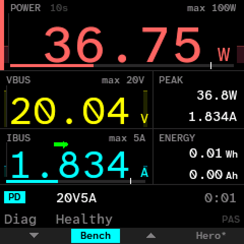

- Flow is the page the K2 boots into. The big number is power (W); volts and amps sit below it, each with a trend.
- The two cells on the right (peak, drop, cable, energy) turn by themselves. The bottom block names the PD diagnosis (here "Healthy") and the contract, and how long the session has run.
- **OK** opens the Bench. **Long OK** resets the energy counter and the peaks. **Long BACK** changes the big number (W, V, A). **Long PLUS / MINUS** change the trend window (10 s, 60 s, 10 min).

### The other faces: Graphs, Numbers, Lines

<table>
<tr>
<td align="center">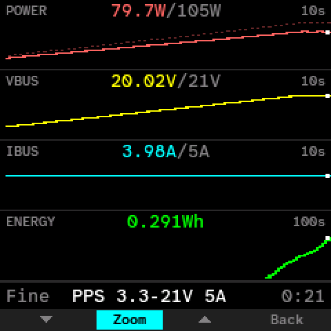</td>
<td align="center">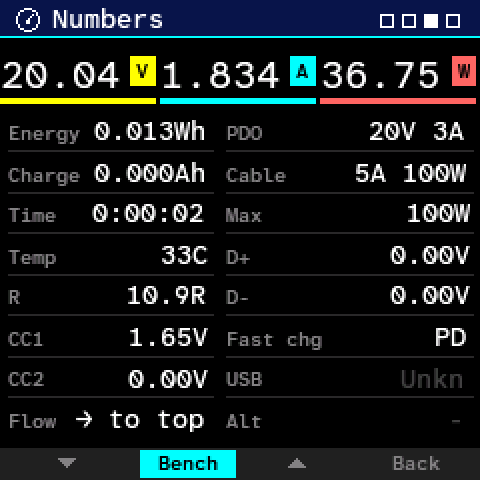</td>
<td align="center">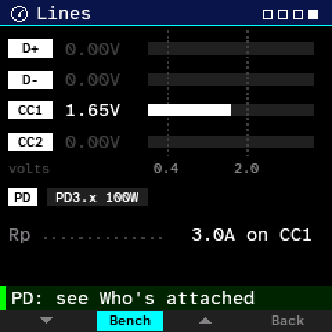</td>
</tr>
<tr>
<td align="center"><sub>Graphs: power, volts, amps, energy</sub></td>
<td align="center"><sub>Numbers: every reading in a grid</sub></td>
<td align="center"><sub>Lines: D+, D-, CC1, CC2</sub></td>
</tr>
</table>

- **Dn** and **Up** flip through Flow, Graphs, Numbers and Lines and wrap round. **OK** opens the Bench from Flow, Numbers and Lines; on Graphs it is Zoom. **BACK** goes to Flow.
- Graphs has its own trends. **OK** (Zoom) changes the time span.
- Numbers shows the contract, cable rating, energy, charge, time and the line levels. Lines draws the levels of the four signal lines as bars.

### Bench and the places

<table>
<tr>
<td align="center">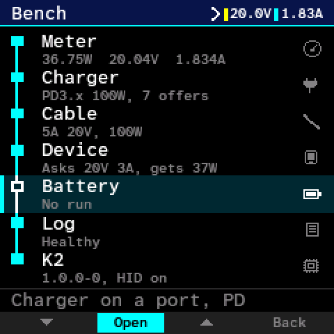</td>
<td align="center">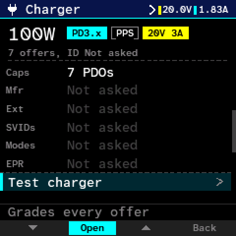</td>
<td align="center">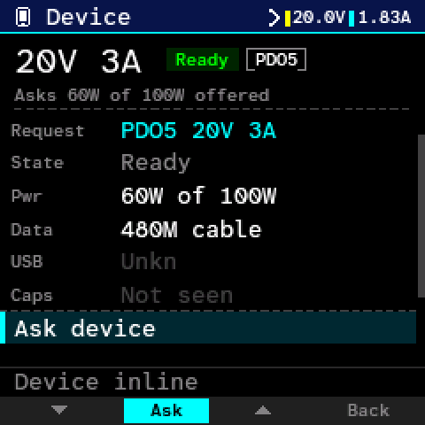</td>
</tr>
<tr>
<td align="center"><sub>Bench: the places</sub></td>
<td align="center"><sub>Charger: offers and tests</sub></td>
<td align="center"><sub>Device: what it asks for</sub></td>
</tr>
</table>

- The Bench lists seven places, each with a status line: Meter, Charger, Cable, Device, Battery, Log and K2. **Up** and **Dn** move, **OK** opens a place, **BACK** returns to the face you came from.
- The Charger place is the PD page. It shows what the charger offers (fixed, PPS, AVS, EPR) and the actions you can run on it: Test charger, Request voltage, Fast charge, Report cards.
- The Device place shows what the attached device asks the charger for. The Log place shows the PD diagnosis and opens the Black Box. The Battery place records charge efficiency (next section).

### Battery place

<table>
<tr>
<td align="center">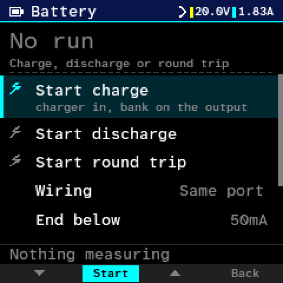</td>
<td align="center">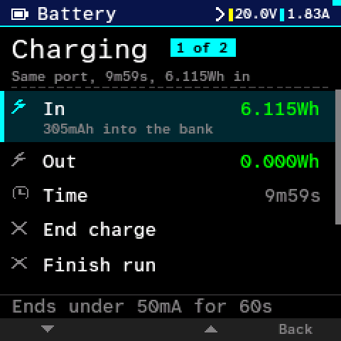</td>
<td align="center">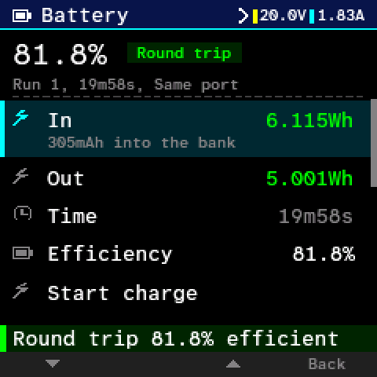</td>
</tr>
<tr>
<td align="center"><sub>No run: pick a mode</sub></td>
<td align="center"><sub>Charging: Wh in so far</sub></td>
<td align="center"><sub>Done: the efficiency</sub></td>
</tr>
</table>

- The recorder measures what flows into and out of a power bank over hours, from the power monitor, and runs in the background while you use any other page. The Bench row shows it: `No run`, `Charging 1h05m, 12.34Wh`, then `Round trip 80.0%`.
- **Start charge** records one charge, **Start discharge** one discharge, and **Start round trip** a charge, a wait and then a discharge; the round trip reports the efficiency, Wh out divided by Wh in. A finished run shows In, Out, Time and Efficiency.
- **Wiring** says where the bank sits: **Same port** (the bank stays on the output and feeds a load on the input) or **Moved** (the bank moves to the input). The K2 needs this to tell energy in from energy out.
- A phase ends by itself when the current stays under **End below** (default 50 mA) for **End after** (default 60 s). **End charge** or **End discharge** ends it by hand: **OK**, then **OK** again within 5 s. **Saved runs** keeps the newest three; **Share as QR** shows one on screen. The same controls are in `tools/k2_remote.py battery`, and the rules are in [`docs/BATTERY_RECORDER.md`](docs/BATTERY_RECORDER.md).

### Charger test

Start it from **Test charger** in the Charger place. Plug the charger in with **nothing on the output**. The test steps through the voltages the charger offers and grades each one.

<table>
<tr>
<td align="center">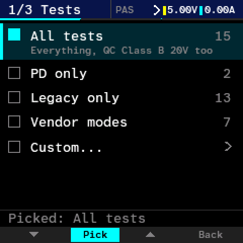</td>
<td align="center">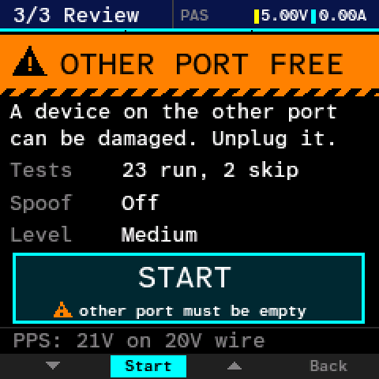</td>
<td align="center">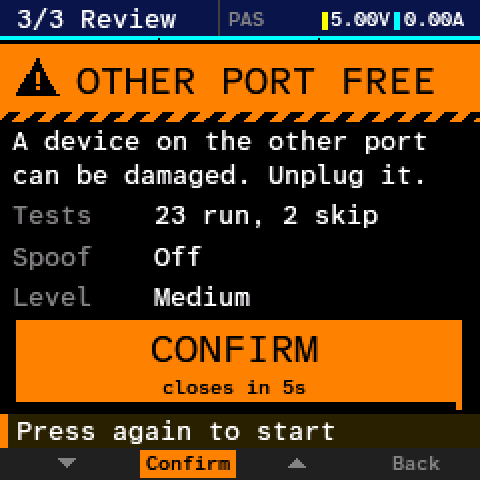</td>
</tr>
<tr>
<td align="center"><sub>1/3 Tests: pick a preset</sub></td>
<td align="center"><sub>3/3 Review: warning, Level, START</sub></td>
<td align="center"><sub>OK again within 5 s</sub></td>
</tr>
</table>

- Step 1 picks a preset (All tests, PD only, Legacy only, Vendor modes or Custom). **OK** picks it and goes on. Step 2 picks the cable identity to present; the Review step lists what will run.
- The Review step's **Level** bar (**Light | Medium | Deep**; MINUS or PLUS moves the cursor between it and START, **OK** steps the pick Light, Medium, Deep and back to Light) sets how far the run goes: **Light** lists what the charger advertises and keeps VBUS at 5 V, **Medium** (the default, set in Settings > Test level) tests every level, **Deep** adds the PPS and AVS deep sweeps (every 100 mV across each range). A Light run marks what it did not measure as listed or not run (on the card: advertised or detected), never as a pass.
- Review always opens with the orange **OTHER PORT FREE** banner: a device on the other port can be damaged, so unplug it first. The K2 only knows a device is there when it sees proof of one, so the banner is always on and START carries the note "other port must be empty".
- On Review, **OK** (Start) arms the run. The button turns orange and reads CONFIRM; a bar drains over 5 s. A second **OK** inside that time starts the run; if the 5 s pass, it disarms. Make sure the other port is empty and the output has no load before the first press.

<table>
<tr>
<td align="center">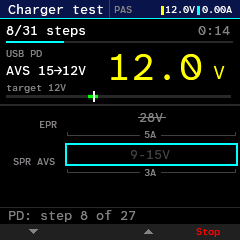</td>
<td align="center">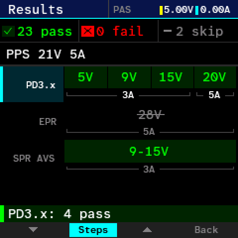</td>
<td align="center">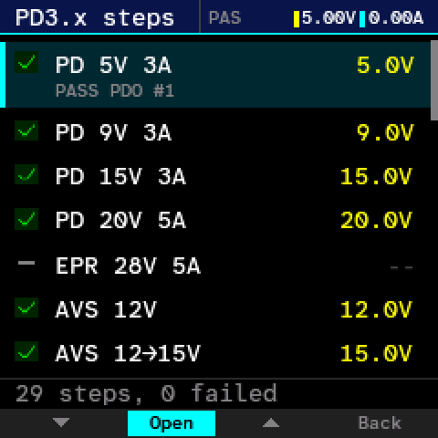</td>
</tr>
<tr>
<td align="center"><sub>Running: the step under test</sub></td>
<td align="center"><sub>Results: one cell per voltage</sub></td>
<td align="center"><sub>Steps: the list for one unit</sub></td>
</tr>
</table>

- Running shows the step count, VBUS, the target and a grid that follows the step in progress. **Up** and **Dn** scroll it. **BACK** (Stop) ends the run early.
- Results grades every unit. The header counts pass, fail and skip. A green cell passed, a red one failed, a struck-out one was skipped (here the EPR 28 V step). **OK** (Steps) opens the steps of the focused unit. **Long OK** shows a QR code that opens the full result on a phone.
- Steps lists each step with the volts it measured; its footer counts the steps and the failures ("25 steps, 0 failed"; with cautions and no failure it reads "25 steps, 2 caution"). **OK** (Open) shows one step's detail.
- A level that holds its voltage but **folds back** (the output drops on a step up, for example "folds to 9.2V above 10.5V") is a **caution**, not a failure: the step stays a pass, the Detail band is amber and reads CAUTION, and a run with a caution gets a fourth header cell, "caution", between pass and fail. A real track break keeps its own verdict.
- Probe rows (the Xiaomi 6 A probe at a level) get a row of their own between the PD rows. On a SuperVOOC charger a Deep run adds an **SV cap** row: the highest current ask the charger kept the session going under, read as "6.3A claimed", "<=11.1V, 10.9A 121W claimed" or "stopped at 3.3s, <=11.0V, 10.9A 120W claimed". It is the K2's own ask read from the protocol, never a drawn current or power (the watts are VBUS times the ask); the K2 never loads the charger. Status: host-tested only; the hardware check on a OnePlus 120 W charger was parked because the probe ends about 3.3 s after the wake, so the "ceiling" is the last ask.

<table>
<tr>
<td align="center">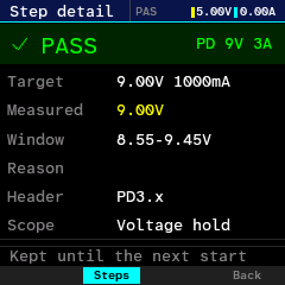</td>
</tr>
<tr>
<td align="center"><sub>Detail: target, measured, window</sub></td>
</tr>
</table>

The level shows in the results and on the running page:

<table>
<tr>
<td align="center">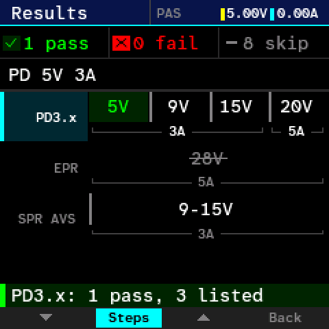</td>
<td align="center">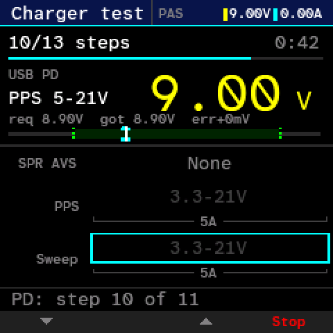</td>
</tr>
<tr>
<td align="center"><sub>Light: 5 V measured, the rest listed</sub></td>
<td align="center"><sub>Deep: a PPS sweep row, set and err</sub></td>
</tr>
</table>

- A Deep run's PPS and AVS sweep rows show the voltage with three decimals (for example 9.000 V) and a line under it, "set 9.000  err +0 mV": the setpoint the K2 asked for and how far VBUS is from it. Other rows keep the two-decimal readout.
- A Light run keeps VBUS at 5 V. In its Results only the 5 V cell is a measured pass; the other levels are drawn without a fill and the footer says "1 pass, 3 listed".
- A Deep run steps a PPS or AVS range in 100 mV points. While a sweep row runs, the hero shows VBUS with the voltage the K2 asked for (**req**), the voltage the charger gave (**got**) and the error between them. The grid shows the range row and, below it, the **Sweep** strip for that range; the strip turns green, amber or red when the sweep closes, graded by the worst error.

### PD Spec Check

This page is only in builds made with `K2_PDSPEC=1`; the default build does not have it. It is a no-load conformance pass over the attached PD charger, judged against the limits of the PD specification.

<table>
<tr>
<td align="center">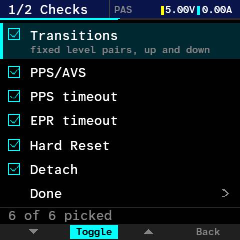</td>
<td align="center">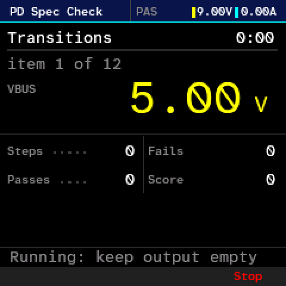</td>
<td align="center">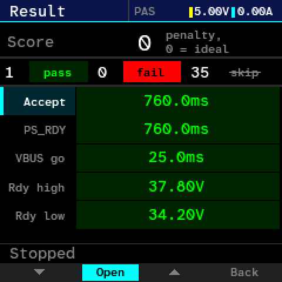</td>
</tr>
<tr>
<td align="center"><sub>1/2 Checks: pick families</sub></td>
<td align="center"><sub>Running: family and VBUS</sub></td>
<td align="center"><sub>Results: a run stopped early</sub></td>
</tr>
</table>

- Setup picks the check families (**OK** toggles one). Review shows what will run and uses the same two-press START as the charger test.
- Running shows the check, VBUS and the counts. **BACK** (Stop) ends it and returns the charger to 5 V.
- Results lists every check as pass, fail or skip with its worst value. The picture is a run that was stopped early, so most checks are skipped. **OK** opens a check's detail. The score is a penalty: 0 is ideal.

### E-marker and cable read

<table>
<tr>
<td align="center">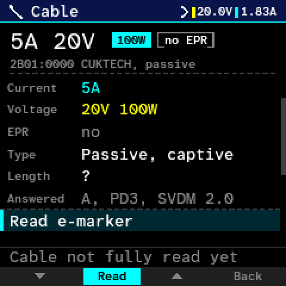</td>
</tr>
<tr>
<td align="center"><sub>Cable: e-marker identity and Read e-marker</sub></td>
</tr>
</table>

- The Cable place shows what the cable's e-marker reports: current, voltage, type, length and the answered modes.
- Plug the cable into the bottom port with nothing else attached, then press **OK** (Read) to read it. Save it, spoof it or measure its resistance from the same list.

### Settings

<table>
<tr>
<td align="center">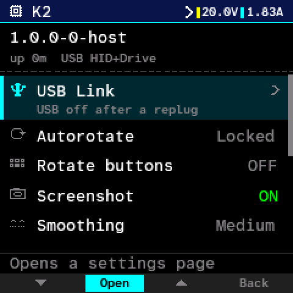</td>
<td align="center">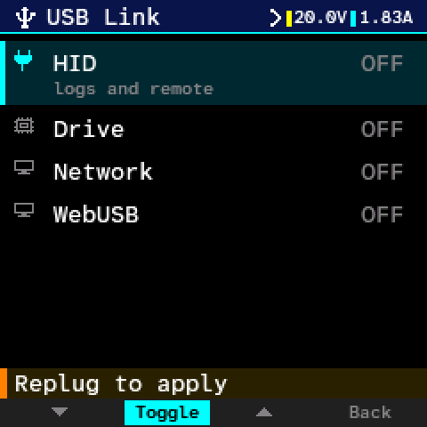</td>
</tr>
<tr>
<td align="center"><sub>K2 place: settings</sub></td>
<td align="center"><sub>USB Link: turn on HID</sub></td>
</tr>
</table>

- The K2 place, last on the Bench, shows the firmware version, uptime and USB mode, then the settings: USB Link, Autorotate, Rotate buttons, Screenshot, Smoothing, Wake sleeping port and Test level (the level each new charger test starts at: Light, Medium or Deep; **OK** cycles it), and last System state, Memory and Boot info.
- **OK** opens a page or toggles a value. On USB Link, **OK** (Toggle) turns HID or Drive on; the change applies after a replug. The footer says so.
- Hold **MINUS and PLUS together** to rotate the screen.

### Also

- **Reboot:** hold **OK and BACK together for 3 s** on any page. A card counts down after 1 s; release either button to cancel.
- **Web page:** `tools/web/k2.html` is the browser dashboard (WebHID; it also opens WebUSB on builds made with `K2_WEBUSB=1`). It shows the readings and runs the same tools from a computer. See "Browser dashboard" below.

### Regenerating the pictures

The host tests draw each page to a 240x240 buffer. With `K2_DUMP=<dir>` set, the UI test programs write the frames, and `tools/panel2png.py <dir> <out> --scale 2` turns them into PNG files (480x480). Host builds only; no firmware build or K2 is needed:

```bash
make host-build/test_ui_mockup host-build/test_ui_charger_test host-build/test_ui_pdspec_page \
     host-build/test_ui_sweep_live host-build/test_ui_graphs
mkdir -p runs/shots runs/png
for t in mockup charger_test pdspec_page sweep_live graphs; do K2_DUMP=runs/shots ./host-build/test_ui_$t; done
python3 tools/panel2png.py runs/shots runs/png --scale 2
```

Each picture is one frame of `runs/png` (the `k2_` prefix and the `.panel` suffix of the dump are the file name there), reduced to 128 colours (`Image.quantize(128, method=Image.Quantize.MEDIANCUT, dither=Image.Dither.NONE)` in PIL):

| Picture in `docs/img/ui` | Frame | Driver |
| :--- | :--- | :--- |
| `home`, `numbers`, `lines`, `bench`, `settings` | `mock_readme_home`, `_numbers`, `_lines`, `_bench`, `_place_k2` | `test_ui_mockup` |
| `place-battery`, `place-battery-charging`, `place-battery-done` | `mock_readme_place_battery`, `_charging`, `_done` | `test_ui_mockup` |
| `place-charger`, `place-device`, `place-cable`, `usblink`, `ct-tests` | `mock_place_charger`, `_device`, `_cable`, `mock_usblink`, `mock_ct_setup` | `test_ui_mockup` |
| `ct-review`, `ct-confirm`, `ct-running`, `ct-results`, `ct-steps`, `ct-detail`, `ct-light` | `readme_ct_review`, `_confirm`, `_running`, `_results`, `_steps`, `_detail`, `_light` | `test_ui_charger_test` |
| `sweep-running` | `sweep_pps_rot3` | `test_ui_sweep_live` |
| `pdspec-setup`, `pdspec-running`, `pdspec-results` | `readme_pdspec_setup`, `_running`, `_results` | `test_ui_pdspec_page` |
| `graphs` | `mock_graphs_pps_r3` | `test_ui_graphs` |

The `readme_*` frames exist for this section: they are taken at rotation 3 (the strip at the bottom) after ticking the UI until it stops painting, because the stock gallery frames of the same pages are taken mid-paint or with a charger the stub's converter cannot follow (red failures). The Home, Bench, Numbers, Lines and Battery frames carry the stand-in live session (a healthy Black Box report, CC1 1.65 V with D+/D- at 0 V, the MCU temperature, the PD verdict), so no row says "no session" or "--" beside a live contract. The charger-test frames use an EPR charger the stub's converter follows up to 36 V, run at Medium (Light for `ct-light`).

What the host pictures cannot show: LCD timing and SPI glitches, real readings, a real voltage fold (the caution state is covered by the UI tests, not by a picture here), the SuperVOOC ceiling row, QR codes that scan, and the PD Spec pages on a default build.

## Hardware

- **MCU**: AT32F403AVGT7 (Cortex-M4F, 240 MHz from the 8 MHz crystal, 1 MB flash, 96 KB SRAM mapped by default).
- **Display**: ST7789V 240x240 on SPI3 (PA15 CS, PB3 SCK, PB4 DC, PB5 MOSI, PB6 RESET, PB7 backlight as plain GPIO).
- **Buttons**: PB14 BACK, PA14 MINUS, PA9 OK, PA13 PLUS. The pin map is `include/k2/drivers/pins.hpp`.
- **Buses**: FUSB302 on PB10/PB11, power monitor (INA226 on this unit) on PB8/PB9, both bit-banged I2C.
- **Debugging**: no debugger (SWJ is off, its pins are buttons and LCD lines). The channels are USB log lines (`[TAG] ...`), the Black Box and the screen.
- **Flash**: `0x08000000..0x08003800` is the bootloader and is never written. The app is linked at `0x08003800`; the layout rules and the writable regions are in `docs/ARCHITECTURE.md` (code: `include/k2/drivers/flash_map.hpp`).

---

## Download / flash

- **From the browser** (Chrome or Edge, WebHID): open <https://yarost12.github.io/open-k2-firmware/>, press **Connect**, pick the K2, then **Flash release vX.Y**. The page offers the newest tagged release only; it downloads the image from the site itself and checks its SHA-256 before flashing. The K2 needs USB HID enabled (Settings > USB Link) to be sent into the bootloader without the button, or hold **MINUS** while plugging in; see "Flashing" below.
- **A release asset**: every release on the [Releases page](https://github.com/YaroST12/open-k2-firmware/releases) carries `open_k2.k2` (the container to flash), `open_k2.bin`, `open_k2.elf` and `SHA256SUMS`. Flash the `.k2` with the page above (file picker) or `python3 tools/k2_flasher.py flash open_k2.k2 --auto-dfu`.
- **CI builds** of `main` and of pull requests are workflow artifacts (Actions > ci), not releases; the flasher page never offers them.

Cut a release (maintainers): `git tag vX.Y && git push origin vX.Y`. `release.yml` runs the full gate with the version string derived from the tag by `tools/fw_version.py` (`vX.Y` gives `X.Y.0-0-<hash>`, `vX.Y.Z` gives `X.Y.Z-0-<hash>`; builds after the tag read `X.Y.0-<commits since>-<hash>`; major and minor 0 to 15, the container stores them in one byte), creates the GitHub Release with the assets and notes, and redeploys the Pages site so the flasher follows. One-time repo setup: Settings > Pages > Source: GitHub Actions.

## Build

The host has no ARM toolchain; everything builds in the `open-k2-builder` Docker image.

```bash
make docker-image     # once
make docker-build     # build/open_k2.elf, .bin, .k2 (the container to flash)
make test             # host unit tests (C++, Python, node)
make gate             # build with -Werror, invariants, map check, command ids, all tests, size
```

`make gate` runs the whole test suite: a cold run takes about 10 minutes in CI, and a local incremental run is much faster. A normal `make docker-build` is quick.

**`third_party/` must be populated.** TinyUSB and lwIP are git submodules (`third_party/tinyusb`, `third_party/lwip`), and a fresh clone or a new git worktree has them empty, so the build fails. Run `git submodule update --init third_party/tinyusb third_party/lwip`, or in a new worktree copy them from a populated checkout: `cp -a /path/to/open-k2-firmware/third_party/{tinyusb,lwip} third_party/`.

All firmware is C++23 under `src/` and `include/` (only TinyUSB and lwIP are C). One image holds every USB mode except the network one: the web interface (lwIP, CDC-NCM, HTTP dashboard) is compiled out by default to free RAM and flash and comes back with `make docker-build K2_NET=1` (see "USB modes").
Build identity stamps are non-intermediate: a changed git hash recompiles the version object
even when the host-test object cache uses `.SECONDARY`.

### Code navigation (clangd, IDEs)

Every build writes `compile_commands.json` at the repo root (gitignored): each compile recipe records its exact command in `<object>.cmd`, and `tools/compdb.py` merges them (`make docker-build` for `build/`, `make test` for the host tests in `host-build/`, `make compdb` to merge what exists). Firmware entries use the ARM compiler, files only the tests build (`tests/*.cpp`) use the host `g++`; a file built by both is listed once, as firmware. `build-net/` and other `BUILD_DIR`s never touch the file, and an unchanged build leaves it untouched (no reindex).

The ARM compiler is not on the host, so the first `make docker-build` also copies its system headers (newlib, libstdc++, 24 MB) out of the image into `.cache/arm-none-eabi/` and `compdb.py` adds them to the firmware entries; `make nav-headers` redoes the copy after a toolchain image change. The committed `.clangd` drops the GCC-only flags clangd does not know. Open the repo with clangd from the repo root; `clangd --check=src/ui/ui_home.cpp` is the quick test (its "errors" count includes harmless "tweak: ... FAIL" probes; real parse errors are the lines without `tweak:`). A user-level `~/.config/clangd/config.yaml` that removes `-m*`/`-f*` flags makes clangd parse the firmware as armv4t instead of Thumb-2; drop that rule for exact parsing.

## USB link modes

**USB is off by default.** After a flash the K2 does not enumerate on the HID port until you enable it on the device: Settings > USB Link. Choices, applied after a replug (kept in flash):

| Mode | What the host sees |
| :--- | :--- |
| Off (default) | nothing; the remote, the log and the smoke test have no channel |
| HID | the logger and remote channel (VID 0x0716 / PID 0x5060), used by `k2_remote.py`, `pd_trace.py`, WebHID |
| HID + Drive | HID plus the read-only `K2 DRIVE` (status, log, saved cables as JSON) |
| HID + Network (**`K2_NET=1` builds only**) | HID plus a CDC-NCM network link; the K2 serves the dashboard at `http://192.168.7.1/` (the host gets 192.168.7.2 by DHCP; Linux, macOS and Windows 11 need no driver) |

The network mode is not in the default build (`K2_NET=0`: no lwIP, no NCM, no HTTP server, no embedded dashboard; Settings > USB Link shows only HID and Drive, and a stored "network" setting runs as HID). To get it back, build with `make docker-build K2_NET=1` and flash that image. `make gate` also builds that variant in `build-net/`, so it keeps compiling. The WebHID dashboard in `tools/web` works in every build.

Drive and Network cannot be combined (USB packet memory). **The HID port needs a USB C-to-A cable**: a C-to-C cable does not enumerate on the left port. Enable HID in Settings > USB Link before you use any `tools/k2_remote.py` command or `make smoke`.

**Orientation:** open Settings > Autorotate, select Auto or
Manual 0/90/180/270 deg with short PLUS/MINUS, then press OK to apply. Auto follows gravity;
Manual stays fixed. Orientation choices last for the current boot.

---

## Flashing

1. Get the K2 into DFU mode: with the app running and USB HID on, `--auto-dfu` does it for you (below). Otherwise hold **MINUS** while plugging in the PC USB cable; this always works, also for a K2 that runs nothing useful.
2. Check the connection (DFU mode only): `python3 tools/k2_flasher.py probe`
3. Flash:
   ```bash
   python3 tools/k2_flasher.py flash build/open_k2.k2              # K2 already in DFU
   python3 tools/k2_flasher.py flash build/open_k2.k2 --auto-dfu   # app running, no button; what `make flash` does
   python3 tools/k2_flasher.py flash build/open_k2.k2 --monitor --timeout 20   # then show the boot log
   python3 tools/k2_remote.py dfu --confirm                         # only enter DFU, flash later
   make smoke                                                       # gate, flash, exercise the device, write build/smoke/<hash>/
   ```
   Every `flash` first makes a full backup into `runs/k2-backup-<UTC time>` (`--backup-dir DIR` to choose,
   `--no-backup` to skip; `make flash FLASH_ARGS=--no-backup` passes it on). `make smoke` flashes with `--no-backup`.

The K2 is a shared device: do not run ad-hoc flash loops, and nothing that changes VBUS runs unattended.

### How DFU entry works and how to recover

`DFU_ENTER` (remote command 0x30, confirm payload `DFU!`, also the "Enter DFU..." button of the
WebHID dashboard) makes the app program the "K200" model signature word at 0x08004010 to 0 (a
pure 1 -> 0 bit-clear, no erase, from RAM with interrupts off), verify it and reset. The
bootloader no longer recognises the app and stays in DFU. Flashing erases and rewrites that page,
so the signature comes back with the next firmware.

- The bootloader region 0x08000000-0x080037FF is never written; the write path accepts only the two
  half-words of the marker word, and only the value 0.
- Neither state (not the app, not the bootloader): hold **MINUS** while plugging in USB, then flash.
- If the bit-clear does not force DFU the app simply boots again (only one marker word changed). The
  flasher then reports "the app is still answering"; next try is the commit marker 0x08004400, one
  constant (`kDfuMarkerAddr` in `include/k2/drivers/flash.hpp`).

---

## USB drive

The K2 enumerates as a composite device: the HID logger (unchanged) plus a read-only mass-storage drive named `K2 DRIVE` (when Settings > USB Link has the Drive on; HID-only is a runtime mode of the same firmware image, and Drive cannot be combined with the network mode). In the network mode (a `make docker-build K2_NET=1` image only; Settings > USB Link > Network, replug) the K2 serves the dashboard itself: open http://192.168.7.1/ (the host gets 192.168.7.2 by DHCP; Linux, macOS and Windows 11 need no driver). Files:

- `README.TXT`, `STATUS.TXT` (live V/A/W, source caps, cable), `LOG.TXT` (recent log lines)
- `CABLES/<name>.JSN`: one JSON file per saved cable (see `docs/EMARKER_JSON.md`); manage them with `python3 tools/k2_remote.py emarker list | save | rename <id> "<name>" | delete <id> --confirm | spoof <id>|builtin:<id|name>|off`
- `NATIVE/` (only when the unit has a native e-marker library): `LIBRARY.BIN` (the raw 2 KB page at 0x080E3800) and `LIBRARY.TXT` (header, checksum, one line per record). Read-only.
- `SAVEDLOG.TXT` after `store save-log`, plus `RIPPLE.CSV` and `BLACKBOX/` placeholders

Save the cable currently read by the K2 with `python3 tools/k2_remote.py store save-emarker` (same as `emarker save`), list with `store list`. The native pages at 0x080E3000/0x080E3800 are never written. Flash is written only by these commands. After a save, unplug and re-plug (or re-mount) the drive to see the new files. Details: `docs/ARCHITECTURE.md`, section "USB drive (MSC), flash store and FAT synthesis".

---

## Browser dashboard (prototype)

`tools/web/k2.html` is a card dashboard over WebHID (Chrome or Edge): power with a V/A/W chart, USB-PD, cable e-marker, lines and ADC, ripple capture, device and DFU controls, and the log. Sections for identity (with Identify device), PD trigger and fast-charge trigger appear only when the firmware answers their commands.

```bash
make web      # serves tools/web on http://localhost:8765/k2.html
```

Click **Connect** and pick the K2. On Linux the hidraw node needs the udev rule with `MODE="0666"` for VID 0716, and no other tool may hold the device. Details: `docs/ARCHITECTURE.md`, section "WebHID dashboard".

### WebHID flasher (GitHub Pages)

`webhid-flasher/index.html` is a standalone firmware flasher over WebHID — no Python, no DFU button dance: pick a `.k2`/`.bin` file, press **Flash firmware**. If the app is running it is sent into the bootloader via `DFU_ENTER` first (press **Connect** again once the K2 re-enumerates as `WITRN.K2`); a K2 already in DFU (MINUS held while plugging in) is flashed directly. Same flow as `k2_flasher.py flash`: erase, write, read-back verify, commit marker, reboot. The page refuses any image whose erase span would reach the device-storage area (nothing above 0x080E0000 is ever erased or written); an image that reaches the littlefs volume (0x080B3000 and up) is flashed with a note, and the K2 formats a new volume at the next boot. A flash that stops half way leaves the commit marker clear, so the K2 stays in the bootloader and the next attempt starts over.

**Backup and restore.** The backup is full by default: the whole 1 MB (0x08000000..0x08100000), read twice and compared. The box **Back up this K2 first (full backup)** is ticked every time the page loads; with it ticked, **Flash** (file or release) makes the backup first, downloads it, then flashes, in one click. Unticking it shows a warning: the flash erases the firmware that is on the K2 now, and without a backup it cannot be brought back. **Back up the K2** makes a backup without flashing (the K2 goes into the bootloader the same way as for a flash). The download is one ZIP, `K2_BACKUP_<version>_<UTC time>.zip`, with `K2_RECOVERY_<version>.k2` (the file to keep), `flash.bin`, `app.bin`, `bootloader.bin`, `native_nvram.bin` and `manifest.json`; the same files are also offered one by one under "Individual files". To restore, pick the ZIP (or the `.k2` inside it) as the firmware file, or press **Restore this backup** right after the backup. The recovery image stops before the littlefs volume (0x080B3000), so restoring puts the firmware back and leaves the volume untouched. The native data area (0x080E0000, settings and e-marker records) is saved in `native_nvram.bin` but is never restored by the page. `manifest.json` has `backup_kind` (`full`, `app-only` or `partial`) and the SHA-256 of `native_nvram.bin`. If the bootloader refuses reads above 0x080E3000 the backup is marked `partial` and the page says that the device-storage part is missing. The advanced option "application area only" reads 0x08000000..0x080E3000 and says so in the result. The Python flasher does the same: `k2_flasher.py backup <folder>` is full and writes the ZIP next to the folder (`--app-only` for the application area only; `--full` is accepted and changes nothing), and `k2_flasher.py flash` makes a full backup into `runs/k2-backup-<UTC time>` (or `--backup-dir`) first unless `--no-backup` is given.

```bash
make webhid   # stages the page with tools/web/k2proto.js under build/webhid/ and serves it on http://localhost:8765/
```

The page is published to GitHub Pages by `.github/workflows/pages.yml` on pushes to `main` and on manual runs; `release.yml` starts it on `main` after it creates a release (a deploy from a tag ref does not go live, so a release made by hand in the GitHub UI needs a manual "Run workflow" on `main`) (one-time setup: Settings → Pages → Source: GitHub Actions; the workflow stages `tools/web/k2proto.js` next to the page, so nothing is tracked twice), reachable at `https://<owner>.github.io/<repo>/`. Pages never builds firmware: it adds the newest release's `open_k2.k2` as `fw/open_k2.k2` plus `fw/latest.json` (`tools/stage_fw.py`, checked against the release's `SHA256SUMS`), and the page's release card reads them (GitHub release assets carry no CORS headers, so the page cannot fetch them from GitHub directly). Without a release there is no `fw/` and the card stays hidden; `make site` stages a local build the same way, labelled `local-<git>`. Protocol code: `webhid-flasher/k2boot.js` (bootloader protocol + `.k2` container, byte-tested against `tools/k2_flasher.py` in `tests/test_k2boot.mjs`).

### Site layout and the results page

The Pages site is the flasher at the root plus everything under `docs/site/`, which the workflow copies over the root
(`cp -r docs/site/. _site/`), so the flasher keeps its address and other pages can sit beside it.

| Path on the site | Source | What |
|---|---|---|
| `/` | `webhid-flasher/` | the WebHID firmware flasher |
| `/fw/` | newest GitHub release | `open_k2.k2` + `latest.json`, staged by the workflow (absent until a release exists) |
| `/r/` | `docs/site/r/` | charger-test results: the page a K2 report-card QR code opens |

The K2 shows a report card as a link code (long OK on the charger test Results page or in Tools, Report cards); a phone
camera opens `https://yarost12.github.io/open-k2-firmware/r/#<card>` and the page shows one badge per capability the charger
achieved, with the full results below. The card travels after the `#`, so it never reaches the server; the page is static
(`card.js` decoder and badge model, `view.js` drawing, `index.html`), loads nothing from the network and works offline once
opened. Format and golden tests: `docs/QR_SHARE.md`, `tests/test_cardpage.mjs`. `make site` stages the whole tree under
`build/site/` the way the workflow does.

---

## Recovery

### First contact with a new K2 (do this before flashing anything)

The area 0x080E0000..0x080FFEFF holds data that was on the unit before this firmware: settings, e-marker
records, assets. This firmware never erases or programs it (the volume ends at 0x080E0000; the only
erasable page there is an old raw store of ours, proven by its own signature), but copy it out first so it
can always be restored:

1. Put the K2 in DFU (hold MINUS while plugging in USB), then `python3 tools/k2_flasher.py probe`.
2. `python3 tools/k2_flasher.py backup /path/outside/the/repo/k2-dump` (full by default). It reads
   0x08000000..0x08100000 twice and compares. Exit 3 means the bootloader refused above some address; the
   readable part is saved and `manifest.json` names `last_readable_address`.
3. Only if the dump is partial: `python3 tools/k2_flasher.py flash build/open_k2.k2` (safe: no wipe, no
   format of the device-storage area), enable USB HID in Settings > USB Link, replug (left port needs a C-to-A cable),
   then `python3 tools/k2_remote.py flash-dump /path/outside/the/repo/k2-dump`.
4. Store the dump outside the repo, then flash and use this firmware normally.

Whether the bootloader reads above 0x080E3000 is unverified.

### Erase this firmware's data and leave the app

`factory-wipe` removes everything this firmware keeps in flash (the littlefs volume at
0x080B3000..0x080E0000 and, on units that ran older builds, legacy stores above 0x080E4000) and leaves the K2
in the bootloader, ready for another `.k2` container:

1. Flash this firmware (`make flash`) and enable USB HID in Settings > USB Link, so the remote works.
2. `python3 tools/k2_remote.py factory-wipe --confirm`. The K2 unmounts the volume, erases its 90 sectors and
   the legacy pages that carry our own old signature (the rest of 0x080E0000.., the bootloader and
   the info page are never touched), reads every erased one back
   as 0xFF, clears its own backup registers (DR22..DR37) and enters DFU without booting the app
   again. The command prints the sector counts and exits 0; on any erase or verify failure it exits 6, the
   K2 stays in the app and does not enter DFU.
3. While the K2 is in DFU, flash the next container with `python3 tools/k2_flasher.py flash <file.k2>` (no
   `--auto-dfu`). Do not replug the K2 before this step: the app marker is already cleared, so it stays in
   DFU either way.

## License

Open-K2 Firmware is free software: you can redistribute it and/or modify it under the terms of the GNU
General Public License as published by the Free Software Foundation, either version 3 of the License, or
(at your option) any later version.

This program is distributed in the hope that it will be useful, but WITHOUT ANY WARRANTY; without even
the implied warranty of MERCHANTABILITY or FITNESS FOR A PARTICULAR PURPOSE. See the GNU General Public
License for more details.

You should have received a copy of the GNU General Public License along with this program (the file
[`LICENSE`](LICENSE)). If not, see <https://www.gnu.org/licenses/>.

Copyright (C) 2026 Yaraslau Furman. Every first-party source file carries
`SPDX-License-Identifier: GPL-3.0-or-later`. Code under `third_party/` keeps its own licence, listed in
[`THIRD_PARTY_NOTICES.md`](THIRD_PARTY_NOTICES.md).

Not affiliated with WITRN. WITRN is a trademark of its owner.
