# Open-K2 user guide

How to use the K2 with this firmware. Part 1 gets you running in a few minutes. Part 2 is the full reference: one section per page, tool and setting.

- [Part 1: Getting started](#part-1-getting-started)
- [Part 2: Reference](#part-2-reference)

Status words used below: **verified** means it was checked on real hardware, **partly verified** means some of it was, **not verified** means it is implemented but untested on a device. The authoritative list is [`ROADMAP.md`](ROADMAP.md).

---

# Part 1: Getting started

## What it is

The K2 is a pocket USB-C power meter and USB Power Delivery (PD) analyzer with a 240x240 screen and four buttons. It sits between a charger and a device (or in front of a charger alone) and shows voltage, current, power, what the charger offers, what the cable can carry, and what the lines (CC, D+, D-) are doing.

Open-K2 is a free replacement application for it. It is **passive by default**: the PD chip only listens, so plugging the K2 in never changes what a charger or device does. Features that talk to the charger (triggers, the charger test, cable reading, spoofing) run only when you start them.

## Install it

You need a Chrome or Edge browser and a USB cable.

1. Open <https://yarost12.github.io/open-k2-firmware/>.
2. Press **Connect** and pick the K2 in the browser dialog.
3. Leave **Back up this K2 first (full backup)** ticked. It is ticked every time the page loads.
4. Press **Flash release vX.Y**. The page first makes a full backup and downloads it as `K2_BACKUP_<version>_<UTC time>.zip`, then checks the image's SHA-256, writes the firmware, verifies it and restarts the K2. Keep the ZIP somewhere safe: it lets you put the K2 back the way it was.

If the K2 is running the app when you press Flash, the page sends it into the bootloader first; press **Connect** again when it reappears as `WITRN.K2`, then press Flash again. The backup runs at that point.

If you untick the box, the page warns you: the flash erases the firmware that is on the K2 now, and without a backup it cannot be brought back.

If the K2 is not recognised (it runs nothing useful, or USB is off), hold **MINUS** while plugging in the USB cable. That always puts it in the bootloader, ready to flash.

Other ways: pick a `.k2` file with the page's file picker, or use the Python flasher: `python3 tools/k2_flasher.py flash open_k2.k2 --auto-dfu` (it also makes the full backup first, into `runs/k2-backup-<UTC time>`; `--backup-dir <folder>` chooses the place, `--no-backup` skips it). Details: [Backup, restore and recovery](#backup-restore-and-recovery).

## Turn USB on (once)

USB is **off** after a fresh flash. Without it the K2 still works as a meter, but the remote control, the browser tools and the drive have nothing to talk to.

1. On the K2 go to Settings (long PLUS from Home until the Settings page, or see the map below).
2. Open **USB Link**, select **HID** (and **Drive** if you want the read-only `K2 DRIVE`), press OK to toggle.
3. Unplug and replug the K2. The left port needs a **USB C-to-A cable**; a C-to-C cable does not enumerate there.

## The four buttons

| Button | Short press | Long press (0.5 s) | Hold (5 s) |
| :--- | :--- | :--- | :--- |
| **BACK** | Go back one level; on a top-level page, go Home | nothing | Reboot (a card counts down "Reboot in N") |
| **MINUS** | Select up / previous / decrease | Previous page | |
| **OK** | Do the page's main action | A second action (Share, Reset, Delete...) | |
| **PLUS** | Select down / next / increase | Next page | |

- The strip on the right edge of the screen **always shows what each button does right now**. Read it instead of memorising.
- Long MINUS / long PLUS page between the six top-level pages. There is no wrap-around: long MINUS does nothing on Home, long PLUS does nothing on Settings.
- Inside a tool (a "submenu") paging is off; BACK leaves the tool and the page it came from is still there.
- Hold MINUS and PLUS together to rotate the screen through the four orientations (this boot only).

## Navigation map

```
Home -- Detail -- Charger test -- Lines -- Tools -- Settings      long MINUS / long PLUS
 |        |            |            |        |          |
 |        |            |            |        |          +-- USB Link (HID, Drive)
 |        |            |            |        |              Autorotate (Auto, Manual 0/90/180/270)
 |        |            |            |        |              Rotate buttons, Screenshot, Smoothing
 |        |            |            |        |
 |        |            |            |        +-- FC trigger     QC / AFC / FCP / SCP / VOOC, scan
 |        |            |            |            PD trigger     pick a PDO or PPS/AVS voltage
 |        |            |            |            Spoof          answer a charger as a saved cable
 |        |            |            |            Cable R        cable resistance
 |        |            |            |            Who's attached Source | Cable | Sink
 |        |            |            |            |                 +-- Actions: Read cable, Save cable,
 |        |            |            |            |                     Spoof as, Saved cables, Share, Identify
 |        |            |            |            Black Box      PD trace captures, Link view
 |        |            |            |            Report cards   saved charger results
 |        |            |            |            Diag           system state
 |        |            |            |
 |        |            |            +-- (read-only bars: D+, D-, CC1, CC2)
 |        |            +-- Tests (presets, Custom) > Cable > Review > run > Results
 |        +-- 8x2 grid of readings
 +-- big V and A, power, energy, trend
```

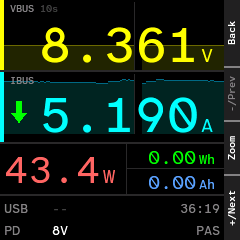 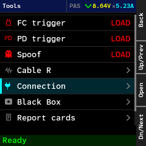

## Common tasks

### Read volts, amps and watts

1. Plug the charger into one port and the device into the other (the K2 sits inline).
2. Look at **Home**: VBUS (volts) and IBUS (amps) are the two big cells; power is in the band below.
3. OK cycles the trend window (10 s, 60 s, 10 min). Long OK resets the energy counter.

### See what a charger offers over PD

1. Plug the charger in.
2. Go to **Tools > Who's attached** and stay on the **Source** tab: every offer (fixed, PPS, AVS, EPR) is listed.
3. For a one-glance view with the contract, open **Detail**.

### Run the charger test and share the result

1. Plug the charger in with **no load**. Go to the **Charger test** page (third page from Home).
2. Pick a preset (for example **PD only**), then a cable identity, then the Review step.
3. Press OK on START, then OK again within 5 seconds. Wait: the K2 steps through voltages and holds each briefly.
4. On Results, long OK shows a QR code. A phone camera opens a results page with badges for what the charger achieved. Cards stay in **Tools > Report cards**.

### Read a cable's e-marker

1. Go to **Tools > Who's attached > Cable** (the chip in an e-marked cable tells its current and voltage rating).
2. Plug the cable into the bottom port with **nothing else** connected, press OK, choose **Read cable**.
3. Choose **Save cable** to keep it. Saved cables are listed under **Saved cables** and exported as JSON on the USB drive.

### Ask a charger for a voltage

1. Plug a PD charger in. Make sure **nothing is connected to the output**.
2. **Tools > PD trigger**: pick the offer, the voltage and the current, then press OK on Send. Anything above 5 V needs a confirm.
3. BACK ends it and returns the charger to 5 V.
For QC, AFC, FCP, SCP and VOOC chargers use **FC trigger** (start with **SCAN**).

### Check the system

1. **Tools > Diag** shows the link, PD chip, power meter, uptime and model.
2. Long OK shares the log as a QR code.

## Safety in one place

- Check your unit's voltage rating: the K2 comes as a **36 V** or a **48 V** model, and this firmware is tested on the 36 V one. Never trigger above your model's limit.
- Only these features can put more than 5 V on the port: **FC trigger**, **PD trigger**, and the **Charger test**. All of them expect **no load** on the output.
- Every trigger above 5 V asks for a confirmation (two OK presses within a few seconds) and returns to 5 V when you leave.
- **Spoof** and **Read cable** use the CC line and VCONN. Do not run them with a phone or laptop on the other port.
- Quick Charge at 20 V failing is expected (the K2 is limited to 12 V for QC2/QC3 in normal use) and is not a fault.
- Flash is written only by actions that say so: Save cable, Delete, Settings that are "remembered", Report cards, Black Box captures. See [Where things are stored](#where-things-are-stored).

---

# Part 2: Reference

## Contents

- [Controls in detail](#controls-in-detail)
- [Top-level pages](#top-level-pages): [Home](#home), [Detail](#detail), [Charger test](#charger-test), [Lines](#lines), [Tools](#tools), [Settings](#settings)
- [Tools](#tools-reference): [FC trigger](#fc-trigger), [PD trigger](#pd-trigger), [Spoof](#spoof), [Cable R](#cable-r), [Who's attached](#whos-attached), [Saved cables](#saved-cables), [Black Box](#black-box), [Report cards](#report-cards), [Diag](#diag)
- [Share (QR)](#share-qr)
- [Settings](#settings-reference): [USB Link](#usb-link), [Autorotate](#autorotate), [Rotate buttons, Screenshot, Smoothing](#other-settings)
- [USB link modes](#usb-link-modes) and [USB drive contents](#usb-drive-contents)
- [Remote control and dashboards](#remote-control-and-dashboards)
- [Backup, restore and recovery](#backup-restore-and-recovery)
- [Erase this firmware's data](#erase-this-firmwares-data)
- [Where things are stored](#where-things-are-stored)
- [Troubleshooting](#troubleshooting)
- [Glossary](#glossary)

## Controls in detail

Every press has three kinds: **short** (acts on release), **long** (fires at 0.5 s, while still held) and **hold** (5 s).

- **Top-level pages** (Home, Detail, Charger test, Lines, Tools, Settings): long PLUS goes to the next page, long MINUS to the previous. Short BACK goes Home (on Home it does nothing).
- **Inside a tool or settings submenu**: paging is off. Short BACK first lets the page handle it (for example, step back from a detail view), otherwise it leaves the submenu.
- **BACK hold (5 s)** works everywhere and reboots the K2. A counting card ("Reboot in N") appears; release before it reaches zero to cancel. A half-second long BACK does nothing.
- **MINUS and PLUS held together** cycle the screen orientation (this boot only).
- **Label strip**: the narrow column on the right shows the current action of each button. Navigation pages show Back, "-/Prev" and "+/Next". Lists show Up and Dn. Greyed or missing labels mean the button does nothing there.

Colours follow one scheme everywhere: green = good or ready, amber = caution or pending, red = fault or failed, grey = not applicable.

## Top-level pages

### Home


The live meter.

- **VBUS** and **IBUS** hero cells with a sweeping trace behind each number.
- A band with **W**, **Wh** and **Ah** (the energy counter since the last reset).
- A **limit bar** with a tick at 90 % of the contract current: the bar turns amber from 90 % (near) and red above 100 % (over).
- Two info rows: the USB protocol in use and the source/role.
- Pills: **NO VBUS** (top right) when the port has no voltage; **PAS** (bottom right) while the K2 is passive.

| Button | Action |
| :--- | :--- |
| OK | Zoom: cycles the trend window 10 s, 60 s, 10 min |
| long OK | Reset the energy counter |
| BACK | nothing |

Readings are filtered by the **Smoothing** setting; see [Other settings](#other-settings).

### Detail

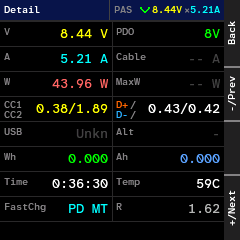

A dense 8 x 2 grid of everything at once, with no actions of its own.

| Row | Left | Right |
| :--- | :--- | :--- |
| 1 | V and the PDO in use (the contract) | A and the cable rating |
| 2 | W and the contract's maximum W | CC1 / CC2 levels and D+ / D- levels |
| 3 | USB version and alternate mode | Wh and Ah |
| 4 | Time and temperature | Fast-charge protocol and R |

Use it when you want the contract and the line levels next to the live numbers.

### Charger test

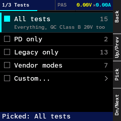

A guided, no-load test of what a charger really negotiates: fixed PDOs, PPS and AVS ranges and the legacy protocols. It checks **voltage negotiation**, not maximum current or loaded power. Full description of the units and their order: [`CHARGER_TEST_FLOW.md`](CHARGER_TEST_FLOW.md). Status: **partly verified** (PD and several legacy units were run on real chargers; not every unit on every charger).

Steps of the wizard:

1. **Tests (step 1 of 3)**: pick what to run. OK picks a preset and moves to Cable; the footer shows "Picked: ...".

   | Preset | Units | What |
   | :--- | :--- | :--- |
   | All tests | 15 | Everything, including QC Class B 20 V |
   | PD only | 2 | PD fixed and PPS, plus the Xiaomi 6 A step |
   | Legacy only | 13 | D+/D- protocols: vendor modes, QC, UFCS |
   | Vendor modes | 7 | Huawei, Samsung, OPPO, vivo |
   | Custom... | | Pick families and individual tests |
   | Last results | | Appears once a run exists; opens the last Results |

   **Custom**: six families (Huawei/Honor, Samsung, OPPO/OnePlus/vivo, Xiaomi/Redmi, USB PD, QC/UFCS) with counts as ON, OFF or PART. Short OK toggles a family, long OK opens its group (inside, short OK sets one test, long OK toggles the whole group). The Xiaomi family cannot be toggled on its own because it rides on PD. The last row is Next.

2. **Cable (2 of 3)**: the cable identity the K2 presents to the charger (it answers the charger's cable query). The list is the shared one: a plain, no-identity option, built-ins (for example EPR 50 V 5 A, CUKTECH 6A, OnePlus 100W) and your saved cables. OK picks one and goes to Review. The choice is remembered. It applies to the PD units only.

3. **Review (3 of 3)**: a START row and a summary (Tests, Peak, Cap, Header, Cable).
   - The first OK opens a confirmation window: "No load! OK twice within 5 s".
   - The second OK starts the test. BACK, a changed setting, or 5 s with no OK closes the window.
   - If the cable lines look wrong (an Ra guard check), a choice appears: **Start anyway**, **Start with cable OFF**, **Cancel**.

4. **Waiting for charger**: a bar counts down while the K2 waits for a source. OK or BACK cancels.

5. **Running**: the hero readout shows the step in flight, VBUS against the target on a pass-band gauge, and a grid of verdicts per step. +/- scroll the grid, OK opens a step view. OK shows **Stop** while a step is busy. A BACK hold cancels. When it ends or stops, the K2 returns to 5 V and checks it.

6. **Results**: counters (N pass, N fail, N skip), a summary strip and a grid of units. OK opens the Steps list (on a "Changes" row it opens the diff against the previous run). A step opens its Detail (OK = Steps, long OK = Share). Long OK on Results shares the saved card once it exists.

7. **Resume**: if the K2 reset mid-run (a journal survives), it offers OK = Resume or BACK = abandon.

Notes:

- Units run in two session modes: **PD** (the PD link stays up) and **Legacy** (PD-silent, D+/D- only). Legacy units run first.
- QC at 20 V failing is normal (Class B) and is not a finding. QC2 and QC3 are limited to 12 V in the normal tests.
- Never put a load on the output during a run.
- Every run saves a **report card** (see [Report cards](#report-cards)) identified by a fingerprint of what the charger did, so repeat runs of the same charger update one card.

### Lines

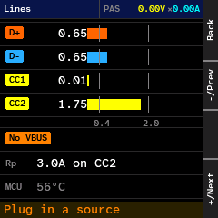

Four bars for **D+**, **D-**, **CC1** and **CC2** with ticks at 0.4 V and 2.0 V (the usual PD and Rp thresholds), plus:

- a status badge ("No VBUS", and so on),
- an **Rp** row naming the current advertisement on a CC line (for example "3.0A on CC2") when a source is attached,
- the **MCU temperature**,
- a footer hint ("Plug in a source").

Read-only. Use it to see whether a charger is waiting, which CC line the cable uses and what D+/D- are doing.

### Tools


The hub. Eight entries; each row shows a readiness tag, or a chevron when it is ready. +/- moves, OK opens.

| Entry | Hint on the row | Tag when not ready |
| :--- | :--- | :--- |
| FC trigger | charger on top or bottom | LOAD (a load is inline) |
| PD trigger | PD charger, either port | LOAD, or NO PD (no PD source) |
| Spoof | act as a saved cable | LOAD (a live sink is inline) |
| Cable R | charger + cable + load | NO PM (power monitor not found) |
| Who's attached | source, cable and device | always ready |
| Black Box | passive PD recorder | always ready |
| Report cards | saved charger results | always ready |
| Diag | USB, PD and system state | always ready |

Spoof is a shortcut: it opens Who's attached on the Cable tab and then the Spoof page.

### Settings

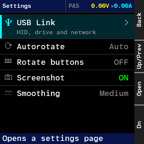

| Row | Value | Kept |
| :--- | :--- | :--- |
| USB Link | opens a submenu | across boots |
| Autorotate | Auto / Locked, opens a submenu | this boot only |
| Rotate buttons | ON / OFF | this boot only |
| Screenshot | ON / OFF | across boots |
| Smoothing | Off / Low / Medium / High | across boots |

+/- selects. OK opens, toggles or cycles (the label on the OK button says which). The footer says "Opens a settings page", "This boot only" or "Remembered across boots".

---

## Tools reference

### FC trigger

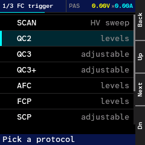

**Puts voltage on the output.** Requests a voltage over D+/D- from fast-charge chargers. Protocol facts: [`FASTCHARGE_PROTOCOLS.md`](FASTCHARGE_PROTOCOLS.md) (Quick Charge is its section 1). Status: **not verified on hardware in this build** (VOOC and related modes need a load to be meaningful); UFCS handshake verified on one charger.

Stages: **Pick** (header "1/3 FC trigger"), **Edit**, **Review**, **Live**.

| Entry | Choice |
| :--- | :--- |
| SCAN | one-click auto-detector, steps up to 9 V and names what answered |
| QC2 | 5, 9, 12, 20 V |
| QC3 | 3.6 to 20 V in 200 mV steps |
| QC3+ | 3.6 to 12 V |
| AFC | 9 or 12 V |
| FCP | 5, 9 or 12 V |
| SCP | 3 to 11 V in 1 V steps |
| VOOC, SVOOC, SVOOC65 | fixed modes |

Buttons: on Pick, Up/Dn choose and OK goes Next. On Edit, +/- change the voltage (long press for a big step) and OK goes to Review. On Review/Live, OK = Send, Confirm or Stop.

Safety: anything above 5 V needs **two OK presses within 3 s**. Targets are clamped to the monitor ceiling. While running, BACK shows "Stop"; leaving releases the charger to 5 V. Run with no load. 20 V results on QC are expected to fail.

### PD trigger

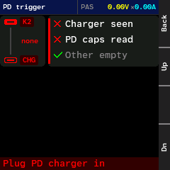

**Puts voltage on the output.** A wizard that makes the K2 request a specific offer from a PD charger: **Offer** (choose a PDO, Next, Dn/Up), **Voltage** (+/- 1 V, for PPS/AVS), **Current** (+/- 0.5 A), **Confirm** (OK = Send), **Live** (the contract is active; BACK releases). Status: **verified** for fixed and PPS on a lone charger.

If it refuses, a checklist shows why: **Charger seen**, **PD caps read**, **Other empty** (the other port must be empty), with the hint "Plug PD charger in". The tool is refused while a live sink is inline.

### Spoof

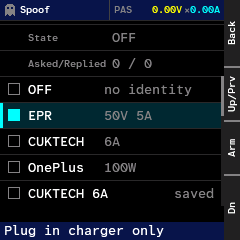

Makes the K2 answer a charger's cable query (SOP') as if it were a chosen cable, so you can see how a charger reacts to, say, a 5 A or EPR cable without owning one. Facts and measurements: [`K2_PORTS_SPEC.md`](K2_PORTS_SPEC.md). Status: **verified** on the top port with a charger and no cable (a 5 A and an EPR 28 V contract were obtained with a spoofed identity).

The page shows State (OFF or ARMED), "Asked / Replied" counts and the cable list: OFF ("no identity"), built-ins (EPR 50 V 5 A, CUKTECH 6A, OnePlus 100W), then your saved cables (marked "saved"). OK = **Arm**, **Disarm** or **Off**. The armed row wears an amber ARMED pill. Footer: "Plug in charger only": arm first, then plug the charger so the identity is presented at attach. Refused while a live sink is inline. Do not use with a phone or laptop attached.

### Cable R

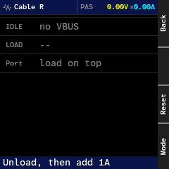

Measures a cable's resistance from the voltage drop under a load. Status: passive mode **not checked against a reference**; Kelvin mode **not verified**.

Rows: IDLE (the no-load reading), LOAD (the loaded reading) and Port (which side the load is on). Footer: "Unload, then add 1A".

1. Plug charger, cable and a load (about 1 A or more) in series.
2. Start with the load off so the K2 captures the idle reading (current at most 200 mA, VBUS at least 4.5 V).
3. Add the load: a current step of at least 1000 mA fixes the second reading. The K2 shows the resistance and a grade.

| Grade | Resistance |
| :--- | :--- |
| Excellent | below 150 milliohm |
| Good | below 300 milliohm |
| Fair | below 500 milliohm |
| Poor | 500 milliohm or more |

Buttons: OK = Reset (clear the readings), PLUS = Mode (**Passive** <-> **Kelvin**; Kelvin needs at least 450 mA), MINUS unused.

### Who's attached

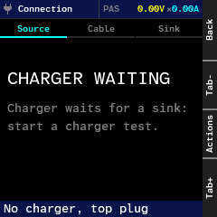

One screen for the three parties on the two ports: **Source** (charger), **Cable** and **Sink** (device). Background: [`SOURCE_SINK_DETECTION.md`](SOURCE_SINK_DETECTION.md).

- **+ / -** (labels Tab+ and Tab-) switch tabs. OK opens the **Actions** pop-up. Long OK shares the Source caps or the Cable record as a QR code.
- The tab it opens on: Sink if a live device is inline, else Source if a charger is seen, else Cable if a cable is held, else Source.
- The **status bar** says "Charger / No charger", "Cable read / No cable", "Device inline / No device", with ", top plug" or ", via cable" when the CC lines show which. When a spoof is armed and a charger is already attached it says "Armed, replug to apply".
- Empty states: CHARGER WAITING (a charger is attached but waiting for a sink), NO CHARGER, NO DEVICE, NO CABLE, CABLE NOT READ, NO CABLE READ, each with a hint.
- Vendor PD protocols are named from the partner's SVIDs: Xiaomi PD, OPPO PD, Huawei PD, Vivo PD, Cuktech PD, UFCS.

| Tab | Shows |
| :--- | :--- |
| Source | The charger's offers (fixed, PPS, AVS, EPR), identity, SVIDs |
| Cable | The e-marker: ratings, VID/PID, USB speed, VDOs |
| Sink | The attached device's identity and modes |

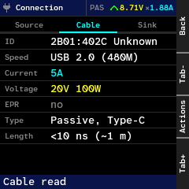 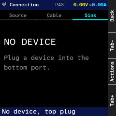

**Actions pop-up** (Select, Up, Dn, Back):

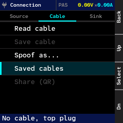

| Tab | Item | What it does |
| :--- | :--- | :--- |
| Source | Refresh | Re-reads the charger's offers |
| Source | Share (QR) | QR code of the offers ("No caps yet" when none) |
| Cable | Read cable | Reads the e-marker through VCONN (active; see below) |
| Cable | Save cable | Stores it in the library (needs a cable read) |
| Cable | Spoof as... | Opens the Spoof page for a saved cable (refused with a live sink) |
| Cable | Saved cables | Opens the library |
| Cable | Share (QR) | QR code of the cable record |
| Sink | Identify | Asks the attached device for identity, SVIDs, modes, sink caps (refused with a live sink inline: the sniffed identity is shown instead, marked "sniff") |

A greyed item tells you why when chosen: "No caps yet", "No cable read", "Live sink: unplug load", "No device seen".

**Read cable** and **Identify** are active: they drive CC and VCONN. Run **Read cable** with the cable alone in the bottom port and no charger or device, and never with a phone or laptop attached. **Identify** only works on an idle CC. With a device inline (charger -> K2 -> phone) both are refused - an inline K2 never transmits, so it would be a second device talking on the live wire; the Sink tab then shows what the phone already told the charger on its own, marked "sniff". Status: both **verified** (cable read and save; Identify on a Pixel).

### Saved cables

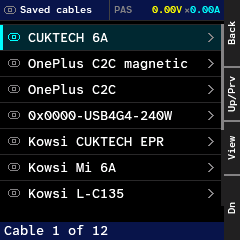

Reached from Who's attached > Cable > Actions > Saved cables. A list ("Cable 1 of 12") of your library, which holds up to 140 cables. Labels: Back, Up, **View**, Dn. OK opens the detail:

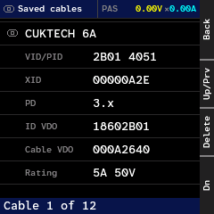

VID/PID, XID, PD version, ID VDO, Cable VDO and the Rating (for example "5A 50V"). In the detail, **OK deletes the cable** (after a Confirm view) and long OK shares it. The library is also exported as JSON on the USB drive and managed with `k2_remote.py emarker`; format: [`EMARKER_JSON.md`](EMARKER_JSON.md). Saving and deleting write flash.

### Black Box

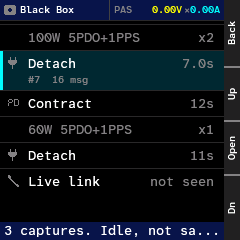

A passive recorder of the PD conversation, always running. Trigger events freeze the recent window into a capture, which is kept in **flash** (up to 32, the oldest dropped) and survives power-off. Triggers: Contract (a new contract), Hard reset, VBUS dip, Detach, D+/D- edges, "6 A refused".

The list shows captures newest first and a final **Live link** row. +/- selects, OK opens.

- **Timeline**: a strip chart of VBUS with a scrollable list of messages (ATTACH, `<VDM`, `>Request`...) and relative times. +/- scroll, OK switches to Link, BACK returns to the list.

  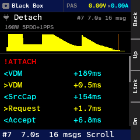

- **Link**: five rows, USB, Thunderbolt, DisplayPort, Cable, Partner USB, from what the PD traffic announced ("not seen" if nothing was). Footer "CC wire only, no data": this is what was announced on CC, not a live data check.

  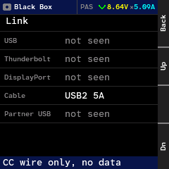

For the raw trace use `python3 tools/pd_trace.py live | dump | captures | capture N`. See [`DEBUG_STREAMING.md`](DEBUG_STREAMING.md). Status: capture and persistence **verified**.

### Report cards

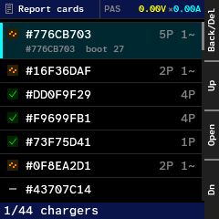

Every charger test run is stored as a card for that charger. The list shows a badge, the name (the name you set, else `VID:PID`, else `#` plus a fingerprint), a row summary and the boot count. Footer: "1/44 chargers" (the selected row, then how many cards are held). The store holds up to 64 cards; saving a new charger when full drops the oldest.

Row summary, for example `2P 1~ 1F`: tests passed (P), partly (~; capped or stopped early) and failed (F). Protocols the charger never answered are grey and not counted.

| Where | Button | Action |
| :--- | :--- | :--- |
| List | +/- | Move |
| List | OK | Open the card |
| List | long BACK | Delete (then Confirm) |
| Card | +/- | Move between rows |
| Card | OK | Open the row's sheet (full values) |
| Card | long OK | Share (QR) |
| Card | BACK | Step back |

Cards are saved in flash and exported on the USB drive and with `k2_remote.py cards list | show | export | rename | delete`. Format: [`QR_SHARE.md`](QR_SHARE.md).

### Diag

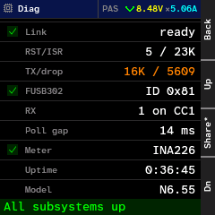

Nine rows: Link (USB), RST/ISR, TX/drop, FUSB302 (PD chip, its ID), RX (which CC line), Poll gap, Meter (power monitor chip), Uptime, Model. The footer says "All subsystems up" when nothing is wrong. Long OK shares the recent log as a QR code. Buttons: Up, Share, Dn.

---

## Share (QR)

Any "Share (QR)" action opens a QR screen. The code fills the whole screen, centred, with no button labels. A bigger record needs a bigger code, so its modules get smaller (3 px up to a medium code, 2 px above); hold the phone a little further back and let it focus. A big link shows "Preparing code..." for a moment first.

- **Link form** (charger cards, cable records, source offers): a phone camera opens a page on the project's site (`https://yarost12.github.io/open-k2-firmware/r/#1<kind>.<data>`). All data is after the `#`, so it never reaches the server; the page works offline once opened. OK toggles **Link** and **K2 data**; K2 data is the raw frame that `tools/k2_qr.py` imports.
- **Multi-part** (for example the log): the QR is several frames. OK cycles **Auto** and **Hold**; +/- go to the previous or next frame; BACK returns.

Captions say what the code contains: "Scan: full results" (card), "Scan: cable details", "Scan: charger offers", "Scan: firmware info". A caption shows under the code only when the margin has room for it. **Long OK** shows a text view instead (what the code is, its QR version and module size, the keys); long OK or BACK returns to the code, any other key acts on it. A code too dense for the main camera says "Use the wide camera" there (none of today's records need it). Format: [`QR_SHARE.md`](QR_SHARE.md).

---

## Settings reference

### USB Link

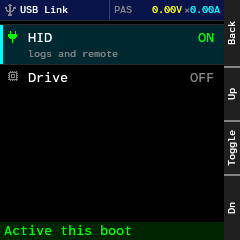

Independent toggles: **HID** ("logs and remote") and **Drive** ("read-only files"), each ON or OFF. OK toggles. Changes apply **after a replug**. The footer says:

- "Replug to apply" (amber): the stored choice differs from what is running,
- "Active this boot" (green): matches,
- "USB link off": both off.

A network row exists only in `K2_NET=1` builds, which are not released. Stored in flash, off by default. If the flash write is refused the row keeps showing the stored value.

### Autorotate

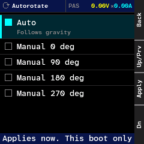

Radio rows: **Auto** (follows gravity), then **Manual** 0, 90, 180, 270 degrees. OK applies at once. Footer: "Applies now. This boot only".

### Other settings

- **Rotate buttons**: ON makes the buttons follow the display orientation; OFF keeps the physical key meaning ("Follow the display" vs "Physical keys"). This boot only.
- **Screenshot**: ON allows remote and browser screen capture. Remembered. Turn it off if you do not want the screen readable over USB.
- **Smoothing**: Off ("Raw readings"), Low ("Light calming"), Medium ("Balanced"), High ("Steady, slower"). OK cycles. Applied at once, remembered. It filters the display readings only, not the recorded data.

---

## USB link modes

| Mode | What the host sees |
| :--- | :--- |
| Off (default) | nothing |
| HID | the logger and remote channel (VID 0x0716, PID 0x5060): `k2_remote.py`, `pd_trace.py`, WebHID tools |
| HID + Drive | HID plus the read-only `K2 DRIVE` |
| HID + Network | only in `K2_NET=1` builds; HID plus a network link serving a dashboard at `http://192.168.7.1/` |

HID and Drive are separate toggles in Settings > USB Link. Drive and Network cannot be combined (USB packet memory). The **HID port needs a C-to-A cable**: a C-to-C cable does not enumerate on the left port. In a build without network, a stored "network" setting runs as HID.

## USB drive contents

When Drive is on, the host sees a read-only disk named `K2 DRIVE`:

| Entry | Content |
| :--- | :--- |
| `README.TXT` | what the drive is |
| `STATUS.TXT` | live V/A/W, source offers, cable |
| `LOG.TXT` | recent log lines |
| `CABLES/<name>.JSN` | one JSON file per saved cable ([`EMARKER_JSON.md`](EMARKER_JSON.md)) |
| `NATIVE/` | only on units that carry a native e-marker library: `LIBRARY.BIN`, `LIBRARY.TXT`, read-only |
| `SAVEDLOG.TXT` | the log, after `k2_remote.py store save-log` |
| `RIPPLE.CSV`, `BLACKBOX/` | placeholders |

The disk is a snapshot: after saving a cable, unplug and replug (or remount) to see it. Report cards are exported as `CARDS.JSON` and `SUMMARY.md`.

## Remote control and dashboards

With HID on, from a computer:

| Tool | What |
| :--- | :--- |
| `python3 tools/k2_remote.py ping` | firmware version, git hash, uptime |
| `... state`, `... pdos`, `... emarker list`, `... cards list` | read data |
| `... press ok`, `... press --long plus` | press buttons |
| `... page home`, `... page tools` | switch page (`home detail chargertest lines tools settings`, or 0..5) |
| `... screenshot out.png --scale 2` | save the screen as a PNG (needs Screenshot ON) |
| `... fc scan`, `... pd request ...` | active triggers (above 5 V needs `--confirm`) |
| `python3 tools/pd_trace.py live` | stream the Black Box |
| `python3 tools/ct_start.py` | start a charger test remotely |

`k2_remote.py --help` lists everything. One device tool at a time: they share a lock.

The browser dashboard `tools/web/k2.html` (run `make web`, open http://localhost:8765/k2.html in Chrome or Edge) shows power with a chart, PD, cable, lines, device controls and the log. Sections for identity, PD trigger and fast-charge trigger appear only when the firmware answers them. Status: **not verified in Chrome**. On Linux the hidraw device needs a udev rule (`MODE="0666"` for VID 0716). Details: [`ARCHITECTURE.md`](ARCHITECTURE.md).

## Backup, restore and recovery

**Every flash starts with a full backup.** The backup reads the whole 1 MB (0x08000000..0x08100000) twice and compares.

- In the browser: <https://yarost12.github.io/open-k2-firmware/>. The box **Back up this K2 first (full backup)** is ticked on every page load; **Flash** then backs up, offers the ZIP and flashes in one click. **Back up the K2** makes a backup without flashing.
- The download is one ZIP, `K2_BACKUP_<version>_<UTC time>.zip`, with six files: `K2_RECOVERY_<version>.k2` (the file to keep), `flash.bin`, `app.bin`, `bootloader.bin`, `native_nvram.bin`, `manifest.json`. They are also offered one by one under "Individual files".
- To restore, pick the ZIP (or the `K2_RECOVERY_<version>.k2` in it) as the firmware file, or press **Restore this backup** right after the backup.
- From Python: `python3 tools/k2_flasher.py backup <folder>` is full and writes the ZIP next to the folder. `--app-only` reads the application area only; `--full` is accepted and changes nothing. `python3 tools/k2_flasher.py flash FILE` makes the full backup first into `runs/k2-backup-<UTC time>` (`--backup-dir <folder>` to choose, `--no-backup` to skip). A failed backup stops the flash before anything is erased.

What is saved and what is restored:

- The **recovery image** holds the firmware and stops before the volume this firmware uses for its own data (starts at 0x080B3000). Restoring puts the firmware back and leaves that data alone.
- The device's **native data area** (settings and e-marker records, 0x080E0000) is saved in `native_nvram.bin` but **never restored** by the page.
- `manifest.json` has `backup_kind` (`full`, `app-only` or `partial`) and the SHA-256 of `native_nvram.bin`.
- If the bootloader refuses reads above 0x080E3000, the backup is marked **partial**: everything it served was read twice and compared, and the page and the command line say that the device-storage part is missing. The flash still goes on, because the flashers never write above the application area.
- The advanced option "application area only" (Python: `--app-only`) reads 0x08000000..0x080E3000 and says so in the result.

**The K2 shows a WRONG APP or does not boot, or stays in the bootloader:**

1. Hold **MINUS** and plug the USB cable in (the bootloader always starts this way).
2. `python3 tools/k2_flasher.py probe` should report a K2.
3. Flash a good `.k2` (a release or your recovery image) with the web flasher or `python3 tools/k2_flasher.py flash open_k2.k2`.

The bootloader area (0x08000000 to 0x080037FF) is never written by this firmware or by the flashers.

## Erase this firmware's data

`python3 tools/k2_remote.py factory-wipe --confirm` (needs HID on) erases this firmware's volume and its legacy pages, reads them back as erased, and leaves the K2 in the bootloader for another `.k2`. It exits non-zero and stays in the app if any erase fails. It does not touch the bootloader or the native data area. Flash the next image straight away; do not replug first.

## Where things are stored

| Item | Where | Notes |
| :--- | :--- | :--- |
| USB link choice | flash, `/usb.cfg` | off by default, applies after replug |
| Screenshot on/off, Smoothing | flash, `/prefs.cfg` | remembered |
| Cable identity for the charger test | flash, `/cable.cfg` | remembered |
| Saved cables (up to 140) | flash | also shown on the drive as JSON |
| Report cards (up to 64) | flash | also on the drive as `CARDS.JSON` |
| Black Box captures (32) | flash | survive power-off; the live ring does not |
| Orientation, Rotate buttons | RAM | reset at every boot |
| Energy counter, trends | RAM | reset at boot (and by long OK on Home) |

## Troubleshooting

| Problem | Do |
| :--- | :--- |
| The K2 does not appear on the computer | USB is off by default: Settings > USB Link, enable HID, replug. Use a **C-to-A cable** on the left port. |
| `k2_remote.py` finds no device | Enable HID and replug. Close other tools (one at a time). On Linux check the udev rule. |
| Web flasher does not list the K2 | Use Chrome or Edge, press **Connect**, pick the K2. After a flash or DFU entry press **Connect** again once the K2 re-enumerates. |
| WRONG APP, or the K2 does not boot | Hold **MINUS** while plugging in, then reflash a good `.k2`. |
| Home shows NO VBUS | Nothing is delivering voltage. A charger alone keeps VBUS at 0 V until a sink asks: that is normal in passive mode. |
| A trigger is greyed with LOAD | A load is inline. Unplug the device first. |
| Spoof refused | A live sink is inline. Plug only the charger. |
| Cable R shows NO PM | The power monitor chip was not found. |
| QC 20 V fails | Expected (Class B); not a fault. |
| The screen is rotated | MINUS+PLUS together cycle orientation; or Settings > Autorotate. |
| The K2 rebooted in the middle of something | BACK held 5 s reboots on purpose. If it was not you, note what you were doing and report it. |

## Glossary

| Term | Meaning |
| :--- | :--- |
| **PD** | USB Power Delivery: a message protocol on the CC line that agrees voltage and current. |
| **PDO** | Power Data Object: one offer from a charger (for example "9 V 3 A"). |
| **Fixed** | A PDO at one voltage. |
| **PPS** | Programmable Power Supply: a range of voltage and a current limit, adjustable in 20 mV steps. |
| **AVS** | Adjustable Voltage Supply: another adjustable range, used for higher power. |
| **SPR / EPR** | Standard Power Range (up to 20 V) and Extended Power Range (up to 48 V, up to 240 W). |
| **RDO** | Request Data Object: the message that asks for one PDO. |
| **Contract** | The voltage and current the charger and device agreed on. |
| **CC** | Configuration Channel: the wire PD talks on; its resistors (Rp, Rd, Ra) also say who is source and sink. |
| **Rp / Rd / Ra** | Pull-up of a source (also its current advertisement), pull-down of a sink, and the cable's VCONN resistor. |
| **VCONN** | A 5 V supply on the unused CC line that powers the chip in an e-marked cable. |
| **e-marker** | The chip in a cable that states its current (3 or 5 A), voltage and speed. |
| **SOP / SOP'** | The address of a PD message: SOP to the port partner, SOP' to a cable plug. |
| **VDM / SVID** | Vendor Defined Message, and the Standard or Vendor ID that names a protocol or vendor. |
| **Alt mode** | An extra function on the USB-C pins, such as DisplayPort. |
| **Hard reset** | A PD signal that drops the supply back to 5 V. |
| **QC, AFC, FCP, SCP, VOOC, UFCS** | Older and vendor fast-charge protocols that negotiate voltage on D+/D- (or, for UFCS, a separate data channel): Quick Charge, Adaptive Fast Charging, Fast Charge Protocol, Super Charge Protocol, VOOC flash charge, Universal Fast Charging Specification. See [`FASTCHARGE_PROTOCOLS.md`](FASTCHARGE_PROTOCOLS.md). |
| **Class B** | The QC voltage class that includes 20 V. |
| **Passive** | The K2 is not driving CC; it only measures and listens. |
| **Sink / Source** | The device that takes power, and the charger that gives it. |
| **Inline** | The K2 between a charger and a device. |
| **INA226 / INA228 / INA237** | The power monitor chips the firmware auto-detects (voltage, current, power). |

For charger-specific behaviour and quirks seen in testing: [`CHARGER_QUIRKS.md`](CHARGER_QUIRKS.md). For the build and architecture: [`ARCHITECTURE.md`](ARCHITECTURE.md).
