# K2 UI mockups v2: generated screens

Generated by `render_mockups.py`; do not edit by hand. Sketch cell = 8 x 12 px; `*` icon, `^`/`v` flow
chevrons, `~` sparkline, `.` card edge. Tables give pixels in the 224 x 240 content area (panel x 224..239).
Chevrons and port symbols are listed in the code, not the table (polygons).

## home_live

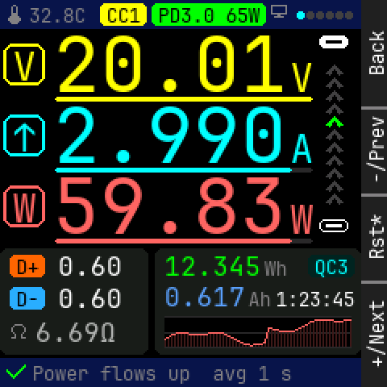

Panel: Back / -/Prev / Rst* / +/Next

```
    0123456789012345678901234567|
  0 * 32.8C CC1 PD3.0 65W*      |
 12                             |
 24                             |
 36  V  2   0   .   0   1    ^  |
 48                       V  ^  |
 60                          ^  |
 72     2   .   9   9   0    ^  |
 84  ^                    A  ^  |
 96                          ^  |
108                          ^  |
120  W  5   9   .   8   3    ^  |
132                       W     |
144 ........... ................|
156  D+ 0.60    12.345  Wh  QC3 |
168                             |
180  D- 0.60    0.617  Ah1:23:45|
192                             |
204 * 6.69O     ~~~~~~~~~~~~~~~ |
216 ........... ................|
228 * Power flows up  avg 1 s   |
```

<details><summary>Element table</summary>

| element | kind | x | y | w | h | font / radius | token |
|---|---|---|---|---|---|---|---|
| status bar | rect | 0 | 0 | 224 | 18 | r0 | `bar` |
| icon therm | icon | 4 | 3 | 12 | 12 | - | `dim` |
| MCU temp | text | 18 | 3 | 35 | 13 | 12px | `dim` |
| CC pill | rect | 62 | 2 | 29 | 14 | r3 | `volt` |
| CC pill text | text | 66 | 3 | 21 | 13 | 12px | `bg` |
| PD pill | rect | 94 | 2 | 71 | 14 | r3 | `energy` |
| PD pill text | text | 98 | 3 | 63 | 13 | 12px | `bg` |
| icon pc | icon | 168 | 3 | 12 | 12 | - | `dim` |
| page dot | rect | 184 | 7 | 5 | 5 | r1 | `focus` |
| page dot | rect | 190 | 7 | 5 | 5 | r1 | `faint` |
| page dot | rect | 196 | 7 | 5 | 5 | r1 | `faint` |
| page dot | rect | 202 | 7 | 5 | 5 | r1 | `faint` |
| page dot | rect | 208 | 7 | 5 | 5 | r1 | `faint` |
| page dot | rect | 214 | 7 | 5 | 5 | r1 | `faint` |
| V badge | frame | 2 | 27 | 26 | 26 | r6 | `volt` |
| V badge glyph | text | 8 | 28 | 14 | 26 | 24px | `volt` |
| V digits | text | 33 | 22 | 145 | 35 | 48px | `volt` |
| V unit | text | 180 | 35 | 14 | 26 | 24px | `volt` |
| V gauge vs contract track | rect | 34 | 60 | 160 | 3 | r1 | `rule` |
| V gauge vs contract fill | rect | 34 | 60 | 160 | 3 | r1 | `volt` |
| A badge | frame | 2 | 71 | 26 | 26 | r6 | `amp` |
| A badge glyph | text | 8 | 72 | 14 | 26 | 24px | `amp` |
| A digits | text | 33 | 66 | 145 | 35 | 48px | `amp` |
| A unit | text | 180 | 79 | 14 | 26 | 24px | `amp` |
| A gauge vs contract track | rect | 34 | 104 | 160 | 3 | r1 | `rule` |
| A gauge vs contract fill | rect | 34 | 104 | 147 | 3 | r1 | `amp` |
| W badge | frame | 2 | 115 | 26 | 26 | r6 | `watt` |
| W badge glyph | text | 8 | 116 | 14 | 26 | 24px | `watt` |
| W digits | text | 33 | 110 | 145 | 35 | 48px | `watt` |
| W unit | text | 180 | 123 | 14 | 26 | 24px | `watt` |
| W gauge vs contract track | rect | 34 | 148 | 160 | 3 | r1 | `rule` |
| W gauge vs contract fill | rect | 34 | 148 | 147 | 3 | r1 | `watt` |
| rail top port | rect | 198 | 22 | 18 | 8 | r3 | `text` |
| rail top port slot | rect | 202 | 25 | 10 | 2 | r0 | `bg` |
| rail bottom port | frame | 198 | 136 | 18 | 8 | r3 | `text` |
| rail bottom port tongue | rect | 202 | 139 | 10 | 2 | r0 | `text` |
| lines card | rect | 0 | 154 | 92 | 66 | r5 | `surface` |
| D+ tag | rect | 6 | 158 | 22 | 14 | r3 | `dplus` |
| D+ tag text | text | 10 | 159 | 14 | 13 | 12px | `bg` |
| D+ V | text | 36 | 157 | 40 | 17 | 16px | `text` |
| D- tag | rect | 6 | 178 | 22 | 14 | r3 | `dminus` |
| D- tag text | text | 10 | 179 | 14 | 13 | 12px | `bg` |
| D- V | text | 36 | 177 | 40 | 17 | 16px | `text` |
| icon ohm | icon | 6 | 201 | 12 | 12 | - | `dim` |
| load R | text | 22 | 198 | 50 | 17 | 16px | `ohm` |
| totals card | rect | 96 | 154 | 128 | 66 | r5 | `surface` |
| Wh | text | 102 | 157 | 60 | 17 | 16px | `energy` |
| 'Wh' | text | 164 | 160 | 14 | 13 | 12px | `dim` |
| Ah | text | 102 | 176 | 50 | 17 | 16px | `charge` |
| 'Ah' | text | 154 | 179 | 14 | 13 | 12px | `dim` |
| FC pill | rect | 191 | 158 | 29 | 14 | r3 | `amp_t` |
| FC pill text | text | 195 | 159 | 21 | 13 | 12px | `amp` |
| elapsed | text | 171 | 179 | 49 | 13 | 12px | `text` |
| W sparkline 60 s | spark | 102 | 196 | 116 | 20 | - | `watt` |
| footer | rect | 0 | 222 | 224 | 18 | r0 | `bar` |
| icon check | icon | 4 | 225 | 12 | 12 | - | `ok` |
| footer text | text | 20 | 225 | 161 | 13 | 12px | `dim` |

</details>

## home_reverse

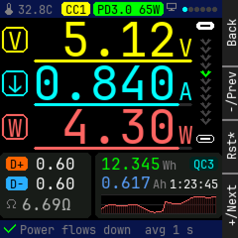

Panel: Back / -/Prev / Rst* / +/Next

```
    0123456789012345678901234567|
  0 * 32.8C CC1 PD3.0 65W*      |
 12                             |
 24                             |
 36  V      5   .   1   2    v  |
 48                       V  v  |
 60                          v  |
 72     0   .   8   4   0    v  |
 84  v                    A  v  |
 96                          v  |
108                          v  |
120  W      4   .   3   0    v  |
132                       W     |
144 ........... ................|
156  D+ 0.60    12.345  Wh  QC3 |
168                             |
180  D- 0.60    0.617  Ah1:23:45|
192                             |
204 * 6.69O     ~~~~~~~~~~~~~~~ |
216 ........... ................|
228 * Power flows down  avg 1 s |
```

<details><summary>Element table</summary>

| element | kind | x | y | w | h | font / radius | token |
|---|---|---|---|---|---|---|---|
| status bar | rect | 0 | 0 | 224 | 18 | r0 | `bar` |
| icon therm | icon | 4 | 3 | 12 | 12 | - | `dim` |
| MCU temp | text | 18 | 3 | 35 | 13 | 12px | `dim` |
| CC pill | rect | 62 | 2 | 29 | 14 | r3 | `volt` |
| CC pill text | text | 66 | 3 | 21 | 13 | 12px | `bg` |
| PD pill | rect | 94 | 2 | 71 | 14 | r3 | `energy` |
| PD pill text | text | 98 | 3 | 63 | 13 | 12px | `bg` |
| icon pc | icon | 168 | 3 | 12 | 12 | - | `dim` |
| page dot | rect | 184 | 7 | 5 | 5 | r1 | `focus` |
| page dot | rect | 190 | 7 | 5 | 5 | r1 | `faint` |
| page dot | rect | 196 | 7 | 5 | 5 | r1 | `faint` |
| page dot | rect | 202 | 7 | 5 | 5 | r1 | `faint` |
| page dot | rect | 208 | 7 | 5 | 5 | r1 | `faint` |
| page dot | rect | 214 | 7 | 5 | 5 | r1 | `faint` |
| V badge | frame | 2 | 27 | 26 | 26 | r6 | `volt` |
| V badge glyph | text | 8 | 28 | 14 | 26 | 24px | `volt` |
| V digits | text | 33 | 22 | 145 | 35 | 48px | `volt` |
| V unit | text | 180 | 35 | 14 | 26 | 24px | `volt` |
| V gauge vs contract track | rect | 34 | 60 | 160 | 3 | r1 | `rule` |
| V gauge vs contract fill | rect | 34 | 60 | 160 | 3 | r1 | `volt` |
| A badge | frame | 2 | 71 | 26 | 26 | r6 | `amp` |
| A badge glyph | text | 8 | 72 | 14 | 26 | 24px | `amp` |
| A digits | text | 33 | 66 | 145 | 35 | 48px | `amp` |
| A unit | text | 180 | 79 | 14 | 26 | 24px | `amp` |
| A gauge vs contract track | rect | 34 | 104 | 160 | 3 | r1 | `rule` |
| A gauge vs contract fill | rect | 34 | 104 | 147 | 3 | r1 | `amp` |
| W badge | frame | 2 | 115 | 26 | 26 | r6 | `watt` |
| W badge glyph | text | 8 | 116 | 14 | 26 | 24px | `watt` |
| W digits | text | 33 | 110 | 145 | 35 | 48px | `watt` |
| W unit | text | 180 | 123 | 14 | 26 | 24px | `watt` |
| W gauge vs contract track | rect | 34 | 148 | 160 | 3 | r1 | `rule` |
| W gauge vs contract fill | rect | 34 | 148 | 147 | 3 | r1 | `watt` |
| rail top port | rect | 198 | 22 | 18 | 8 | r3 | `text` |
| rail top port slot | rect | 202 | 25 | 10 | 2 | r0 | `bg` |
| rail bottom port | frame | 198 | 136 | 18 | 8 | r3 | `text` |
| rail bottom port tongue | rect | 202 | 139 | 10 | 2 | r0 | `text` |
| lines card | rect | 0 | 154 | 92 | 66 | r5 | `surface` |
| D+ tag | rect | 6 | 158 | 22 | 14 | r3 | `dplus` |
| D+ tag text | text | 10 | 159 | 14 | 13 | 12px | `bg` |
| D+ V | text | 36 | 157 | 40 | 17 | 16px | `text` |
| D- tag | rect | 6 | 178 | 22 | 14 | r3 | `dminus` |
| D- tag text | text | 10 | 179 | 14 | 13 | 12px | `bg` |
| D- V | text | 36 | 177 | 40 | 17 | 16px | `text` |
| icon ohm | icon | 6 | 201 | 12 | 12 | - | `dim` |
| load R | text | 22 | 198 | 50 | 17 | 16px | `ohm` |
| totals card | rect | 96 | 154 | 128 | 66 | r5 | `surface` |
| Wh | text | 102 | 157 | 60 | 17 | 16px | `energy` |
| 'Wh' | text | 164 | 160 | 14 | 13 | 12px | `dim` |
| Ah | text | 102 | 176 | 50 | 17 | 16px | `charge` |
| 'Ah' | text | 154 | 179 | 14 | 13 | 12px | `dim` |
| FC pill | rect | 191 | 158 | 29 | 14 | r3 | `amp_t` |
| FC pill text | text | 195 | 159 | 21 | 13 | 12px | `amp` |
| elapsed | text | 171 | 179 | 49 | 13 | 12px | `text` |
| W sparkline 60 s | spark | 102 | 196 | 116 | 20 | - | `watt` |
| footer | rect | 0 | 222 | 224 | 18 | r0 | `bar` |
| icon check | icon | 4 | 225 | 12 | 12 | - | `ok` |
| footer text | text | 20 | 225 | 175 | 13 | 12px | `dim` |

</details>

## home_idle

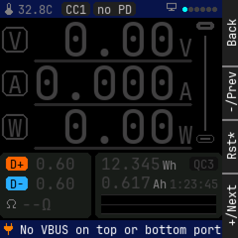

Panel: Back / -/Prev / Rst* / +/Next

```
    0123456789012345678901234567|
  0 * 32.8C CC1 no PD    *      |
 12                             |
 24                             |
 36  V      0   .   0   0       |
 48                       V     |
 60                             |
 72     0   .   0   0   0       |
 84  A                    A     |
 96                             |
108                             |
120  W      0   .   0   0       |
132                       W     |
144 ........... ................|
156  D+ 0.60    12.345  Wh  QC3 |
168                             |
180  D- 0.60    0.617  Ah1:23:45|
192                             |
204 * --O       ~~~~~~~~~~~~~~~ |
216 ........... ................|
228 * No VBUS on top or bottom p|
```

<details><summary>Element table</summary>

| element | kind | x | y | w | h | font / radius | token |
|---|---|---|---|---|---|---|---|
| status bar | rect | 0 | 0 | 224 | 18 | r0 | `bar` |
| icon therm | icon | 4 | 3 | 12 | 12 | - | `dim` |
| MCU temp | text | 18 | 3 | 35 | 13 | 12px | `dim` |
| CC pill | rect | 62 | 2 | 29 | 14 | r3 | `stale_t` |
| CC pill text | text | 66 | 3 | 21 | 13 | 12px | `stale` |
| PD pill | rect | 94 | 2 | 43 | 14 | r3 | `stale_t` |
| PD pill text | text | 98 | 3 | 35 | 13 | 12px | `stale` |
| icon pc | icon | 168 | 3 | 12 | 12 | - | `dim` |
| page dot | rect | 184 | 7 | 5 | 5 | r1 | `focus` |
| page dot | rect | 190 | 7 | 5 | 5 | r1 | `faint` |
| page dot | rect | 196 | 7 | 5 | 5 | r1 | `faint` |
| page dot | rect | 202 | 7 | 5 | 5 | r1 | `faint` |
| page dot | rect | 208 | 7 | 5 | 5 | r1 | `faint` |
| page dot | rect | 214 | 7 | 5 | 5 | r1 | `faint` |
| V badge | frame | 2 | 27 | 26 | 26 | r6 | `faint` |
| V badge glyph | text | 8 | 28 | 14 | 26 | 24px | `faint` |
| V digits | text | 33 | 22 | 145 | 35 | 48px | `faint` |
| V unit | text | 180 | 35 | 14 | 26 | 24px | `faint` |
| V gauge vs contract track | rect | 34 | 60 | 160 | 3 | r1 | `rule` |
| A badge | frame | 2 | 71 | 26 | 26 | r6 | `faint` |
| A badge glyph | text | 8 | 72 | 14 | 26 | 24px | `faint` |
| A digits | text | 33 | 66 | 145 | 35 | 48px | `faint` |
| A unit | text | 180 | 79 | 14 | 26 | 24px | `faint` |
| A gauge vs contract track | rect | 34 | 104 | 160 | 3 | r1 | `rule` |
| W badge | frame | 2 | 115 | 26 | 26 | r6 | `faint` |
| W badge glyph | text | 8 | 116 | 14 | 26 | 24px | `faint` |
| W digits | text | 33 | 110 | 145 | 35 | 48px | `faint` |
| W unit | text | 180 | 123 | 14 | 26 | 24px | `faint` |
| W gauge vs contract track | rect | 34 | 148 | 160 | 3 | r1 | `rule` |
| rail top port | rect | 198 | 22 | 18 | 8 | r3 | `faint` |
| rail top port slot | rect | 202 | 25 | 10 | 2 | r0 | `bg` |
| rail bottom port | frame | 198 | 136 | 18 | 8 | r3 | `faint` |
| rail bottom port tongue | rect | 202 | 139 | 10 | 2 | r0 | `faint` |
| rail idle | rect | 206 | 36 | 2 | 96 | r0 | `faint` |
| lines card | rect | 0 | 154 | 92 | 66 | r5 | `surface` |
| D+ tag | rect | 6 | 158 | 22 | 14 | r3 | `dplus` |
| D+ tag text | text | 10 | 159 | 14 | 13 | 12px | `bg` |
| D+ V | text | 36 | 157 | 40 | 17 | 16px | `faint` |
| D- tag | rect | 6 | 178 | 22 | 14 | r3 | `dminus` |
| D- tag text | text | 10 | 179 | 14 | 13 | 12px | `bg` |
| D- V | text | 36 | 177 | 40 | 17 | 16px | `faint` |
| icon ohm | icon | 6 | 201 | 12 | 12 | - | `dim` |
| load R | text | 22 | 198 | 30 | 17 | 16px | `faint` |
| totals card | rect | 96 | 154 | 128 | 66 | r5 | `surface` |
| Wh | text | 102 | 157 | 60 | 17 | 16px | `faint` |
| 'Wh' | text | 164 | 160 | 14 | 13 | 12px | `dim` |
| Ah | text | 102 | 176 | 50 | 17 | 16px | `faint` |
| 'Ah' | text | 154 | 179 | 14 | 13 | 12px | `dim` |
| FC pill | rect | 191 | 158 | 29 | 14 | r3 | `faint_t` |
| FC pill text | text | 195 | 159 | 21 | 13 | 12px | `faint` |
| elapsed | text | 171 | 179 | 49 | 13 | 12px | `faint` |
| W sparkline 60 s | spark | 102 | 196 | 116 | 20 | - | `faint` |
| footer | rect | 0 | 222 | 224 | 18 | r0 | `bar` |
| icon plug | icon | 4 | 225 | 12 | 12 | - | `caution` |
| footer text | text | 20 | 225 | 203 | 13 | 12px | `text` |

</details>

## home_stale

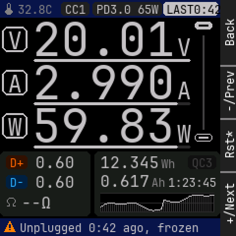

Panel: Back / -/Prev / Rst* / +/Next

```
    0123456789012345678901234567|
  0 * 32.8C CC1 PD3.0 65WLAST0:4|
 12                             |
 24                             |
 36  V  2   0   .   0   1       |
 48                       V     |
 60                             |
 72     2   .   9   9   0       |
 84  A                    A     |
 96                             |
108                             |
120  W  5   9   .   8   3       |
132                       W     |
144 ........... ................|
156  D+ 0.60    12.345  Wh  QC3 |
168                             |
180  D- 0.60    0.617  Ah1:23:45|
192                             |
204 * --O       ~~~~~~~~~~~~~~~ |
216 ........... ................|
228 * Unplugged 0:42 ago, frozen|
```

<details><summary>Element table</summary>

| element | kind | x | y | w | h | font / radius | token |
|---|---|---|---|---|---|---|---|
| status bar | rect | 0 | 0 | 224 | 18 | r0 | `bar` |
| icon therm | icon | 4 | 3 | 12 | 12 | - | `dim` |
| MCU temp | text | 18 | 3 | 35 | 13 | 12px | `dim` |
| CC pill | rect | 62 | 2 | 29 | 14 | r3 | `stale_t` |
| CC pill text | text | 66 | 3 | 21 | 13 | 12px | `stale` |
| PD pill | rect | 94 | 2 | 71 | 14 | r3 | `stale_t` |
| PD pill text | text | 98 | 3 | 63 | 13 | 12px | `stale` |
| LAST pill | rect | 166 | 2 | 56 | 14 | r3 | `stale` |
| LAST text | text | 169 | 3 | 56 | 13 | 12px | `bg` |
| V badge | frame | 2 | 27 | 26 | 26 | r6 | `stale` |
| V badge glyph | text | 8 | 28 | 14 | 26 | 24px | `stale` |
| V digits | text | 33 | 22 | 145 | 35 | 48px | `stale` |
| V unit | text | 180 | 35 | 14 | 26 | 24px | `stale` |
| V gauge vs contract track | rect | 34 | 60 | 160 | 3 | r1 | `rule` |
| V gauge vs contract fill | rect | 34 | 60 | 160 | 3 | r1 | `stale` |
| A badge | frame | 2 | 71 | 26 | 26 | r6 | `stale` |
| A badge glyph | text | 8 | 72 | 14 | 26 | 24px | `stale` |
| A digits | text | 33 | 66 | 145 | 35 | 48px | `stale` |
| A unit | text | 180 | 79 | 14 | 26 | 24px | `stale` |
| A gauge vs contract track | rect | 34 | 104 | 160 | 3 | r1 | `rule` |
| A gauge vs contract fill | rect | 34 | 104 | 147 | 3 | r1 | `stale` |
| W badge | frame | 2 | 115 | 26 | 26 | r6 | `stale` |
| W badge glyph | text | 8 | 116 | 14 | 26 | 24px | `stale` |
| W digits | text | 33 | 110 | 145 | 35 | 48px | `stale` |
| W unit | text | 180 | 123 | 14 | 26 | 24px | `stale` |
| W gauge vs contract track | rect | 34 | 148 | 160 | 3 | r1 | `rule` |
| W gauge vs contract fill | rect | 34 | 148 | 147 | 3 | r1 | `stale` |
| rail top port | rect | 198 | 22 | 18 | 8 | r3 | `stale` |
| rail top port slot | rect | 202 | 25 | 10 | 2 | r0 | `bg` |
| rail bottom port | frame | 198 | 136 | 18 | 8 | r3 | `stale` |
| rail bottom port tongue | rect | 202 | 139 | 10 | 2 | r0 | `stale` |
| rail idle | rect | 206 | 36 | 2 | 96 | r0 | `faint` |
| lines card | rect | 0 | 154 | 92 | 66 | r5 | `surface` |
| D+ tag | rect | 6 | 158 | 22 | 14 | r3 | `dplus_t` |
| D+ tag text | text | 10 | 159 | 14 | 13 | 12px | `dplus` |
| D+ V | text | 36 | 157 | 40 | 17 | 16px | `stale` |
| D- tag | rect | 6 | 178 | 22 | 14 | r3 | `dminus_t` |
| D- tag text | text | 10 | 179 | 14 | 13 | 12px | `dminus` |
| D- V | text | 36 | 177 | 40 | 17 | 16px | `stale` |
| icon ohm | icon | 6 | 201 | 12 | 12 | - | `dim` |
| load R | text | 22 | 198 | 30 | 17 | 16px | `stale` |
| totals card | rect | 96 | 154 | 128 | 66 | r5 | `surface` |
| Wh | text | 102 | 157 | 60 | 17 | 16px | `stale` |
| 'Wh' | text | 164 | 160 | 14 | 13 | 12px | `dim` |
| Ah | text | 102 | 176 | 50 | 17 | 16px | `stale` |
| 'Ah' | text | 154 | 179 | 14 | 13 | 12px | `dim` |
| FC pill | rect | 191 | 158 | 29 | 14 | r3 | `faint_t` |
| FC pill text | text | 195 | 159 | 21 | 13 | 12px | `faint` |
| elapsed | text | 171 | 179 | 49 | 13 | 12px | `stale` |
| W sparkline 60 s | spark | 102 | 196 | 116 | 20 | - | `stale` |
| footer | rect | 0 | 222 | 224 | 18 | r0 | `bar` |
| icon warn | icon | 4 | 225 | 12 | 12 | - | `caution` |
| footer text | text | 20 | 225 | 182 | 13 | 12px | `stale` |

</details>

## home_error

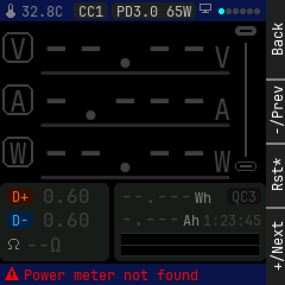

Panel: Back / -/Prev / Rst* / +/Next

```
    0123456789012345678901234567|
  0 * 32.8C CC1 PD3.0 65W*      |
 12                             |
 24                             |
 36  V  -   -   .   -   -       |
 48                       V     |
 60                             |
 72     -   .   -   -   -       |
 84  A                    A     |
 96                             |
108                             |
120  W  -   -   .   -   -       |
132                       W     |
144 ........... ................|
156  D+ 0.60    --.---  Wh  QC3 |
168                             |
180  D- 0.60    -.---  Ah1:23:45|
192                             |
204 * --O       ~~~~~~~~~~~~~~~ |
216 ........... ................|
228 * Power meter not found     |
```

<details><summary>Element table</summary>

| element | kind | x | y | w | h | font / radius | token |
|---|---|---|---|---|---|---|---|
| status bar | rect | 0 | 0 | 224 | 18 | r0 | `bar` |
| icon therm | icon | 4 | 3 | 12 | 12 | - | `dim` |
| MCU temp | text | 18 | 3 | 35 | 13 | 12px | `dim` |
| CC pill | rect | 62 | 2 | 29 | 14 | r3 | `stale_t` |
| CC pill text | text | 66 | 3 | 21 | 13 | 12px | `stale` |
| PD pill | rect | 94 | 2 | 71 | 14 | r3 | `stale_t` |
| PD pill text | text | 98 | 3 | 63 | 13 | 12px | `stale` |
| icon pc | icon | 168 | 3 | 12 | 12 | - | `dim` |
| page dot | rect | 184 | 7 | 5 | 5 | r1 | `focus` |
| page dot | rect | 190 | 7 | 5 | 5 | r1 | `faint` |
| page dot | rect | 196 | 7 | 5 | 5 | r1 | `faint` |
| page dot | rect | 202 | 7 | 5 | 5 | r1 | `faint` |
| page dot | rect | 208 | 7 | 5 | 5 | r1 | `faint` |
| page dot | rect | 214 | 7 | 5 | 5 | r1 | `faint` |
| V badge | frame | 2 | 27 | 26 | 26 | r6 | `faint` |
| V badge glyph | text | 8 | 28 | 14 | 26 | 24px | `faint` |
| V digits | text | 33 | 22 | 145 | 35 | 48px | `faint` |
| V unit | text | 180 | 35 | 14 | 26 | 24px | `faint` |
| V gauge vs contract track | rect | 34 | 60 | 160 | 3 | r1 | `rule` |
| A badge | frame | 2 | 71 | 26 | 26 | r6 | `faint` |
| A badge glyph | text | 8 | 72 | 14 | 26 | 24px | `faint` |
| A digits | text | 33 | 66 | 145 | 35 | 48px | `faint` |
| A unit | text | 180 | 79 | 14 | 26 | 24px | `faint` |
| A gauge vs contract track | rect | 34 | 104 | 160 | 3 | r1 | `rule` |
| W badge | frame | 2 | 115 | 26 | 26 | r6 | `faint` |
| W badge glyph | text | 8 | 116 | 14 | 26 | 24px | `faint` |
| W digits | text | 33 | 110 | 145 | 35 | 48px | `faint` |
| W unit | text | 180 | 123 | 14 | 26 | 24px | `faint` |
| W gauge vs contract track | rect | 34 | 148 | 160 | 3 | r1 | `rule` |
| rail top port | rect | 198 | 22 | 18 | 8 | r3 | `faint` |
| rail top port slot | rect | 202 | 25 | 10 | 2 | r0 | `bg` |
| rail bottom port | frame | 198 | 136 | 18 | 8 | r3 | `faint` |
| rail bottom port tongue | rect | 202 | 139 | 10 | 2 | r0 | `faint` |
| rail idle | rect | 206 | 36 | 2 | 96 | r0 | `faint` |
| lines card | rect | 0 | 154 | 92 | 66 | r5 | `surface` |
| D+ tag | rect | 6 | 158 | 22 | 14 | r3 | `dplus_t` |
| D+ tag text | text | 10 | 159 | 14 | 13 | 12px | `dplus` |
| D+ V | text | 36 | 157 | 40 | 17 | 16px | `faint` |
| D- tag | rect | 6 | 178 | 22 | 14 | r3 | `dminus_t` |
| D- tag text | text | 10 | 179 | 14 | 13 | 12px | `dminus` |
| D- V | text | 36 | 177 | 40 | 17 | 16px | `faint` |
| icon ohm | icon | 6 | 201 | 12 | 12 | - | `dim` |
| load R | text | 22 | 198 | 30 | 17 | 16px | `faint` |
| totals card | rect | 96 | 154 | 128 | 66 | r5 | `surface` |
| Wh | text | 102 | 157 | 60 | 17 | 16px | `faint` |
| 'Wh' | text | 164 | 160 | 14 | 13 | 12px | `dim` |
| Ah | text | 102 | 176 | 50 | 17 | 16px | `faint` |
| 'Ah' | text | 154 | 179 | 14 | 13 | 12px | `dim` |
| FC pill | rect | 191 | 158 | 29 | 14 | r3 | `faint_t` |
| FC pill text | text | 195 | 159 | 21 | 13 | 12px | `faint` |
| elapsed | text | 171 | 179 | 49 | 13 | 12px | `faint` |
| W sparkline 60 s | spark | 102 | 196 | 116 | 20 | - | `faint` |
| footer | rect | 0 | 222 | 224 | 18 | r0 | `bar` |
| icon warn | icon | 4 | 225 | 12 | 12 | - | `error` |
| footer text | text | 20 | 225 | 147 | 13 | 12px | `error` |

</details>

## home_reboot_hold

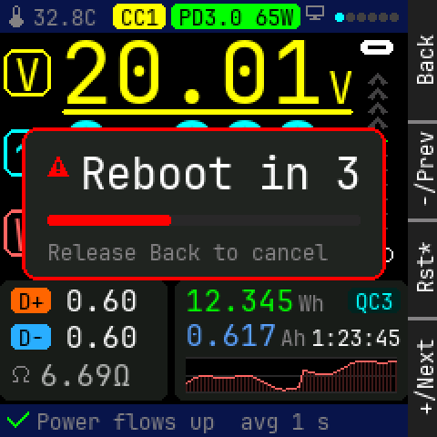

Panel: Back / -/Prev / Rst* / +/Next

```
    0123456789012345678901234567|
  0 * 32.8C CC1 PD3.0 65W*      |
 12                             |
 24                             |
 36  V  2   0   .   0   1    ^  |
 48                       V  ^  |
 60  ........................^  |
 72     2   .   9   9   0    ^  |
 84  ^ * R e b o o t   i n   3  |
 96                          ^  |
108                          ^  |
120  W  5   9   .   8   3    ^  |
132    Release Back to cancel   |
144 ............................|
156  D+ 0.60    12.345  Wh  QC3 |
168                             |
180  D- 0.60    0.617  Ah1:23:45|
192                             |
204 * 6.69O     ~~~~~~~~~~~~~~~ |
216 ........... ................|
228 * Power flows up  avg 1 s   |
```

<details><summary>Element table</summary>

| element | kind | x | y | w | h | font / radius | token |
|---|---|---|---|---|---|---|---|
| status bar | rect | 0 | 0 | 224 | 18 | r0 | `bar` |
| icon therm | icon | 4 | 3 | 12 | 12 | - | `dim` |
| MCU temp | text | 18 | 3 | 35 | 13 | 12px | `dim` |
| CC pill | rect | 62 | 2 | 29 | 14 | r3 | `volt` |
| CC pill text | text | 66 | 3 | 21 | 13 | 12px | `bg` |
| PD pill | rect | 94 | 2 | 71 | 14 | r3 | `energy` |
| PD pill text | text | 98 | 3 | 63 | 13 | 12px | `bg` |
| icon pc | icon | 168 | 3 | 12 | 12 | - | `dim` |
| page dot | rect | 184 | 7 | 5 | 5 | r1 | `focus` |
| page dot | rect | 190 | 7 | 5 | 5 | r1 | `faint` |
| page dot | rect | 196 | 7 | 5 | 5 | r1 | `faint` |
| page dot | rect | 202 | 7 | 5 | 5 | r1 | `faint` |
| page dot | rect | 208 | 7 | 5 | 5 | r1 | `faint` |
| page dot | rect | 214 | 7 | 5 | 5 | r1 | `faint` |
| V badge | frame | 2 | 27 | 26 | 26 | r6 | `volt` |
| V badge glyph | text | 8 | 28 | 14 | 26 | 24px | `volt` |
| V digits | text | 33 | 22 | 145 | 35 | 48px | `volt` |
| V unit | text | 180 | 35 | 14 | 26 | 24px | `volt` |
| V gauge vs contract track | rect | 34 | 60 | 160 | 3 | r1 | `rule` |
| V gauge vs contract fill | rect | 34 | 60 | 160 | 3 | r1 | `volt` |
| A badge | frame | 2 | 71 | 26 | 26 | r6 | `amp` |
| A badge glyph | text | 8 | 72 | 14 | 26 | 24px | `amp` |
| A digits | text | 33 | 66 | 145 | 35 | 48px | `amp` |
| A unit | text | 180 | 79 | 14 | 26 | 24px | `amp` |
| A gauge vs contract track | rect | 34 | 104 | 160 | 3 | r1 | `rule` |
| A gauge vs contract fill | rect | 34 | 104 | 147 | 3 | r1 | `amp` |
| W badge | frame | 2 | 115 | 26 | 26 | r6 | `watt` |
| W badge glyph | text | 8 | 116 | 14 | 26 | 24px | `watt` |
| W digits | text | 33 | 110 | 145 | 35 | 48px | `watt` |
| W unit | text | 180 | 123 | 14 | 26 | 24px | `watt` |
| W gauge vs contract track | rect | 34 | 148 | 160 | 3 | r1 | `rule` |
| W gauge vs contract fill | rect | 34 | 148 | 147 | 3 | r1 | `watt` |
| rail top port | rect | 198 | 22 | 18 | 8 | r3 | `text` |
| rail top port slot | rect | 202 | 25 | 10 | 2 | r0 | `bg` |
| rail bottom port | frame | 198 | 136 | 18 | 8 | r3 | `text` |
| rail bottom port tongue | rect | 202 | 139 | 10 | 2 | r0 | `text` |
| lines card | rect | 0 | 154 | 92 | 66 | r5 | `surface` |
| D+ tag | rect | 6 | 158 | 22 | 14 | r3 | `dplus` |
| D+ tag text | text | 10 | 159 | 14 | 13 | 12px | `bg` |
| D+ V | text | 36 | 157 | 40 | 17 | 16px | `text` |
| D- tag | rect | 6 | 178 | 22 | 14 | r3 | `dminus` |
| D- tag text | text | 10 | 179 | 14 | 13 | 12px | `bg` |
| D- V | text | 36 | 177 | 40 | 17 | 16px | `text` |
| icon ohm | icon | 6 | 201 | 12 | 12 | - | `dim` |
| load R | text | 22 | 198 | 50 | 17 | 16px | `ohm` |
| totals card | rect | 96 | 154 | 128 | 66 | r5 | `surface` |
| Wh | text | 102 | 157 | 60 | 17 | 16px | `energy` |
| 'Wh' | text | 164 | 160 | 14 | 13 | 12px | `dim` |
| Ah | text | 102 | 176 | 50 | 17 | 16px | `charge` |
| 'Ah' | text | 154 | 179 | 14 | 13 | 12px | `dim` |
| FC pill | rect | 191 | 158 | 29 | 14 | r3 | `amp_t` |
| FC pill text | text | 195 | 159 | 21 | 13 | 12px | `amp` |
| elapsed | text | 171 | 179 | 49 | 13 | 12px | `text` |
| W sparkline 60 s | spark | 102 | 196 | 116 | 20 | - | `watt` |
| footer | rect | 0 | 222 | 224 | 18 | r0 | `bar` |
| icon check | icon | 4 | 225 | 12 | 12 | - | `ok` |
| footer text | text | 20 | 225 | 161 | 13 | 12px | `dim` |
| hold card | rect | 12 | 70 | 200 | 84 | r8 | `surface2` |
| hold outline | frame | 12 | 70 | 200 | 84 | r8 | `error` |
| icon warn | icon | 26 | 86 | 12 | 12 | - | `error` |
| countdown | text | 44 | 82 | 154 | 26 | 24px | `text` |
| hold track | rect | 26 | 118 | 172 | 6 | r1 | `rule` |
| hold fill | rect | 26 | 118 | 68 | 6 | r1 | `error` |
| 'Release Back to cancel' | text | 26 | 132 | 154 | 13 | 12px | `dim` |

</details>

## pd_live

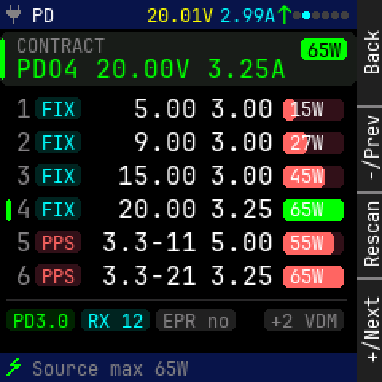

Panel: Back / -/Prev / Rescan / +/Next

```
    0123456789012345678901234567|
  0 * PD       20.01V2.99^      |
 12 ............................|
 24  CONTRACT               65W |
 36  PDO4 20.00V 3.25A          |
 48 ............................|
 60  1 FIX    5.00  3.00  15W   |
 72                             |
 84  2 FIX    9.00  3.00  27W   |
 96                             |
108  3 FIX   15.00  3.00  45W   |
120  4 FIX   20.00  3.25  65W   |
132                             |
144  5 PPS  3.3-11  5.00  55W   |
156                             |
168  6 PPS  3.3-21  3.25  65W   |
180                             |
192  PD3.0RX 12 EPR no   +2 VDM |
204                             |
216                             |
228 * Source max 65W            |
```

<details><summary>Element table</summary>

| element | kind | x | y | w | h | font / radius | token |
|---|---|---|---|---|---|---|---|
| status bar | rect | 0 | 0 | 224 | 18 | r0 | `bar` |
| icon plug | icon | 4 | 3 | 12 | 12 | - | `dim` |
| title | text | 20 | 3 | 14 | 13 | 12px | `text` |
| mini V | text | 92 | 3 | 42 | 13 | 12px | `volt` |
| mini A | text | 138 | 3 | 35 | 13 | 12px | `amp` |
| mini flow | text | 174 | 1 | 10 | 17 | 16px | `flow` |
| page dot | rect | 184 | 7 | 5 | 5 | r1 | `faint` |
| page dot | rect | 190 | 7 | 5 | 5 | r1 | `focus` |
| page dot | rect | 196 | 7 | 5 | 5 | r1 | `faint` |
| page dot | rect | 202 | 7 | 5 | 5 | r1 | `faint` |
| page dot | rect | 208 | 7 | 5 | 5 | r1 | `faint` |
| page dot | rect | 214 | 7 | 5 | 5 | r1 | `faint` |
| contract card | rect | 0 | 20 | 224 | 34 | r5 | `surface` |
| contract card accent | rect | 0 | 24 | 3 | 26 | r1 | `energy` |
| 'CONTRACT' | text | 10 | 22 | 56 | 13 | 12px | `dim` |
| contract | text | 10 | 35 | 170 | 17 | 16px | `energy` |
| pill | rect | 189 | 24 | 29 | 14 | r3 | `energy` |
| pill text | text | 193 | 25 | 21 | 13 | 12px | `bg` |
| '1' | text | 10 | 60 | 10 | 17 | 16px | `dim` |
| type pill | rect | 22 | 61 | 29 | 14 | r3 | `amp_t` |
| type pill text | text | 26 | 62 | 21 | 13 | 12px | `amp` |
| V | text | 74 | 60 | 50 | 17 | 16px | `text` |
| A | text | 132 | 60 | 40 | 17 | 16px | `text` |
| W bar track | rect | 178 | 62 | 38 | 14 | r3 | `watt_t` |
| W bar | rect | 178 | 62 | 8 | 14 | r3 | `watt` |
| W | text | 182 | 62 | 21 | 13 | 12px | `text` |
| '2' | text | 10 | 81 | 10 | 17 | 16px | `dim` |
| type pill | rect | 22 | 82 | 29 | 14 | r3 | `amp_t` |
| type pill text | text | 26 | 83 | 21 | 13 | 12px | `amp` |
| V | text | 74 | 81 | 50 | 17 | 16px | `text` |
| A | text | 132 | 81 | 40 | 17 | 16px | `text` |
| W bar track | rect | 178 | 83 | 38 | 14 | r3 | `watt_t` |
| W bar | rect | 178 | 83 | 15 | 14 | r3 | `watt` |
| W | text | 182 | 83 | 21 | 13 | 12px | `text` |
| '3' | text | 10 | 102 | 10 | 17 | 16px | `dim` |
| type pill | rect | 22 | 103 | 29 | 14 | r3 | `amp_t` |
| type pill text | text | 26 | 104 | 21 | 13 | 12px | `amp` |
| V | text | 74 | 102 | 50 | 17 | 16px | `text` |
| A | text | 132 | 102 | 40 | 17 | 16px | `text` |
| W bar track | rect | 178 | 104 | 38 | 14 | r3 | `watt_t` |
| W bar | rect | 178 | 104 | 26 | 14 | r3 | `watt` |
| W | text | 182 | 104 | 21 | 13 | 12px | `text` |
| active bar | rect | 4 | 125 | 3 | 14 | r1 | `energy` |
| '4' | text | 10 | 123 | 10 | 17 | 16px | `dim` |
| type pill | rect | 22 | 124 | 29 | 14 | r3 | `amp_t` |
| type pill text | text | 26 | 125 | 21 | 13 | 12px | `amp` |
| V | text | 74 | 123 | 50 | 17 | 16px | `text` |
| A | text | 132 | 123 | 40 | 17 | 16px | `text` |
| W bar track | rect | 178 | 125 | 38 | 14 | r3 | `energy_t` |
| W bar | rect | 178 | 125 | 38 | 14 | r3 | `energy` |
| W | text | 182 | 125 | 21 | 13 | 12px | `text` |
| '5' | text | 10 | 144 | 10 | 17 | 16px | `dim` |
| type pill | rect | 22 | 145 | 29 | 14 | r3 | `watt_t` |
| type pill text | text | 26 | 146 | 21 | 13 | 12px | `watt` |
| V | text | 64 | 144 | 60 | 17 | 16px | `text` |
| A | text | 132 | 144 | 40 | 17 | 16px | `text` |
| W bar track | rect | 178 | 146 | 38 | 14 | r3 | `watt_t` |
| W bar | rect | 178 | 146 | 32 | 14 | r3 | `watt` |
| W | text | 182 | 146 | 21 | 13 | 12px | `text` |
| '6' | text | 10 | 165 | 10 | 17 | 16px | `dim` |
| type pill | rect | 22 | 166 | 29 | 14 | r3 | `watt_t` |
| type pill text | text | 26 | 167 | 21 | 13 | 12px | `watt` |
| V | text | 64 | 165 | 60 | 17 | 16px | `text` |
| A | text | 132 | 165 | 40 | 17 | 16px | `text` |
| W bar track | rect | 178 | 167 | 38 | 14 | r3 | `watt_t` |
| W bar | rect | 178 | 167 | 38 | 14 | r3 | `watt` |
| W | text | 182 | 167 | 21 | 13 | 12px | `text` |
| divider | rect | 4 | 188 | 214 | 1 | r0 | `rule` |
| pill | rect | 4 | 194 | 43 | 14 | r3 | `energy_t` |
| pill text | text | 8 | 195 | 35 | 13 | 12px | `energy` |
| pill | rect | 51 | 194 | 43 | 14 | r3 | `amp_t` |
| pill text | text | 55 | 195 | 35 | 13 | 12px | `amp` |
| pill | rect | 98 | 194 | 50 | 14 | r3 | `dim_t` |
| pill text | text | 102 | 195 | 42 | 13 | 12px | `dim` |
| pill | rect | 166 | 194 | 50 | 14 | r3 | `dim_t` |
| pill text | text | 170 | 195 | 42 | 13 | 12px | `dim` |
| footer | rect | 0 | 222 | 224 | 18 | r0 | `bar` |
| icon bolt | icon | 4 | 225 | 12 | 12 | - | `energy` |
| footer text | text | 20 | 225 | 98 | 13 | 12px | `dim` |

</details>

## pd_wait

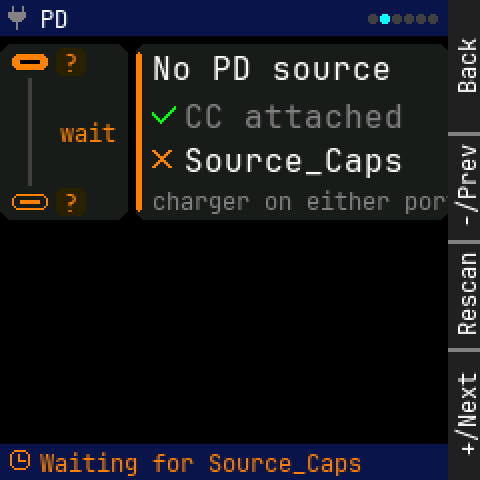

Panel: Back / -/Prev / Rescan / +/Next

```
    0123456789012345678901234567|
  0 * PD                        |
 12 ............................|
 24     ?    No PD source       |
 36                             |
 48          * CC attached      |
 60    wait                     |
 72          * Source_Caps      |
 84                             |
 96     ?    charger on either p|
108 ............................|
120                             |
132                             |
144                             |
156                             |
168                             |
180                             |
192                             |
204                             |
216                             |
228 * Waiting for Source_Caps   |
```

<details><summary>Element table</summary>

| element | kind | x | y | w | h | font / radius | token |
|---|---|---|---|---|---|---|---|
| status bar | rect | 0 | 0 | 224 | 18 | r0 | `bar` |
| icon plug | icon | 4 | 3 | 12 | 12 | - | `dim` |
| title | text | 20 | 3 | 14 | 13 | 12px | `text` |
| page dot | rect | 184 | 7 | 5 | 5 | r1 | `faint` |
| page dot | rect | 190 | 7 | 5 | 5 | r1 | `focus` |
| page dot | rect | 196 | 7 | 5 | 5 | r1 | `faint` |
| page dot | rect | 202 | 7 | 5 | 5 | r1 | `faint` |
| page dot | rect | 208 | 7 | 5 | 5 | r1 | `faint` |
| page dot | rect | 214 | 7 | 5 | 5 | r1 | `faint` |
| flow diagram | rect | 0 | 22 | 64 | 88 | r6 | `surface` |
| top port (male) | rect | 6 | 27 | 18 | 8 | r3 | `caution` |
| top port (male) slot | rect | 10 | 30 | 10 | 2 | r0 | `bg` |
| bottom port (female) | frame | 6 | 97 | 18 | 8 | r3 | `caution` |
| bottom port (female) tongue | rect | 10 | 100 | 10 | 2 | r0 | `caution` |
| top role | rect | 28 | 24 | 15 | 14 | r3 | `caution_t` |
| top role text | text | 32 | 25 | 7 | 13 | 12px | `caution` |
| bottom role | rect | 28 | 94 | 15 | 14 | r3 | `caution_t` |
| bottom role text | text | 32 | 95 | 7 | 13 | 12px | `caution` |
| no-flow line | rect | 14 | 39 | 2 | 54 | r0 | `faint` |
| diagram caption | text | 30 | 60 | 28 | 13 | 12px | `caution` |
| empty card | rect | 68 | 22 | 156 | 88 | r5 | `surface` |
| empty card accent | rect | 68 | 26 | 3 | 80 | r1 | `caution` |
| 'No PD source' | text | 76 | 26 | 120 | 17 | 16px | `text` |
| icon check | icon | 76 | 52 | 12 | 12 | - | `ok` |
| check text | text | 92 | 50 | 110 | 17 | 16px | `dim` |
| icon cross | icon | 76 | 74 | 12 | 12 | - | `caution` |
| check text | text | 92 | 72 | 110 | 17 | 16px | `text` |
| 'charger on either port' | text | 76 | 94 | 154 | 13 | 12px | `dim` |
| footer | rect | 0 | 222 | 224 | 18 | r0 | `bar` |
| icon clock | icon | 4 | 225 | 12 | 12 | - | `caution` |
| footer text | text | 20 | 225 | 161 | 13 | 12px | `caution` |

</details>

## pd_stale

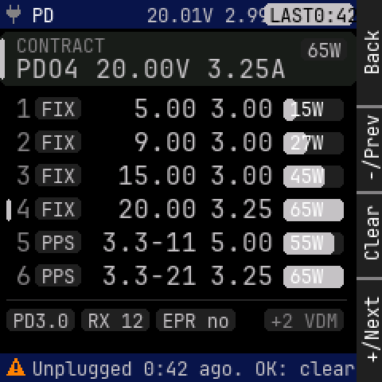

Panel: Back / -/Prev / Clear / +/Next

```
    0123456789012345678901234567|
  0 * PD       20.01V 2.9LAST0:4|
 12 ............................|
 24  CONTRACT               65W |
 36  PDO4 20.00V 3.25A          |
 48 ............................|
 60  1 FIX    5.00  3.00  15W   |
 72                             |
 84  2 FIX    9.00  3.00  27W   |
 96                             |
108  3 FIX   15.00  3.00  45W   |
120  4 FIX   20.00  3.25  65W   |
132                             |
144  5 PPS  3.3-11  5.00  55W   |
156                             |
168  6 PPS  3.3-21  3.25  65W   |
180                             |
192  PD3.0RX 12 EPR no   +2 VDM |
204                             |
216                             |
228 * Unplugged 0:42 ago. OK: cl|
```

<details><summary>Element table</summary>

| element | kind | x | y | w | h | font / radius | token |
|---|---|---|---|---|---|---|---|
| status bar | rect | 0 | 0 | 224 | 18 | r0 | `bar` |
| icon plug | icon | 4 | 3 | 12 | 12 | - | `dim` |
| title | text | 20 | 3 | 14 | 13 | 12px | `text` |
| mini readout | text | 92 | 3 | 84 | 13 | 12px | `stale` |
| LAST pill | rect | 166 | 2 | 56 | 14 | r3 | `stale` |
| LAST text | text | 169 | 3 | 56 | 13 | 12px | `bg` |
| contract card | rect | 0 | 20 | 224 | 34 | r5 | `surface` |
| contract card accent | rect | 0 | 24 | 3 | 26 | r1 | `stale` |
| 'CONTRACT' | text | 10 | 22 | 56 | 13 | 12px | `dim` |
| contract | text | 10 | 35 | 170 | 17 | 16px | `stale` |
| pill | rect | 189 | 24 | 29 | 14 | r3 | `stale_t` |
| pill text | text | 193 | 25 | 21 | 13 | 12px | `stale` |
| '1' | text | 10 | 60 | 10 | 17 | 16px | `dim` |
| type pill | rect | 22 | 61 | 29 | 14 | r3 | `stale_t` |
| type pill text | text | 26 | 62 | 21 | 13 | 12px | `stale` |
| V | text | 74 | 60 | 50 | 17 | 16px | `stale` |
| A | text | 132 | 60 | 40 | 17 | 16px | `stale` |
| W bar track | rect | 178 | 62 | 38 | 14 | r3 | `stale_t` |
| W bar | rect | 178 | 62 | 8 | 14 | r3 | `stale` |
| W | text | 182 | 62 | 21 | 13 | 12px | `text` |
| '2' | text | 10 | 81 | 10 | 17 | 16px | `dim` |
| type pill | rect | 22 | 82 | 29 | 14 | r3 | `stale_t` |
| type pill text | text | 26 | 83 | 21 | 13 | 12px | `stale` |
| V | text | 74 | 81 | 50 | 17 | 16px | `stale` |
| A | text | 132 | 81 | 40 | 17 | 16px | `stale` |
| W bar track | rect | 178 | 83 | 38 | 14 | r3 | `stale_t` |
| W bar | rect | 178 | 83 | 15 | 14 | r3 | `stale` |
| W | text | 182 | 83 | 21 | 13 | 12px | `text` |
| '3' | text | 10 | 102 | 10 | 17 | 16px | `dim` |
| type pill | rect | 22 | 103 | 29 | 14 | r3 | `stale_t` |
| type pill text | text | 26 | 104 | 21 | 13 | 12px | `stale` |
| V | text | 74 | 102 | 50 | 17 | 16px | `stale` |
| A | text | 132 | 102 | 40 | 17 | 16px | `stale` |
| W bar track | rect | 178 | 104 | 38 | 14 | r3 | `stale_t` |
| W bar | rect | 178 | 104 | 26 | 14 | r3 | `stale` |
| W | text | 182 | 104 | 21 | 13 | 12px | `text` |
| active bar | rect | 4 | 125 | 3 | 14 | r1 | `stale` |
| '4' | text | 10 | 123 | 10 | 17 | 16px | `dim` |
| type pill | rect | 22 | 124 | 29 | 14 | r3 | `stale_t` |
| type pill text | text | 26 | 125 | 21 | 13 | 12px | `stale` |
| V | text | 74 | 123 | 50 | 17 | 16px | `stale` |
| A | text | 132 | 123 | 40 | 17 | 16px | `stale` |
| W bar track | rect | 178 | 125 | 38 | 14 | r3 | `stale_t` |
| W bar | rect | 178 | 125 | 38 | 14 | r3 | `stale` |
| W | text | 182 | 125 | 21 | 13 | 12px | `text` |
| '5' | text | 10 | 144 | 10 | 17 | 16px | `dim` |
| type pill | rect | 22 | 145 | 29 | 14 | r3 | `stale_t` |
| type pill text | text | 26 | 146 | 21 | 13 | 12px | `stale` |
| V | text | 64 | 144 | 60 | 17 | 16px | `stale` |
| A | text | 132 | 144 | 40 | 17 | 16px | `stale` |
| W bar track | rect | 178 | 146 | 38 | 14 | r3 | `stale_t` |
| W bar | rect | 178 | 146 | 32 | 14 | r3 | `stale` |
| W | text | 182 | 146 | 21 | 13 | 12px | `text` |
| '6' | text | 10 | 165 | 10 | 17 | 16px | `dim` |
| type pill | rect | 22 | 166 | 29 | 14 | r3 | `stale_t` |
| type pill text | text | 26 | 167 | 21 | 13 | 12px | `stale` |
| V | text | 64 | 165 | 60 | 17 | 16px | `stale` |
| A | text | 132 | 165 | 40 | 17 | 16px | `stale` |
| W bar track | rect | 178 | 167 | 38 | 14 | r3 | `stale_t` |
| W bar | rect | 178 | 167 | 38 | 14 | r3 | `stale` |
| W | text | 182 | 167 | 21 | 13 | 12px | `text` |
| divider | rect | 4 | 188 | 214 | 1 | r0 | `rule` |
| pill | rect | 4 | 194 | 43 | 14 | r3 | `stale_t` |
| pill text | text | 8 | 195 | 35 | 13 | 12px | `stale` |
| pill | rect | 51 | 194 | 43 | 14 | r3 | `stale_t` |
| pill text | text | 55 | 195 | 35 | 13 | 12px | `stale` |
| pill | rect | 98 | 194 | 50 | 14 | r3 | `stale_t` |
| pill text | text | 102 | 195 | 42 | 13 | 12px | `stale` |
| pill | rect | 166 | 194 | 50 | 14 | r3 | `dim_t` |
| pill text | text | 170 | 195 | 42 | 13 | 12px | `dim` |
| footer | rect | 0 | 222 | 224 | 18 | r0 | `bar` |
| icon warn | icon | 4 | 225 | 12 | 12 | - | `caution` |
| footer text | text | 20 | 225 | 203 | 13 | 12px | `stale` |

</details>

## match_ok

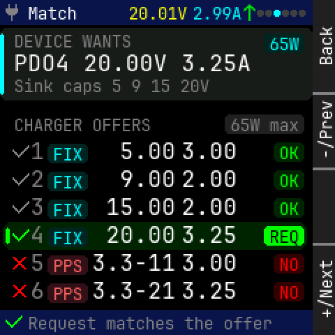

Panel: Back / -/Prev / (empty) / +/Next

```
    0123456789012345678901234567|
  0 * Match    20.01V2.99^      |
 12 ............................|
 24  PD TEST                65W |
 36  PDO4 20.00V 3.25A          |
 48                             |
 60 .Sink caps 5 9 15 20V.......|
 72                             |
 84  CHARGER OFFERS     65W max |
 96                             |
108  *1 FIX   5.00  3.00     OK |
120  *2 FIX   9.00  2.00     OK |
132                             |
144  *3 FIX  15.00  2.00     OK |
156                             |
168  *4 FIX  20.00  3.25    REQ |
180  *5 PPS 3.3-11  3.00     NO |
192                             |
204  *6 PPS 3.3-21  3.25     NO |
216                             |
228 * Request matches the offer |
```

<details><summary>Element table</summary>

| element | kind | x | y | w | h | font / radius | token |
|---|---|---|---|---|---|---|---|
| status bar | rect | 0 | 0 | 224 | 18 | r0 | `bar` |
| icon plug | icon | 4 | 3 | 12 | 12 | - | `dim` |
| title | text | 20 | 3 | 35 | 13 | 12px | `text` |
| mini V | text | 92 | 3 | 42 | 13 | 12px | `volt` |
| mini A | text | 138 | 3 | 35 | 13 | 12px | `amp` |
| mini flow | text | 174 | 1 | 10 | 17 | 16px | `flow` |
| page dot | rect | 184 | 7 | 5 | 5 | r1 | `faint` |
| page dot | rect | 190 | 7 | 5 | 5 | r1 | `faint` |
| page dot | rect | 196 | 7 | 5 | 5 | r1 | `focus` |
| page dot | rect | 202 | 7 | 5 | 5 | r1 | `faint` |
| page dot | rect | 208 | 7 | 5 | 5 | r1 | `faint` |
| page dot | rect | 214 | 7 | 5 | 5 | r1 | `faint` |
| wants card | rect | 0 | 20 | 224 | 52 | r5 | `surface` |
| wants card accent | rect | 0 | 24 | 3 | 44 | r1 | `amp` |
| overline | text | 10 | 23 | 84 | 13 | 12px | `dim` |
| wants | text | 10 | 37 | 170 | 17 | 16px | `text` |
| wants pill | rect | 189 | 24 | 29 | 14 | r3 | `amp_t` |
| wants pill text | text | 193 | 25 | 21 | 13 | 12px | `amp` |
| sink caps | text | 10 | 55 | 140 | 13 | 12px | `dim` |
| max pill | rect | 161 | 82 | 57 | 14 | r3 | `dim_t` |
| max pill text | text | 165 | 83 | 49 | 13 | 12px | `dim` |
| overline | text | 10 | 83 | 98 | 13 | 12px | `dim` |
| match icon | icon | 9 | 103 | 12 | 12 | - | `dim` |
| '1' | text | 22 | 100 | 10 | 17 | 16px | `dim` |
| type pill | rect | 34 | 103 | 29 | 14 | r3 | `amp_t` |
| type pill text | text | 38 | 104 | 21 | 13 | 12px | `amp` |
| V | text | 76 | 100 | 50 | 17 | 16px | `text` |
| A | text | 130 | 100 | 40 | 17 | 16px | `text` |
| match tag | rect | 196 | 102 | 22 | 14 | r3 | `ok_t` |
| match tag text | text | 200 | 103 | 14 | 13 | 12px | `ok` |
| match icon | icon | 9 | 123 | 12 | 12 | - | `dim` |
| '2' | text | 22 | 120 | 10 | 17 | 16px | `dim` |
| type pill | rect | 34 | 123 | 29 | 14 | r3 | `amp_t` |
| type pill text | text | 38 | 124 | 21 | 13 | 12px | `amp` |
| V | text | 76 | 120 | 50 | 17 | 16px | `text` |
| A | text | 130 | 120 | 40 | 17 | 16px | `text` |
| match tag | rect | 196 | 122 | 22 | 14 | r3 | `ok_t` |
| match tag text | text | 200 | 123 | 14 | 13 | 12px | `ok` |
| match icon | icon | 9 | 143 | 12 | 12 | - | `dim` |
| '3' | text | 22 | 140 | 10 | 17 | 16px | `dim` |
| type pill | rect | 34 | 143 | 29 | 14 | r3 | `amp_t` |
| type pill text | text | 38 | 144 | 21 | 13 | 12px | `amp` |
| V | text | 76 | 140 | 50 | 17 | 16px | `text` |
| A | text | 130 | 140 | 40 | 17 | 16px | `text` |
| match tag | rect | 196 | 142 | 22 | 14 | r3 | `ok_t` |
| match tag text | text | 200 | 143 | 14 | 13 | 12px | `ok` |
| selected row | rect | 2 | 159 | 218 | 20 | r6 | `energy_t` |
| request bar | rect | 4 | 163 | 3 | 12 | r1 | `energy` |
| match icon | icon | 9 | 163 | 12 | 12 | - | `energy` |
| '4' | text | 22 | 160 | 10 | 17 | 16px | `dim` |
| type pill | rect | 34 | 163 | 29 | 14 | r3 | `amp_t` |
| type pill text | text | 38 | 164 | 21 | 13 | 12px | `amp` |
| V | text | 76 | 160 | 50 | 17 | 16px | `text` |
| A | text | 130 | 160 | 40 | 17 | 16px | `text` |
| match tag | rect | 189 | 162 | 29 | 14 | r3 | `energy` |
| match tag text | text | 193 | 163 | 21 | 13 | 12px | `bg` |
| match icon | icon | 9 | 183 | 12 | 12 | - | `error` |
| '5' | text | 22 | 180 | 10 | 17 | 16px | `dim` |
| type pill | rect | 34 | 183 | 29 | 14 | r3 | `watt_t` |
| type pill text | text | 38 | 184 | 21 | 13 | 12px | `watt` |
| V | text | 66 | 180 | 60 | 17 | 16px | `text` |
| A | text | 130 | 180 | 40 | 17 | 16px | `text` |
| match tag | rect | 196 | 182 | 22 | 14 | r3 | `error_t` |
| match tag text | text | 200 | 183 | 14 | 13 | 12px | `error` |
| match icon | icon | 9 | 203 | 12 | 12 | - | `error` |
| '6' | text | 22 | 200 | 10 | 17 | 16px | `dim` |
| type pill | rect | 34 | 203 | 29 | 14 | r3 | `watt_t` |
| type pill text | text | 38 | 204 | 21 | 13 | 12px | `watt` |
| V | text | 66 | 200 | 60 | 17 | 16px | `text` |
| A | text | 130 | 200 | 40 | 17 | 16px | `text` |
| match tag | rect | 196 | 202 | 22 | 14 | r3 | `error_t` |
| match tag text | text | 200 | 203 | 14 | 13 | 12px | `error` |
| footer | rect | 0 | 222 | 224 | 18 | r0 | `bar` |
| icon check | icon | 4 | 225 | 12 | 12 | - | `ok` |
| footer text | text | 20 | 225 | 175 | 13 | 12px | `dim` |

</details>

## match_limited

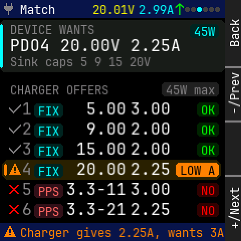

Panel: Back / -/Prev / (empty) / +/Next

```
    0123456789012345678901234567|
  0 * Match    20.01V2.99^      |
 12 ............................|
 24  PD TEST                45W |
 36  PDO4 20.00V 2.25A          |
 48                             |
 60 .Sink caps 5 9 15 20V.......|
 72                             |
 84  CHARGER OFFERS     45W max |
 96                             |
108  *1 FIX   5.00  3.00     OK |
120  *2 FIX   9.00  2.00     OK |
132                             |
144  *3 FIX  15.00  2.00     OK |
156                             |
168  *4 FIX  20.00  2.25  LOW A |
180  *5 PPS 3.3-11  3.00     NO |
192                             |
204  *6 PPS 3.3-21  2.25     NO |
216                             |
228 * Charger gives 2.25A, wants|
```

<details><summary>Element table</summary>

| element | kind | x | y | w | h | font / radius | token |
|---|---|---|---|---|---|---|---|
| status bar | rect | 0 | 0 | 224 | 18 | r0 | `bar` |
| icon plug | icon | 4 | 3 | 12 | 12 | - | `dim` |
| title | text | 20 | 3 | 35 | 13 | 12px | `text` |
| mini V | text | 92 | 3 | 42 | 13 | 12px | `volt` |
| mini A | text | 138 | 3 | 35 | 13 | 12px | `amp` |
| mini flow | text | 174 | 1 | 10 | 17 | 16px | `flow` |
| page dot | rect | 184 | 7 | 5 | 5 | r1 | `faint` |
| page dot | rect | 190 | 7 | 5 | 5 | r1 | `faint` |
| page dot | rect | 196 | 7 | 5 | 5 | r1 | `focus` |
| page dot | rect | 202 | 7 | 5 | 5 | r1 | `faint` |
| page dot | rect | 208 | 7 | 5 | 5 | r1 | `faint` |
| page dot | rect | 214 | 7 | 5 | 5 | r1 | `faint` |
| wants card | rect | 0 | 20 | 224 | 52 | r5 | `surface` |
| wants card accent | rect | 0 | 24 | 3 | 44 | r1 | `amp` |
| overline | text | 10 | 23 | 84 | 13 | 12px | `dim` |
| wants | text | 10 | 37 | 170 | 17 | 16px | `text` |
| wants pill | rect | 189 | 24 | 29 | 14 | r3 | `amp_t` |
| wants pill text | text | 193 | 25 | 21 | 13 | 12px | `amp` |
| sink caps | text | 10 | 55 | 140 | 13 | 12px | `dim` |
| max pill | rect | 161 | 82 | 57 | 14 | r3 | `dim_t` |
| max pill text | text | 165 | 83 | 49 | 13 | 12px | `dim` |
| overline | text | 10 | 83 | 98 | 13 | 12px | `dim` |
| match icon | icon | 9 | 103 | 12 | 12 | - | `dim` |
| '1' | text | 22 | 100 | 10 | 17 | 16px | `dim` |
| type pill | rect | 34 | 103 | 29 | 14 | r3 | `amp_t` |
| type pill text | text | 38 | 104 | 21 | 13 | 12px | `amp` |
| V | text | 76 | 100 | 50 | 17 | 16px | `text` |
| A | text | 130 | 100 | 40 | 17 | 16px | `text` |
| match tag | rect | 196 | 102 | 22 | 14 | r3 | `ok_t` |
| match tag text | text | 200 | 103 | 14 | 13 | 12px | `ok` |
| match icon | icon | 9 | 123 | 12 | 12 | - | `dim` |
| '2' | text | 22 | 120 | 10 | 17 | 16px | `dim` |
| type pill | rect | 34 | 123 | 29 | 14 | r3 | `amp_t` |
| type pill text | text | 38 | 124 | 21 | 13 | 12px | `amp` |
| V | text | 76 | 120 | 50 | 17 | 16px | `text` |
| A | text | 130 | 120 | 40 | 17 | 16px | `text` |
| match tag | rect | 196 | 122 | 22 | 14 | r3 | `ok_t` |
| match tag text | text | 200 | 123 | 14 | 13 | 12px | `ok` |
| match icon | icon | 9 | 143 | 12 | 12 | - | `dim` |
| '3' | text | 22 | 140 | 10 | 17 | 16px | `dim` |
| type pill | rect | 34 | 143 | 29 | 14 | r3 | `amp_t` |
| type pill text | text | 38 | 144 | 21 | 13 | 12px | `amp` |
| V | text | 76 | 140 | 50 | 17 | 16px | `text` |
| A | text | 130 | 140 | 40 | 17 | 16px | `text` |
| match tag | rect | 196 | 142 | 22 | 14 | r3 | `ok_t` |
| match tag text | text | 200 | 143 | 14 | 13 | 12px | `ok` |
| selected row | rect | 2 | 159 | 218 | 20 | r6 | `caution_t` |
| request bar | rect | 4 | 163 | 3 | 12 | r1 | `caution` |
| match icon | icon | 9 | 163 | 12 | 12 | - | `caution` |
| '4' | text | 22 | 160 | 10 | 17 | 16px | `dim` |
| type pill | rect | 34 | 163 | 29 | 14 | r3 | `amp_t` |
| type pill text | text | 38 | 164 | 21 | 13 | 12px | `amp` |
| V | text | 76 | 160 | 50 | 17 | 16px | `text` |
| A | text | 130 | 160 | 40 | 17 | 16px | `text` |
| match tag | rect | 175 | 162 | 43 | 14 | r3 | `caution` |
| match tag text | text | 179 | 163 | 35 | 13 | 12px | `bg` |
| match icon | icon | 9 | 183 | 12 | 12 | - | `error` |
| '5' | text | 22 | 180 | 10 | 17 | 16px | `dim` |
| type pill | rect | 34 | 183 | 29 | 14 | r3 | `watt_t` |
| type pill text | text | 38 | 184 | 21 | 13 | 12px | `watt` |
| V | text | 66 | 180 | 60 | 17 | 16px | `text` |
| A | text | 130 | 180 | 40 | 17 | 16px | `text` |
| match tag | rect | 196 | 182 | 22 | 14 | r3 | `error_t` |
| match tag text | text | 200 | 183 | 14 | 13 | 12px | `error` |
| match icon | icon | 9 | 203 | 12 | 12 | - | `error` |
| '6' | text | 22 | 200 | 10 | 17 | 16px | `dim` |
| type pill | rect | 34 | 203 | 29 | 14 | r3 | `watt_t` |
| type pill text | text | 38 | 204 | 21 | 13 | 12px | `watt` |
| V | text | 66 | 200 | 60 | 17 | 16px | `text` |
| A | text | 130 | 200 | 40 | 17 | 16px | `text` |
| match tag | rect | 196 | 202 | 22 | 14 | r3 | `error_t` |
| match tag text | text | 200 | 203 | 14 | 13 | 12px | `error` |
| footer | rect | 0 | 222 | 224 | 18 | r0 | `bar` |
| icon warn | icon | 4 | 225 | 12 | 12 | - | `caution` |
| footer text | text | 20 | 225 | 203 | 13 | 12px | `caution` |

</details>

## match_mismatch

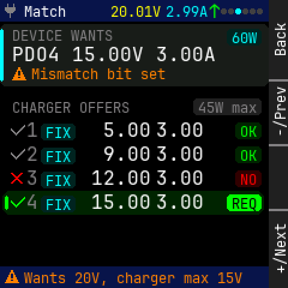

Panel: Back / -/Prev / (empty) / +/Next

```
    0123456789012345678901234567|
  0 * Match    20.01V2.99^      |
 12 ............................|
 24  PD TEST                60W |
 36  PDO4 15.00V 3.00A          |
 48                             |
 60 .*.Mismatch bit set.........|
 72                             |
 84  CHARGER OFFERS     45W max |
 96                             |
108  *1 FIX   5.00  3.00     OK |
120  *2 FIX   9.00  3.00     OK |
132                             |
144  *3 FIX  12.00  3.00     NO |
156                             |
168  *4 FIX  15.00  3.00    REQ |
180                             |
192                             |
204                             |
216                             |
228 * Wants 20V, charger max 15V|
```

<details><summary>Element table</summary>

| element | kind | x | y | w | h | font / radius | token |
|---|---|---|---|---|---|---|---|
| status bar | rect | 0 | 0 | 224 | 18 | r0 | `bar` |
| icon plug | icon | 4 | 3 | 12 | 12 | - | `dim` |
| title | text | 20 | 3 | 35 | 13 | 12px | `text` |
| mini V | text | 92 | 3 | 42 | 13 | 12px | `volt` |
| mini A | text | 138 | 3 | 35 | 13 | 12px | `amp` |
| mini flow | text | 174 | 1 | 10 | 17 | 16px | `flow` |
| page dot | rect | 184 | 7 | 5 | 5 | r1 | `faint` |
| page dot | rect | 190 | 7 | 5 | 5 | r1 | `faint` |
| page dot | rect | 196 | 7 | 5 | 5 | r1 | `focus` |
| page dot | rect | 202 | 7 | 5 | 5 | r1 | `faint` |
| page dot | rect | 208 | 7 | 5 | 5 | r1 | `faint` |
| page dot | rect | 214 | 7 | 5 | 5 | r1 | `faint` |
| wants card | rect | 0 | 20 | 224 | 52 | r5 | `surface` |
| wants card accent | rect | 0 | 24 | 3 | 44 | r1 | `amp` |
| overline | text | 10 | 23 | 84 | 13 | 12px | `dim` |
| wants | text | 10 | 37 | 170 | 17 | 16px | `text` |
| wants pill | rect | 189 | 24 | 29 | 14 | r3 | `amp_t` |
| wants pill text | text | 193 | 25 | 21 | 13 | 12px | `amp` |
| flag icon | icon | 10 | 56 | 12 | 12 | - | `caution` |
| flag | text | 26 | 55 | 112 | 13 | 12px | `caution` |
| max pill | rect | 161 | 82 | 57 | 14 | r3 | `dim_t` |
| max pill text | text | 165 | 83 | 49 | 13 | 12px | `dim` |
| overline | text | 10 | 83 | 98 | 13 | 12px | `dim` |
| match icon | icon | 9 | 103 | 12 | 12 | - | `dim` |
| '1' | text | 22 | 100 | 10 | 17 | 16px | `dim` |
| type pill | rect | 34 | 103 | 29 | 14 | r3 | `amp_t` |
| type pill text | text | 38 | 104 | 21 | 13 | 12px | `amp` |
| V | text | 76 | 100 | 50 | 17 | 16px | `text` |
| A | text | 130 | 100 | 40 | 17 | 16px | `text` |
| match tag | rect | 196 | 102 | 22 | 14 | r3 | `ok_t` |
| match tag text | text | 200 | 103 | 14 | 13 | 12px | `ok` |
| match icon | icon | 9 | 123 | 12 | 12 | - | `dim` |
| '2' | text | 22 | 120 | 10 | 17 | 16px | `dim` |
| type pill | rect | 34 | 123 | 29 | 14 | r3 | `amp_t` |
| type pill text | text | 38 | 124 | 21 | 13 | 12px | `amp` |
| V | text | 76 | 120 | 50 | 17 | 16px | `text` |
| A | text | 130 | 120 | 40 | 17 | 16px | `text` |
| match tag | rect | 196 | 122 | 22 | 14 | r3 | `ok_t` |
| match tag text | text | 200 | 123 | 14 | 13 | 12px | `ok` |
| match icon | icon | 9 | 143 | 12 | 12 | - | `error` |
| '3' | text | 22 | 140 | 10 | 17 | 16px | `dim` |
| type pill | rect | 34 | 143 | 29 | 14 | r3 | `amp_t` |
| type pill text | text | 38 | 144 | 21 | 13 | 12px | `amp` |
| V | text | 76 | 140 | 50 | 17 | 16px | `text` |
| A | text | 130 | 140 | 40 | 17 | 16px | `text` |
| match tag | rect | 196 | 142 | 22 | 14 | r3 | `error_t` |
| match tag text | text | 200 | 143 | 14 | 13 | 12px | `error` |
| selected row | rect | 2 | 159 | 218 | 20 | r6 | `energy_t` |
| request bar | rect | 4 | 163 | 3 | 12 | r1 | `energy` |
| match icon | icon | 9 | 163 | 12 | 12 | - | `energy` |
| '4' | text | 22 | 160 | 10 | 17 | 16px | `dim` |
| type pill | rect | 34 | 163 | 29 | 14 | r3 | `amp_t` |
| type pill text | text | 38 | 164 | 21 | 13 | 12px | `amp` |
| V | text | 76 | 160 | 50 | 17 | 16px | `text` |
| A | text | 130 | 160 | 40 | 17 | 16px | `text` |
| match tag | rect | 189 | 162 | 29 | 14 | r3 | `energy` |
| match tag text | text | 193 | 163 | 21 | 13 | 12px | `bg` |
| footer | rect | 0 | 222 | 224 | 18 | r0 | `bar` |
| icon warn | icon | 4 | 225 | 12 | 12 | - | `caution` |
| footer text | text | 20 | 225 | 182 | 13 | 12px | `caution` |

</details>

## match_missing

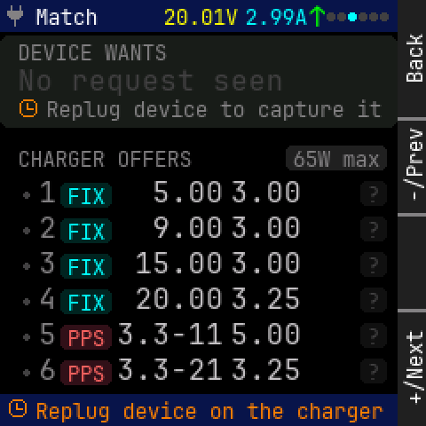

Panel: Back / -/Prev / (empty) / +/Next

```
    0123456789012345678901234567|
  0 * Match    20.01V2.99^      |
 12 ............................|
 24  PD TEST                    |
 36  No request seen            |
 48                             |
 60 .*.Replug device to capture |
 72                             |
 84  CHARGER OFFERS     65W max |
 96                             |
108   1 FIX   5.00  3.00     ?  |
120   2 FIX   9.00  3.00     ?  |
132                             |
144   3 FIX  15.00  3.00     ?  |
156                             |
168   4 FIX  20.00  3.25     ?  |
180   5 PPS 3.3-11  5.00     ?  |
192                             |
204   6 PPS 3.3-21  3.25     ?  |
216                             |
228 * Replug device on the charg|
```

<details><summary>Element table</summary>

| element | kind | x | y | w | h | font / radius | token |
|---|---|---|---|---|---|---|---|
| status bar | rect | 0 | 0 | 224 | 18 | r0 | `bar` |
| icon plug | icon | 4 | 3 | 12 | 12 | - | `dim` |
| title | text | 20 | 3 | 35 | 13 | 12px | `text` |
| mini V | text | 92 | 3 | 42 | 13 | 12px | `volt` |
| mini A | text | 138 | 3 | 35 | 13 | 12px | `amp` |
| mini flow | text | 174 | 1 | 10 | 17 | 16px | `flow` |
| page dot | rect | 184 | 7 | 5 | 5 | r1 | `faint` |
| page dot | rect | 190 | 7 | 5 | 5 | r1 | `faint` |
| page dot | rect | 196 | 7 | 5 | 5 | r1 | `focus` |
| page dot | rect | 202 | 7 | 5 | 5 | r1 | `faint` |
| page dot | rect | 208 | 7 | 5 | 5 | r1 | `faint` |
| page dot | rect | 214 | 7 | 5 | 5 | r1 | `faint` |
| wants card | rect | 0 | 20 | 224 | 52 | r5 | `surface` |
| overline | text | 10 | 23 | 84 | 13 | 12px | `dim` |
| wants | text | 10 | 37 | 150 | 17 | 16px | `faint` |
| hint icon | icon | 10 | 56 | 12 | 12 | - | `caution` |
| hint | text | 26 | 55 | 189 | 13 | 12px | `dim` |
| max pill | rect | 161 | 82 | 57 | 14 | r3 | `dim_t` |
| max pill text | text | 165 | 83 | 49 | 13 | 12px | `dim` |
| overline | text | 10 | 83 | 98 | 13 | 12px | `dim` |
| unknown dot | rect | 13 | 108 | 4 | 4 | r1 | `faint` |
| '1' | text | 22 | 100 | 10 | 17 | 16px | `dim` |
| type pill | rect | 34 | 103 | 29 | 14 | r3 | `amp_t` |
| type pill text | text | 38 | 104 | 21 | 13 | 12px | `amp` |
| V | text | 76 | 100 | 50 | 17 | 16px | `stale` |
| A | text | 130 | 100 | 40 | 17 | 16px | `stale` |
| match tag | rect | 203 | 102 | 15 | 14 | r3 | `faint_t` |
| match tag text | text | 207 | 103 | 7 | 13 | 12px | `faint` |
| unknown dot | rect | 13 | 128 | 4 | 4 | r1 | `faint` |
| '2' | text | 22 | 120 | 10 | 17 | 16px | `dim` |
| type pill | rect | 34 | 123 | 29 | 14 | r3 | `amp_t` |
| type pill text | text | 38 | 124 | 21 | 13 | 12px | `amp` |
| V | text | 76 | 120 | 50 | 17 | 16px | `stale` |
| A | text | 130 | 120 | 40 | 17 | 16px | `stale` |
| match tag | rect | 203 | 122 | 15 | 14 | r3 | `faint_t` |
| match tag text | text | 207 | 123 | 7 | 13 | 12px | `faint` |
| unknown dot | rect | 13 | 148 | 4 | 4 | r1 | `faint` |
| '3' | text | 22 | 140 | 10 | 17 | 16px | `dim` |
| type pill | rect | 34 | 143 | 29 | 14 | r3 | `amp_t` |
| type pill text | text | 38 | 144 | 21 | 13 | 12px | `amp` |
| V | text | 76 | 140 | 50 | 17 | 16px | `stale` |
| A | text | 130 | 140 | 40 | 17 | 16px | `stale` |
| match tag | rect | 203 | 142 | 15 | 14 | r3 | `faint_t` |
| match tag text | text | 207 | 143 | 7 | 13 | 12px | `faint` |
| unknown dot | rect | 13 | 168 | 4 | 4 | r1 | `faint` |
| '4' | text | 22 | 160 | 10 | 17 | 16px | `dim` |
| type pill | rect | 34 | 163 | 29 | 14 | r3 | `amp_t` |
| type pill text | text | 38 | 164 | 21 | 13 | 12px | `amp` |
| V | text | 76 | 160 | 50 | 17 | 16px | `stale` |
| A | text | 130 | 160 | 40 | 17 | 16px | `stale` |
| match tag | rect | 203 | 162 | 15 | 14 | r3 | `faint_t` |
| match tag text | text | 207 | 163 | 7 | 13 | 12px | `faint` |
| unknown dot | rect | 13 | 188 | 4 | 4 | r1 | `faint` |
| '5' | text | 22 | 180 | 10 | 17 | 16px | `dim` |
| type pill | rect | 34 | 183 | 29 | 14 | r3 | `watt_t` |
| type pill text | text | 38 | 184 | 21 | 13 | 12px | `watt` |
| V | text | 66 | 180 | 60 | 17 | 16px | `stale` |
| A | text | 130 | 180 | 40 | 17 | 16px | `stale` |
| match tag | rect | 203 | 182 | 15 | 14 | r3 | `faint_t` |
| match tag text | text | 207 | 183 | 7 | 13 | 12px | `faint` |
| unknown dot | rect | 13 | 208 | 4 | 4 | r1 | `faint` |
| '6' | text | 22 | 200 | 10 | 17 | 16px | `dim` |
| type pill | rect | 34 | 203 | 29 | 14 | r3 | `watt_t` |
| type pill text | text | 38 | 204 | 21 | 13 | 12px | `watt` |
| V | text | 66 | 200 | 60 | 17 | 16px | `stale` |
| A | text | 130 | 200 | 40 | 17 | 16px | `stale` |
| match tag | rect | 203 | 202 | 15 | 14 | r3 | `faint_t` |
| match tag text | text | 207 | 203 | 7 | 13 | 12px | `faint` |
| footer | rect | 0 | 222 | 224 | 18 | r0 | `bar` |
| icon clock | icon | 4 | 225 | 12 | 12 | - | `caution` |
| footer text | text | 20 | 225 | 196 | 13 | 12px | `caution` |

</details>

## diag

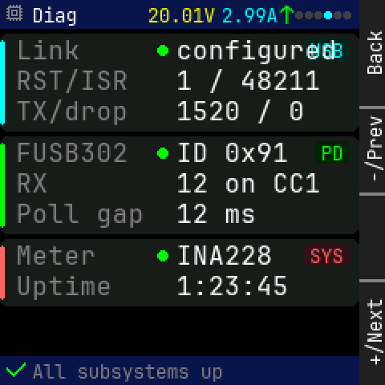

Panel: Back / -/Prev / (empty) / +/Next

```
    0123456789012345678901234567|
  0 * Diag     20.01V2.99^      |
 12                             |
 24  Link        configured USB |
 36                             |
 48  RST/ISR     1 / 48211      |
 60  TX/drop     1520 / 0       |
 72                             |
 84  FUSB302     ID 0x91     PD |
 96                             |
108  RX          12 on CC1      |
120                             |
132  Poll gap    12 ms          |
144                             |
156  Meter       INA228     SYS |
168  Uptime      1:23:45        |
180                             |
192                             |
204                             |
216                             |
228 * All subsystems up         |
```

<details><summary>Element table</summary>

| element | kind | x | y | w | h | font / radius | token |
|---|---|---|---|---|---|---|---|
| status bar | rect | 0 | 0 | 224 | 18 | r0 | `bar` |
| icon chip | icon | 4 | 3 | 12 | 12 | - | `dim` |
| title | text | 20 | 3 | 28 | 13 | 12px | `text` |
| mini V | text | 92 | 3 | 42 | 13 | 12px | `volt` |
| mini A | text | 138 | 3 | 35 | 13 | 12px | `amp` |
| mini flow | text | 174 | 1 | 10 | 17 | 16px | `flow` |
| page dot | rect | 184 | 7 | 5 | 5 | r1 | `faint` |
| page dot | rect | 190 | 7 | 5 | 5 | r1 | `faint` |
| page dot | rect | 196 | 7 | 5 | 5 | r1 | `faint` |
| page dot | rect | 202 | 7 | 5 | 5 | r1 | `focus` |
| page dot | rect | 208 | 7 | 5 | 5 | r1 | `faint` |
| page dot | rect | 214 | 7 | 5 | 5 | r1 | `faint` |
| USB | rect | 0 | 21 | 224 | 61 | r5 | `surface` |
| USB accent | rect | 0 | 25 | 3 | 53 | r1 | `amp` |
| pill | rect | 189 | 24 | 29 | 14 | r3 | `amp_t` |
| pill text | text | 193 | 25 | 21 | 13 | 12px | `amp` |
| 'Link' | text | 10 | 23 | 40 | 17 | 16px | `dim` |
| ok dot | rect | 98 | 28 | 7 | 7 | r3 | `ok` |
| 'configured' | text | 110 | 23 | 100 | 17 | 16px | `text` |
| 'RST/ISR' | text | 10 | 42 | 70 | 17 | 16px | `dim` |
| '1 / 48211' | text | 110 | 42 | 90 | 17 | 16px | `text` |
| 'TX/drop' | text | 10 | 61 | 70 | 17 | 16px | `dim` |
| '1520 / 0' | text | 110 | 61 | 80 | 17 | 16px | `text` |
| PD | rect | 0 | 85 | 224 | 61 | r5 | `surface` |
| PD accent | rect | 0 | 89 | 3 | 53 | r1 | `energy` |
| pill | rect | 196 | 88 | 22 | 14 | r3 | `energy_t` |
| pill text | text | 200 | 89 | 14 | 13 | 12px | `energy` |
| 'FUSB302' | text | 10 | 87 | 70 | 17 | 16px | `dim` |
| ok dot | rect | 98 | 92 | 7 | 7 | r3 | `ok` |
| 'ID 0x91' | text | 110 | 87 | 70 | 17 | 16px | `text` |
| 'RX' | text | 10 | 106 | 20 | 17 | 16px | `dim` |
| '12 on CC1' | text | 110 | 106 | 90 | 17 | 16px | `text` |
| 'Poll gap' | text | 10 | 125 | 80 | 17 | 16px | `dim` |
| '12 ms' | text | 110 | 125 | 50 | 17 | 16px | `text` |
| SYS | rect | 0 | 149 | 224 | 42 | r5 | `surface` |
| SYS accent | rect | 0 | 153 | 3 | 34 | r1 | `watt` |
| pill | rect | 189 | 152 | 29 | 14 | r3 | `watt_t` |
| pill text | text | 193 | 153 | 21 | 13 | 12px | `watt` |
| 'Meter' | text | 10 | 151 | 50 | 17 | 16px | `dim` |
| ok dot | rect | 98 | 156 | 7 | 7 | r3 | `ok` |
| 'INA228' | text | 110 | 151 | 60 | 17 | 16px | `text` |
| 'Uptime' | text | 10 | 170 | 60 | 17 | 16px | `dim` |
| '1:23:45' | text | 110 | 170 | 70 | 17 | 16px | `text` |
| footer | rect | 0 | 222 | 224 | 18 | r0 | `bar` |
| icon check | icon | 4 | 225 | 12 | 12 | - | `ok` |
| footer text | text | 20 | 225 | 119 | 13 | 12px | `dim` |

</details>

## lines

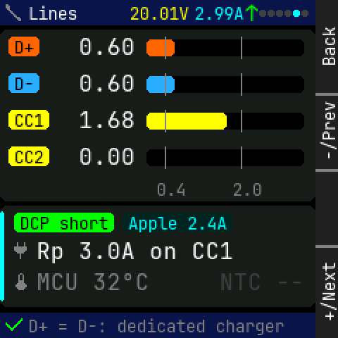

Panel: Back / -/Prev / (empty) / +/Next

```
    0123456789012345678901234567|
  0 * Lines    20.01V2.99^      |
 12 ............................|
 24  D+    0.60                 |
 36                             |
 48  D-    0.60                 |
 60                             |
 72                             |
 84  CC1   1.68                 |
 96                             |
108  CC2   0.00                 |
120                             |
132 .............0.4....2.0.....|
144 ............................|
156  DCP short Apple 2.4A       |
168  * Rp 3.0A on CC1           |
180                             |
192  * MCU 32oC        NTC --   |
204                             |
216 ............................|
228 * D+ = D-: dedicated charger|
```

<details><summary>Element table</summary>

| element | kind | x | y | w | h | font / radius | token |
|---|---|---|---|---|---|---|---|
| status bar | rect | 0 | 0 | 224 | 18 | r0 | `bar` |
| icon cable | icon | 4 | 3 | 12 | 12 | - | `dim` |
| title | text | 20 | 3 | 35 | 13 | 12px | `text` |
| mini V | text | 92 | 3 | 42 | 13 | 12px | `volt` |
| mini A | text | 138 | 3 | 35 | 13 | 12px | `amp` |
| mini flow | text | 174 | 1 | 10 | 17 | 16px | `flow` |
| page dot | rect | 184 | 7 | 5 | 5 | r1 | `faint` |
| page dot | rect | 190 | 7 | 5 | 5 | r1 | `faint` |
| page dot | rect | 196 | 7 | 5 | 5 | r1 | `faint` |
| page dot | rect | 202 | 7 | 5 | 5 | r1 | `faint` |
| page dot | rect | 208 | 7 | 5 | 5 | r1 | `focus` |
| page dot | rect | 214 | 7 | 5 | 5 | r1 | `faint` |
| lines card | rect | 0 | 21 | 224 | 122 | r5 | `surface` |
| pill | rect | 6 | 26 | 22 | 14 | r3 | `dplus` |
| pill text | text | 10 | 27 | 14 | 13 | 12px | `bg` |
| '0.60' | text | 56 | 25 | 40 | 17 | 16px | `text` |
| track | rect | 104 | 28 | 112 | 12 | r3 | `bg` |
| fill | rect | 104 | 28 | 20 | 12 | r3 | `dplus` |
| threshold | rect | 117 | 26 | 1 | 16 | r0 | `dim` |
| threshold | rect | 171 | 26 | 1 | 16 | r0 | `dim` |
| pill | rect | 6 | 52 | 22 | 14 | r3 | `dminus` |
| pill text | text | 10 | 53 | 14 | 13 | 12px | `bg` |
| '0.60' | text | 56 | 51 | 40 | 17 | 16px | `text` |
| track | rect | 104 | 54 | 112 | 12 | r3 | `bg` |
| fill | rect | 104 | 54 | 20 | 12 | r3 | `dminus` |
| threshold | rect | 117 | 52 | 1 | 16 | r0 | `dim` |
| threshold | rect | 171 | 52 | 1 | 16 | r0 | `dim` |
| pill | rect | 6 | 78 | 29 | 14 | r3 | `volt` |
| pill text | text | 10 | 79 | 21 | 13 | 12px | `bg` |
| '1.68' | text | 56 | 77 | 40 | 17 | 16px | `text` |
| track | rect | 104 | 80 | 112 | 12 | r3 | `bg` |
| fill | rect | 104 | 80 | 57 | 12 | r3 | `volt` |
| threshold | rect | 117 | 78 | 1 | 16 | r0 | `dim` |
| threshold | rect | 171 | 78 | 1 | 16 | r0 | `dim` |
| pill | rect | 6 | 104 | 29 | 14 | r3 | `volt` |
| pill text | text | 10 | 105 | 21 | 13 | 12px | `bg` |
| '0.00' | text | 56 | 103 | 40 | 17 | 16px | `text` |
| track | rect | 104 | 106 | 112 | 12 | r3 | `bg` |
| threshold | rect | 117 | 104 | 1 | 16 | r0 | `dim` |
| threshold | rect | 171 | 104 | 1 | 16 | r0 | `dim` |
| '0.4' | text | 111 | 128 | 21 | 13 | 12px | `dim` |
| '2.0' | text | 165 | 128 | 21 | 13 | 12px | `dim` |
| verdict card | rect | 0 | 146 | 224 | 72 | r5 | `surface` |
| verdict card accent | rect | 0 | 150 | 3 | 64 | r1 | `amp` |
| pill | rect | 10 | 151 | 71 | 14 | r3 | `ok` |
| pill text | text | 14 | 152 | 63 | 13 | 12px | `bg` |
| pill | rect | 87 | 151 | 78 | 14 | r3 | `amp_t` |
| pill text | text | 91 | 152 | 70 | 13 | 12px | `amp` |
| icon plug | icon | 10 | 172 | 12 | 12 | - | `dim` |
| 'Rp 3.0A on CC1' | text | 26 | 170 | 140 | 17 | 16px | `text` |
| icon therm | icon | 10 | 194 | 12 | 12 | - | `dim` |
| 'MCU 32°C' | text | 26 | 192 | 80 | 17 | 16px | `dim` |
| 'NTC --' | text | 156 | 192 | 60 | 17 | 16px | `faint` |
| footer | rect | 0 | 222 | 224 | 18 | r0 | `bar` |
| icon check | icon | 4 | 225 | 12 | 12 | - | `ok` |
| footer text | text | 20 | 225 | 182 | 13 | 12px | `dim` |

</details>

## tools_ready

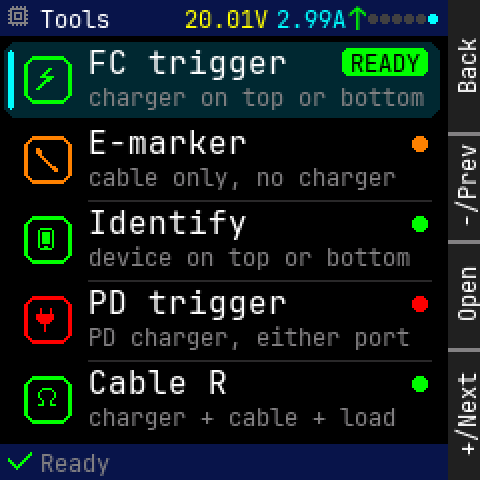

Panel: Back / -/Prev / Open / +/Next

```
    0123456789012345678901234567|
  0 * Tools    20.01V2.99^      |
 12                             |
 24      FC trigger      READY  |
 36   *                         |
 48      charger on top or botto|
 60      E-marker               |
 72   *                         |
 84      cable only, no charger |
 96                             |
108      Identify               |
120   *  device on top or bottom|
132                             |
144      PD trigger             |
156   *                         |
168      PD charger, either port|
180      Cable R                |
192   *                         |
204      charger + cable + load |
216                             |
228 * Ready                     |
```

<details><summary>Element table</summary>

| element | kind | x | y | w | h | font / radius | token |
|---|---|---|---|---|---|---|---|
| status bar | rect | 0 | 0 | 224 | 18 | r0 | `bar` |
| icon chip | icon | 4 | 3 | 12 | 12 | - | `dim` |
| title | text | 20 | 3 | 35 | 13 | 12px | `text` |
| mini V | text | 92 | 3 | 42 | 13 | 12px | `volt` |
| mini A | text | 138 | 3 | 35 | 13 | 12px | `amp` |
| mini flow | text | 174 | 1 | 10 | 17 | 16px | `flow` |
| page dot | rect | 184 | 7 | 5 | 5 | r1 | `faint` |
| page dot | rect | 190 | 7 | 5 | 5 | r1 | `faint` |
| page dot | rect | 196 | 7 | 5 | 5 | r1 | `faint` |
| page dot | rect | 202 | 7 | 5 | 5 | r1 | `faint` |
| page dot | rect | 208 | 7 | 5 | 5 | r1 | `faint` |
| page dot | rect | 214 | 7 | 5 | 5 | r1 | `focus` |
| selected row | rect | 2 | 21 | 218 | 38 | r6 | `focus_t` |
| focus bar | rect | 4 | 25 | 3 | 30 | r1 | `focus` |
| icon badge | frame | 12 | 28 | 24 | 24 | r6 | `ok` |
| icon bolt | icon | 18 | 34 | 12 | 12 | - | `ok` |
| 'FC trigger' | text | 44 | 23 | 100 | 17 | 16px | `text` |
| hint | text | 44 | 42 | 168 | 13 | 12px | `dim` |
| tag | rect | 171 | 24 | 43 | 14 | r3 | `ok` |
| tag text | text | 175 | 25 | 35 | 13 | 12px | `bg` |
| icon badge | frame | 12 | 68 | 24 | 24 | r6 | `caution` |
| icon cable | icon | 18 | 74 | 12 | 12 | - | `caution` |
| 'E-marker' | text | 44 | 63 | 80 | 17 | 16px | `text` |
| hint | text | 44 | 82 | 154 | 13 | 12px | `dim` |
| divider | rect | 44 | 100 | 172 | 1 | r0 | `rule` |
| state dot | rect | 206 | 68 | 8 | 8 | r4 | `caution` |
| icon badge | frame | 12 | 108 | 24 | 24 | r6 | `ok` |
| icon phone | icon | 18 | 114 | 12 | 12 | - | `ok` |
| 'Identify' | text | 44 | 103 | 80 | 17 | 16px | `text` |
| hint | text | 44 | 122 | 161 | 13 | 12px | `dim` |
| divider | rect | 44 | 140 | 172 | 1 | r0 | `rule` |
| state dot | rect | 206 | 108 | 8 | 8 | r4 | `ok` |
| icon badge | frame | 12 | 148 | 24 | 24 | r6 | `error` |
| icon plug | icon | 18 | 154 | 12 | 12 | - | `error` |
| 'PD trigger' | text | 44 | 143 | 100 | 17 | 16px | `text` |
| hint | text | 44 | 162 | 161 | 13 | 12px | `dim` |
| divider | rect | 44 | 180 | 172 | 1 | r0 | `rule` |
| state dot | rect | 206 | 148 | 8 | 8 | r4 | `error` |
| icon badge | frame | 12 | 188 | 24 | 24 | r6 | `ok` |
| icon ohm | icon | 18 | 194 | 12 | 12 | - | `ok` |
| 'Cable R' | text | 44 | 183 | 70 | 17 | 16px | `text` |
| hint | text | 44 | 202 | 154 | 13 | 12px | `dim` |
| state dot | rect | 206 | 188 | 8 | 8 | r4 | `ok` |
| footer | rect | 0 | 222 | 224 | 18 | r0 | `bar` |
| icon check | icon | 4 | 225 | 12 | 12 | - | `ok` |
| footer text | text | 20 | 225 | 35 | 13 | 12px | `dim` |

</details>

## tools_caution

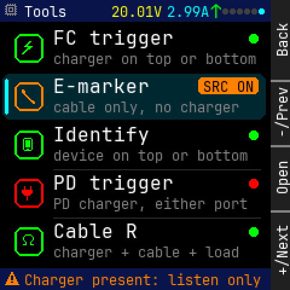

Panel: Back / -/Prev / Open / +/Next

```
    0123456789012345678901234567|
  0 * Tools    20.01V2.99^      |
 12                             |
 24      FC trigger             |
 36   *                         |
 48      charger on top or botto|
 60      E-marker        SRC ON |
 72   *                         |
 84      cable only, no charger |
 96                             |
108      Identify               |
120   *  device on top or bottom|
132                             |
144      PD trigger             |
156   *                         |
168      PD charger, either port|
180      Cable R                |
192   *                         |
204      charger + cable + load |
216                             |
228 * Charger present: listen on|
```

<details><summary>Element table</summary>

| element | kind | x | y | w | h | font / radius | token |
|---|---|---|---|---|---|---|---|
| status bar | rect | 0 | 0 | 224 | 18 | r0 | `bar` |
| icon chip | icon | 4 | 3 | 12 | 12 | - | `dim` |
| title | text | 20 | 3 | 35 | 13 | 12px | `text` |
| mini V | text | 92 | 3 | 42 | 13 | 12px | `volt` |
| mini A | text | 138 | 3 | 35 | 13 | 12px | `amp` |
| mini flow | text | 174 | 1 | 10 | 17 | 16px | `flow` |
| page dot | rect | 184 | 7 | 5 | 5 | r1 | `faint` |
| page dot | rect | 190 | 7 | 5 | 5 | r1 | `faint` |
| page dot | rect | 196 | 7 | 5 | 5 | r1 | `faint` |
| page dot | rect | 202 | 7 | 5 | 5 | r1 | `faint` |
| page dot | rect | 208 | 7 | 5 | 5 | r1 | `faint` |
| page dot | rect | 214 | 7 | 5 | 5 | r1 | `focus` |
| icon badge | frame | 12 | 28 | 24 | 24 | r6 | `ok` |
| icon bolt | icon | 18 | 34 | 12 | 12 | - | `ok` |
| 'FC trigger' | text | 44 | 23 | 100 | 17 | 16px | `text` |
| hint | text | 44 | 42 | 168 | 13 | 12px | `dim` |
| state dot | rect | 206 | 28 | 8 | 8 | r4 | `ok` |
| selected row | rect | 2 | 61 | 218 | 38 | r6 | `focus_t` |
| focus bar | rect | 4 | 65 | 3 | 30 | r1 | `focus` |
| icon badge | frame | 12 | 68 | 24 | 24 | r6 | `caution` |
| icon cable | icon | 18 | 74 | 12 | 12 | - | `caution` |
| 'E-marker' | text | 44 | 63 | 80 | 17 | 16px | `text` |
| hint | text | 44 | 82 | 154 | 13 | 12px | `dim` |
| tag | rect | 164 | 64 | 50 | 14 | r3 | `caution` |
| tag text | text | 168 | 65 | 42 | 13 | 12px | `bg` |
| icon badge | frame | 12 | 108 | 24 | 24 | r6 | `ok` |
| icon phone | icon | 18 | 114 | 12 | 12 | - | `ok` |
| 'Identify' | text | 44 | 103 | 80 | 17 | 16px | `text` |
| hint | text | 44 | 122 | 161 | 13 | 12px | `dim` |
| divider | rect | 44 | 140 | 172 | 1 | r0 | `rule` |
| state dot | rect | 206 | 108 | 8 | 8 | r4 | `ok` |
| icon badge | frame | 12 | 148 | 24 | 24 | r6 | `error` |
| icon plug | icon | 18 | 154 | 12 | 12 | - | `error` |
| 'PD trigger' | text | 44 | 143 | 100 | 17 | 16px | `text` |
| hint | text | 44 | 162 | 161 | 13 | 12px | `dim` |
| divider | rect | 44 | 180 | 172 | 1 | r0 | `rule` |
| state dot | rect | 206 | 148 | 8 | 8 | r4 | `error` |
| icon badge | frame | 12 | 188 | 24 | 24 | r6 | `ok` |
| icon ohm | icon | 18 | 194 | 12 | 12 | - | `ok` |
| 'Cable R' | text | 44 | 183 | 70 | 17 | 16px | `text` |
| hint | text | 44 | 202 | 154 | 13 | 12px | `dim` |
| state dot | rect | 206 | 188 | 8 | 8 | r4 | `ok` |
| footer | rect | 0 | 222 | 224 | 18 | r0 | `bar` |
| icon warn | icon | 4 | 225 | 12 | 12 | - | `caution` |
| footer text | text | 20 | 225 | 196 | 13 | 12px | `caution` |

</details>

## tools_blocked

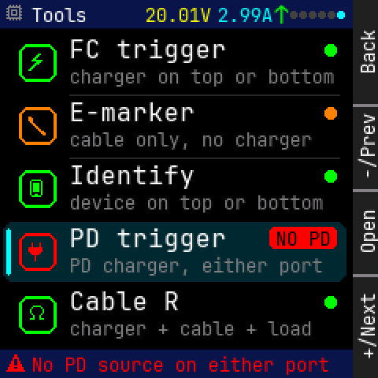

Panel: Back / -/Prev / Open / +/Next

```
    0123456789012345678901234567|
  0 * Tools    20.01V2.99^      |
 12                             |
 24      FC trigger             |
 36   *                         |
 48      charger on top or botto|
 60      E-marker               |
 72   *                         |
 84      cable only, no charger |
 96                             |
108      Identify               |
120   *  device on top or bottom|
132                             |
144      PD trigger      NO PD  |
156   *                         |
168      PD charger, either port|
180      Cable R                |
192   *                         |
204      charger + cable + load |
216                             |
228 * No PD source on either por|
```

<details><summary>Element table</summary>

| element | kind | x | y | w | h | font / radius | token |
|---|---|---|---|---|---|---|---|
| status bar | rect | 0 | 0 | 224 | 18 | r0 | `bar` |
| icon chip | icon | 4 | 3 | 12 | 12 | - | `dim` |
| title | text | 20 | 3 | 35 | 13 | 12px | `text` |
| mini V | text | 92 | 3 | 42 | 13 | 12px | `volt` |
| mini A | text | 138 | 3 | 35 | 13 | 12px | `amp` |
| mini flow | text | 174 | 1 | 10 | 17 | 16px | `flow` |
| page dot | rect | 184 | 7 | 5 | 5 | r1 | `faint` |
| page dot | rect | 190 | 7 | 5 | 5 | r1 | `faint` |
| page dot | rect | 196 | 7 | 5 | 5 | r1 | `faint` |
| page dot | rect | 202 | 7 | 5 | 5 | r1 | `faint` |
| page dot | rect | 208 | 7 | 5 | 5 | r1 | `faint` |
| page dot | rect | 214 | 7 | 5 | 5 | r1 | `focus` |
| icon badge | frame | 12 | 28 | 24 | 24 | r6 | `ok` |
| icon bolt | icon | 18 | 34 | 12 | 12 | - | `ok` |
| 'FC trigger' | text | 44 | 23 | 100 | 17 | 16px | `text` |
| hint | text | 44 | 42 | 168 | 13 | 12px | `dim` |
| divider | rect | 44 | 60 | 172 | 1 | r0 | `rule` |
| state dot | rect | 206 | 28 | 8 | 8 | r4 | `ok` |
| icon badge | frame | 12 | 68 | 24 | 24 | r6 | `caution` |
| icon cable | icon | 18 | 74 | 12 | 12 | - | `caution` |
| 'E-marker' | text | 44 | 63 | 80 | 17 | 16px | `text` |
| hint | text | 44 | 82 | 154 | 13 | 12px | `dim` |
| divider | rect | 44 | 100 | 172 | 1 | r0 | `rule` |
| state dot | rect | 206 | 68 | 8 | 8 | r4 | `caution` |
| icon badge | frame | 12 | 108 | 24 | 24 | r6 | `ok` |
| icon phone | icon | 18 | 114 | 12 | 12 | - | `ok` |
| 'Identify' | text | 44 | 103 | 80 | 17 | 16px | `text` |
| hint | text | 44 | 122 | 161 | 13 | 12px | `dim` |
| state dot | rect | 206 | 108 | 8 | 8 | r4 | `ok` |
| selected row | rect | 2 | 141 | 218 | 38 | r6 | `focus_t` |
| focus bar | rect | 4 | 145 | 3 | 30 | r1 | `focus` |
| icon badge | frame | 12 | 148 | 24 | 24 | r6 | `error` |
| icon plug | icon | 18 | 154 | 12 | 12 | - | `error` |
| 'PD trigger' | text | 44 | 143 | 100 | 17 | 16px | `text` |
| hint | text | 44 | 162 | 161 | 13 | 12px | `dim` |
| tag | rect | 171 | 144 | 43 | 14 | r3 | `error` |
| tag text | text | 175 | 145 | 35 | 13 | 12px | `bg` |
| icon badge | frame | 12 | 188 | 24 | 24 | r6 | `ok` |
| icon ohm | icon | 18 | 194 | 12 | 12 | - | `ok` |
| 'Cable R' | text | 44 | 183 | 70 | 17 | 16px | `text` |
| hint | text | 44 | 202 | 154 | 13 | 12px | `dim` |
| state dot | rect | 206 | 188 | 8 | 8 | r4 | `ok` |
| footer | rect | 0 | 222 | 224 | 18 | r0 | `bar` |
| icon warn | icon | 4 | 225 | 12 | 12 | - | `error` |
| footer text | text | 20 | 225 | 189 | 13 | 12px | `error` |

</details>

## emarker_setup

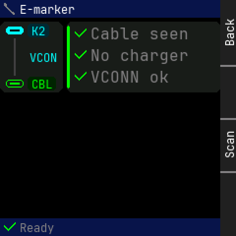

Panel: Back / (empty) / Scan / (empty)

```
    0123456789012345678901234567|
  0 * E-marker                  |
 12 ........                    |
 24     K2   * Cable seen       |
 36                             |
 48    VCON  * No charger       |
 60                             |
 72          * VCONN ok         |
 84 ....CBL.                    |
 96                             |
108                             |
120                             |
132                             |
144                             |
156                             |
168                             |
180                             |
192                             |
204                             |
216                             |
228 * Ready                     |
```

<details><summary>Element table</summary>

| element | kind | x | y | w | h | font / radius | token |
|---|---|---|---|---|---|---|---|
| status bar | rect | 0 | 0 | 224 | 18 | r0 | `bar` |
| icon cable | icon | 4 | 3 | 12 | 12 | - | `dim` |
| title | text | 20 | 3 | 56 | 13 | 12px | `text` |
| flow diagram | rect | 0 | 22 | 64 | 72 | r6 | `surface` |
| top port (male) | rect | 6 | 27 | 18 | 8 | r3 | `focus` |
| top port (male) slot | rect | 10 | 30 | 10 | 2 | r0 | `bg` |
| bottom port (female) | frame | 6 | 81 | 18 | 8 | r3 | `ok` |
| bottom port (female) tongue | rect | 10 | 84 | 10 | 2 | r0 | `ok` |
| top role | rect | 28 | 24 | 22 | 14 | r3 | `focus_t` |
| top role text | text | 32 | 25 | 14 | 13 | 12px | `focus` |
| bottom role | rect | 28 | 78 | 29 | 14 | r3 | `ok_t` |
| bottom role text | text | 32 | 79 | 21 | 13 | 12px | `ok` |
| no-flow line | rect | 14 | 39 | 2 | 38 | r0 | `faint` |
| diagram caption | text | 30 | 52 | 28 | 13 | 12px | `focus` |
| checklist | rect | 68 | 22 | 156 | 72 | r5 | `surface` |
| checklist accent | rect | 68 | 26 | 3 | 64 | r1 | `ok` |
| icon check | icon | 76 | 28 | 12 | 12 | - | `ok` |
| check text | text | 92 | 26 | 100 | 17 | 16px | `dim` |
| icon check | icon | 76 | 50 | 12 | 12 | - | `ok` |
| check text | text | 92 | 48 | 100 | 17 | 16px | `dim` |
| icon check | icon | 76 | 72 | 12 | 12 | - | `ok` |
| check text | text | 92 | 70 | 80 | 17 | 16px | `dim` |
| footer | rect | 0 | 222 | 224 | 18 | r0 | `bar` |
| icon check | icon | 4 | 225 | 12 | 12 | - | `ok` |
| footer text | text | 20 | 225 | 35 | 13 | 12px | `dim` |

</details>

## emarker_sniff

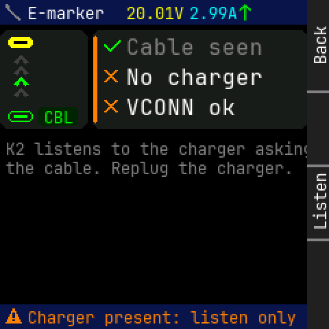

Panel: Back / (empty) / Listen / (empty)

```
    0123456789012345678901234567|
  0 * E-marker 20.01V2.99^      |
 12 ........                    |
 24          * Cable seen       |
 36  ^                          |
 48  ^       * No charger       |
 60  ^                          |
 72          * VCONN ok         |
 84 ....CBL.                    |
 96                             |
108 K2 listens to the charger as|
120 the cable. Replug the charge|
132                             |
144                             |
156                             |
168                             |
180                             |
192                             |
204                             |
216                             |
228 * Charger present: listen on|
```

<details><summary>Element table</summary>

| element | kind | x | y | w | h | font / radius | token |
|---|---|---|---|---|---|---|---|
| status bar | rect | 0 | 0 | 224 | 18 | r0 | `bar` |
| icon cable | icon | 4 | 3 | 12 | 12 | - | `dim` |
| title | text | 20 | 3 | 56 | 13 | 12px | `text` |
| mini V | text | 92 | 3 | 42 | 13 | 12px | `volt` |
| mini A | text | 138 | 3 | 35 | 13 | 12px | `amp` |
| mini flow | text | 174 | 1 | 10 | 17 | 16px | `flow` |
| flow diagram | rect | 0 | 22 | 64 | 72 | r6 | `surface` |
| top port (male) | rect | 6 | 27 | 18 | 8 | r3 | `volt` |
| top port (male) slot | rect | 10 | 30 | 10 | 2 | r0 | `bg` |
| bottom port (female) | frame | 6 | 81 | 18 | 8 | r3 | `ok` |
| bottom port (female) tongue | rect | 10 | 84 | 10 | 2 | r0 | `ok` |
| bottom role | rect | 28 | 78 | 29 | 14 | r3 | `ok_t` |
| bottom role text | text | 32 | 79 | 21 | 13 | 12px | `ok` |
| checklist | rect | 68 | 22 | 156 | 72 | r5 | `surface` |
| checklist accent | rect | 68 | 26 | 3 | 64 | r1 | `caution` |
| icon check | icon | 76 | 28 | 12 | 12 | - | `ok` |
| check text | text | 92 | 26 | 100 | 17 | 16px | `dim` |
| icon cross | icon | 76 | 50 | 12 | 12 | - | `caution` |
| check text | text | 92 | 48 | 100 | 17 | 16px | `text` |
| icon cross | icon | 76 | 72 | 12 | 12 | - | `caution` |
| check text | text | 92 | 70 | 80 | 17 | 16px | `text` |
| 'K2 listens to the charger asking' | text | 4 | 102 | 224 | 13 | 12px | `dim` |
| 'the cable. Replug the charger.' | text | 4 | 116 | 210 | 13 | 12px | `dim` |
| footer | rect | 0 | 222 | 224 | 18 | r0 | `bar` |
| icon warn | icon | 4 | 225 | 12 | 12 | - | `caution` |
| footer text | text | 20 | 225 | 196 | 13 | 12px | `caution` |

</details>

## emarker_scan

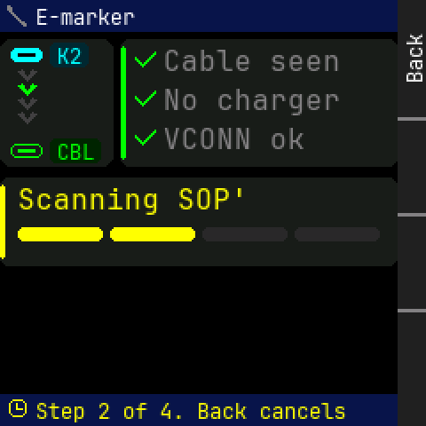

Panel: Back / (empty) / (empty) / (empty)

```
    0123456789012345678901234567|
  0 * E-marker                  |
 12 ........                    |
 24     K2   * Cable seen       |
 36  v                          |
 48  v       * No charger       |
 60  v                          |
 72          * VCONN ok         |
 84 ....CBL.                    |
 96 ............................|
108  Scanning SOP'              |
120                             |
132                             |
144 ............................|
156                             |
168                             |
180                             |
192                             |
204                             |
216                             |
228 * Step 2 of 4. Back cancels |
```

<details><summary>Element table</summary>

| element | kind | x | y | w | h | font / radius | token |
|---|---|---|---|---|---|---|---|
| status bar | rect | 0 | 0 | 224 | 18 | r0 | `bar` |
| icon cable | icon | 4 | 3 | 12 | 12 | - | `dim` |
| title | text | 20 | 3 | 56 | 13 | 12px | `text` |
| flow diagram | rect | 0 | 22 | 64 | 72 | r6 | `surface` |
| top port (male) | rect | 6 | 27 | 18 | 8 | r3 | `focus` |
| top port (male) slot | rect | 10 | 30 | 10 | 2 | r0 | `bg` |
| bottom port (female) | frame | 6 | 81 | 18 | 8 | r3 | `ok` |
| bottom port (female) tongue | rect | 10 | 84 | 10 | 2 | r0 | `ok` |
| top role | rect | 28 | 24 | 22 | 14 | r3 | `focus_t` |
| top role text | text | 32 | 25 | 14 | 13 | 12px | `focus` |
| bottom role | rect | 28 | 78 | 29 | 14 | r3 | `ok_t` |
| bottom role text | text | 32 | 79 | 21 | 13 | 12px | `ok` |
| checklist | rect | 68 | 22 | 156 | 72 | r5 | `surface` |
| checklist accent | rect | 68 | 26 | 3 | 64 | r1 | `ok` |
| icon check | icon | 76 | 28 | 12 | 12 | - | `ok` |
| check text | text | 92 | 26 | 100 | 17 | 16px | `dim` |
| icon check | icon | 76 | 50 | 12 | 12 | - | `ok` |
| check text | text | 92 | 48 | 100 | 17 | 16px | `dim` |
| icon check | icon | 76 | 72 | 12 | 12 | - | `ok` |
| check text | text | 92 | 70 | 80 | 17 | 16px | `dim` |
| progress card | rect | 0 | 100 | 224 | 50 | r5 | `surface` |
| progress card accent | rect | 0 | 104 | 3 | 42 | r1 | `volt` |
| "Scanning SOP'" | text | 10 | 104 | 130 | 17 | 16px | `volt` |
| step seg | rect | 10 | 128 | 48 | 8 | r3 | `volt` |
| step seg | rect | 62 | 128 | 48 | 8 | r3 | `volt` |
| step seg | rect | 114 | 128 | 48 | 8 | r3 | `rule` |
| step seg | rect | 166 | 128 | 48 | 8 | r3 | `rule` |
| footer | rect | 0 | 222 | 224 | 18 | r0 | `bar` |
| icon clock | icon | 4 | 225 | 12 | 12 | - | `volt` |
| footer text | text | 20 | 225 | 175 | 13 | 12px | `volt` |

</details>

## emarker_result

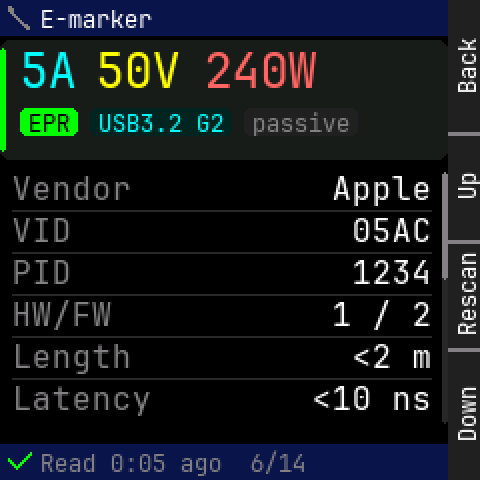

Panel: Back / Up / Rescan / Down

```
    0123456789012345678901234567|
  0 * E-marker                  |
 12 ............................|
 24  5 A  5 0 V 2 4 0 W         |
 36                             |
 48                             |
 60  EPR  USB3.2 G2passive      |
 72 ............................|
 84 Vendor              Apple   |
 96                             |
108 VID                   05AC  |
120                             |
132 PID                   1234  |
144                             |
156 HW/FW               1 / 2   |
168 Length                <2 m  |
180                             |
192 Latency            <10 ns   |
204                             |
216                             |
228 * Read 0:05 ago  6/14       |
```

<details><summary>Element table</summary>

| element | kind | x | y | w | h | font / radius | token |
|---|---|---|---|---|---|---|---|
| status bar | rect | 0 | 0 | 224 | 18 | r0 | `bar` |
| icon cable | icon | 4 | 3 | 12 | 12 | - | `dim` |
| title | text | 20 | 3 | 56 | 13 | 12px | `text` |
| verdict card | rect | 0 | 20 | 224 | 60 | r5 | `surface` |
| verdict card accent | rect | 0 | 24 | 3 | 52 | r1 | `energy` |
| '5A' | text | 10 | 22 | 28 | 26 | 24px | `amp` |
| '50V' | text | 48 | 22 | 42 | 26 | 24px | `volt` |
| '240W' | text | 102 | 22 | 56 | 26 | 24px | `watt` |
| pill | rect | 10 | 54 | 29 | 14 | r3 | `energy` |
| pill text | text | 14 | 55 | 21 | 13 | 12px | `bg` |
| pill | rect | 45 | 54 | 71 | 14 | r3 | `amp_t` |
| pill text | text | 49 | 55 | 63 | 13 | 12px | `amp` |
| pill | rect | 122 | 54 | 57 | 14 | r3 | `dim_t` |
| pill text | text | 126 | 55 | 49 | 13 | 12px | `dim` |
| 'Vendor' | text | 6 | 86 | 60 | 17 | 16px | `dim` |
| 'Apple' | text | 166 | 86 | 50 | 17 | 16px | `text` |
| 'VID' | text | 6 | 107 | 30 | 17 | 16px | `dim` |
| '05AC' | text | 176 | 107 | 40 | 17 | 16px | `text` |
| 'PID' | text | 6 | 128 | 30 | 17 | 16px | `dim` |
| '1234' | text | 176 | 128 | 40 | 17 | 16px | `text` |
| 'HW/FW' | text | 6 | 149 | 50 | 17 | 16px | `dim` |
| '1 / 2' | text | 166 | 149 | 50 | 17 | 16px | `text` |
| 'Length' | text | 6 | 170 | 60 | 17 | 16px | `dim` |
| '<2 m' | text | 176 | 170 | 40 | 17 | 16px | `text` |
| 'Latency' | text | 6 | 191 | 70 | 17 | 16px | `dim` |
| '<10 ns' | text | 156 | 191 | 60 | 17 | 16px | `text` |
| scroll track | rect | 221 | 86 | 3 | 126 | r1 | `rule` |
| scroll thumb | rect | 221 | 86 | 3 | 54 | r1 | `dim` |
| footer | rect | 0 | 222 | 224 | 18 | r0 | `bar` |
| icon check | icon | 4 | 225 | 12 | 12 | - | `ok` |
| footer text | text | 20 | 225 | 133 | 13 | 12px | `dim` |

</details>

## emarker_none

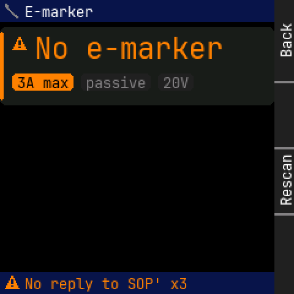

Panel: Back / (empty) / Rescan / (empty)

```
    0123456789012345678901234567|
  0 * E-marker                  |
 12 ............................|
 24                             |
 36  * N o   e - m a r k e r    |
 48                             |
 60  3A max passive 20V         |
 72                             |
 84 ............................|
 96                             |
108                             |
120                             |
132                             |
144                             |
156                             |
168                             |
180                             |
192                             |
204                             |
216                             |
228 * No reply to SOP' x3       |
```

<details><summary>Element table</summary>

| element | kind | x | y | w | h | font / radius | token |
|---|---|---|---|---|---|---|---|
| status bar | rect | 0 | 0 | 224 | 18 | r0 | `bar` |
| icon cable | icon | 4 | 3 | 12 | 12 | - | `dim` |
| title | text | 20 | 3 | 56 | 13 | 12px | `text` |
| verdict card | rect | 0 | 22 | 224 | 64 | r5 | `surface` |
| verdict card accent | rect | 0 | 26 | 3 | 56 | r1 | `caution` |
| icon warn | icon | 10 | 30 | 12 | 12 | - | `caution` |
| 'No e-marker' | text | 28 | 26 | 154 | 26 | 24px | `caution` |
| pill | rect | 10 | 60 | 50 | 14 | r3 | `caution` |
| pill text | text | 14 | 61 | 42 | 13 | 12px | `bg` |
| pill | rect | 66 | 60 | 57 | 14 | r3 | `dim_t` |
| pill text | text | 70 | 61 | 49 | 13 | 12px | `dim` |
| pill | rect | 129 | 60 | 29 | 14 | r3 | `dim_t` |
| pill text | text | 133 | 61 | 21 | 13 | 12px | `dim` |
| footer | rect | 0 | 222 | 224 | 18 | r0 | `bar` |
| icon warn | icon | 4 | 225 | 12 | 12 | - | `caution` |
| footer text | text | 20 | 225 | 133 | 13 | 12px | `caution` |

</details>

## identify_setup

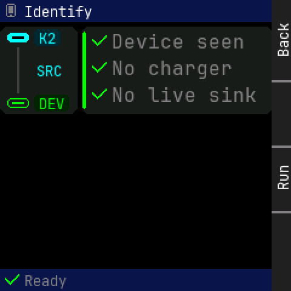

Panel: Back / (empty) / Run / (empty)

```
    0123456789012345678901234567|
  0 * Identify                  |
 12 ........                    |
 24     K2   * Device seen      |
 36                             |
 48    SRC   * No charger       |
 60                             |
 72          * No live sink     |
 84 ....DEV.                    |
 96                             |
108                             |
120                             |
132                             |
144                             |
156                             |
168                             |
180                             |
192                             |
204                             |
216                             |
228 * Ready                     |
```

<details><summary>Element table</summary>

| element | kind | x | y | w | h | font / radius | token |
|---|---|---|---|---|---|---|---|
| status bar | rect | 0 | 0 | 224 | 18 | r0 | `bar` |
| icon phone | icon | 4 | 3 | 12 | 12 | - | `dim` |
| title | text | 20 | 3 | 56 | 13 | 12px | `text` |
| flow diagram | rect | 0 | 22 | 64 | 72 | r6 | `surface` |
| top port (male) | rect | 6 | 27 | 18 | 8 | r3 | `focus` |
| top port (male) slot | rect | 10 | 30 | 10 | 2 | r0 | `bg` |
| bottom port (female) | frame | 6 | 81 | 18 | 8 | r3 | `ok` |
| bottom port (female) tongue | rect | 10 | 84 | 10 | 2 | r0 | `ok` |
| top role | rect | 28 | 24 | 22 | 14 | r3 | `focus_t` |
| top role text | text | 32 | 25 | 14 | 13 | 12px | `focus` |
| bottom role | rect | 28 | 78 | 29 | 14 | r3 | `ok_t` |
| bottom role text | text | 32 | 79 | 21 | 13 | 12px | `ok` |
| no-flow line | rect | 14 | 39 | 2 | 38 | r0 | `faint` |
| diagram caption | text | 30 | 52 | 21 | 13 | 12px | `focus` |
| checklist | rect | 68 | 22 | 156 | 72 | r5 | `surface` |
| checklist accent | rect | 68 | 26 | 3 | 64 | r1 | `ok` |
| icon check | icon | 76 | 28 | 12 | 12 | - | `ok` |
| check text | text | 92 | 26 | 110 | 17 | 16px | `dim` |
| icon check | icon | 76 | 50 | 12 | 12 | - | `ok` |
| check text | text | 92 | 48 | 100 | 17 | 16px | `dim` |
| icon check | icon | 76 | 72 | 12 | 12 | - | `ok` |
| check text | text | 92 | 70 | 120 | 17 | 16px | `dim` |
| footer | rect | 0 | 222 | 224 | 18 | r0 | `bar` |
| icon check | icon | 4 | 225 | 12 | 12 | - | `ok` |
| footer text | text | 20 | 225 | 35 | 13 | 12px | `dim` |

</details>

## identify_refused

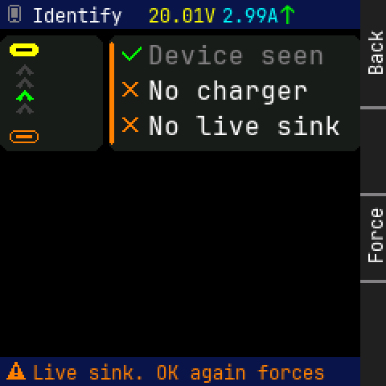

Panel: Back / (empty) / Force / (empty)

```
    0123456789012345678901234567|
  0 * Identify 20.01V2.99^      |
 12 ........                    |
 24          * Device seen      |
 36  ^                          |
 48  ^       * No charger       |
 60  ^                          |
 72          * No live sink     |
 84 ........                    |
 96                             |
108                             |
120                             |
132                             |
144                             |
156                             |
168                             |
180                             |
192                             |
204                             |
216                             |
228 * Live sink. OK again forces|
```

<details><summary>Element table</summary>

| element | kind | x | y | w | h | font / radius | token |
|---|---|---|---|---|---|---|---|
| status bar | rect | 0 | 0 | 224 | 18 | r0 | `bar` |
| icon phone | icon | 4 | 3 | 12 | 12 | - | `dim` |
| title | text | 20 | 3 | 56 | 13 | 12px | `text` |
| mini V | text | 92 | 3 | 42 | 13 | 12px | `volt` |
| mini A | text | 138 | 3 | 35 | 13 | 12px | `amp` |
| mini flow | text | 174 | 1 | 10 | 17 | 16px | `flow` |
| flow diagram | rect | 0 | 22 | 64 | 72 | r6 | `surface` |
| top port (male) | rect | 6 | 27 | 18 | 8 | r3 | `volt` |
| top port (male) slot | rect | 10 | 30 | 10 | 2 | r0 | `bg` |
| bottom port (female) | frame | 6 | 81 | 18 | 8 | r3 | `caution` |
| bottom port (female) tongue | rect | 10 | 84 | 10 | 2 | r0 | `caution` |
| checklist | rect | 68 | 22 | 156 | 72 | r5 | `surface` |
| checklist accent | rect | 68 | 26 | 3 | 64 | r1 | `caution` |
| icon check | icon | 76 | 28 | 12 | 12 | - | `ok` |
| check text | text | 92 | 26 | 110 | 17 | 16px | `dim` |
| icon cross | icon | 76 | 50 | 12 | 12 | - | `caution` |
| check text | text | 92 | 48 | 100 | 17 | 16px | `text` |
| icon cross | icon | 76 | 72 | 12 | 12 | - | `caution` |
| check text | text | 92 | 70 | 120 | 17 | 16px | `text` |
| footer | rect | 0 | 222 | 224 | 18 | r0 | `bar` |
| icon warn | icon | 4 | 225 | 12 | 12 | - | `caution` |
| footer text | text | 20 | 225 | 182 | 13 | 12px | `caution` |

</details>

## identify_result

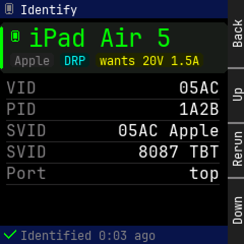

Panel: Back / Up / Rerun / Down

```
    0123456789012345678901234567|
  0 * Identify                  |
 12 ............................|
 24                             |
 36  * i P a d   A i r   5      |
 48  Apple DRP  wants 20V 1.5A  |
 60 ............................|
 72                             |
 84 VID                   05AC  |
 96 PID                   1A2B  |
108                             |
120 SVID          05AC Apple    |
132                             |
144 SVID             8087 TBT   |
156                             |
168 Port                   top  |
180                             |
192                             |
204                             |
216                             |
228 * Identified 0:03 ago       |
```

<details><summary>Element table</summary>

| element | kind | x | y | w | h | font / radius | token |
|---|---|---|---|---|---|---|---|
| status bar | rect | 0 | 0 | 224 | 18 | r0 | `bar` |
| icon phone | icon | 4 | 3 | 12 | 12 | - | `dim` |
| title | text | 20 | 3 | 56 | 13 | 12px | `text` |
| verdict card | rect | 0 | 22 | 224 | 50 | r5 | `surface` |
| verdict card accent | rect | 0 | 26 | 3 | 42 | r1 | `energy` |
| icon phone | icon | 10 | 30 | 12 | 12 | - | `energy` |
| 'iPad Air 5' | text | 28 | 24 | 140 | 26 | 24px | `energy` |
| pill | rect | 10 | 52 | 43 | 14 | r3 | `dim_t` |
| pill text | text | 14 | 53 | 35 | 13 | 12px | `dim` |
| pill | rect | 59 | 52 | 29 | 14 | r3 | `amp_t` |
| pill text | text | 63 | 53 | 21 | 13 | 12px | `amp` |
| pill | rect | 94 | 52 | 106 | 14 | r3 | `volt_t` |
| pill text | text | 98 | 53 | 98 | 13 | 12px | `volt` |
| 'VID' | text | 6 | 78 | 30 | 17 | 16px | `dim` |
| '05AC' | text | 176 | 78 | 40 | 17 | 16px | `text` |
| 'PID' | text | 6 | 99 | 30 | 17 | 16px | `dim` |
| '1A2B' | text | 176 | 99 | 40 | 17 | 16px | `text` |
| 'SVID' | text | 6 | 120 | 40 | 17 | 16px | `dim` |
| '05AC Apple' | text | 116 | 120 | 100 | 17 | 16px | `text` |
| 'SVID' | text | 6 | 141 | 40 | 17 | 16px | `dim` |
| '8087 TBT' | text | 136 | 141 | 80 | 17 | 16px | `text` |
| 'Port' | text | 6 | 162 | 40 | 17 | 16px | `dim` |
| 'top' | text | 186 | 162 | 30 | 17 | 16px | `text` |
| footer | rect | 0 | 222 | 224 | 18 | r0 | `bar` |
| icon check | icon | 4 | 225 | 12 | 12 | - | `ok` |
| footer text | text | 20 | 225 | 133 | 13 | 12px | `dim` |

</details>

## fc_setup

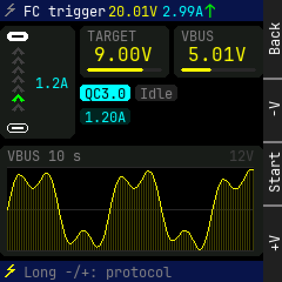

Panel: Back / -V / Start / +V

```
    0123456789012345678901234567|
  0 * FC trigge20.01V2.99^      |
 12 ........                    |
 24          TARGET    VBUS     |
 36  ^       9.00V     5.01V    |
 48  ^                          |
 60  ^ 1.2A                     |
 72  ^       QC3.0Idle          |
 84  ^                          |
 96          1.20A              |
108 ........                    |
120 ............................|
132 VBUS 10 s               12V |
144                             |
156                             |
168 ~~~~~~~~~~~~~~~~~~~~~~~~~~~ |
180                             |
192                             |
204                             |
216 ............................|
228 * Long -/+: protocol        |
```

<details><summary>Element table</summary>

| element | kind | x | y | w | h | font / radius | token |
|---|---|---|---|---|---|---|---|
| status bar | rect | 0 | 0 | 224 | 18 | r0 | `bar` |
| icon bolt | icon | 4 | 3 | 12 | 12 | - | `dim` |
| title | text | 20 | 3 | 70 | 13 | 12px | `text` |
| mini V | text | 92 | 3 | 42 | 13 | 12px | `volt` |
| mini A | text | 138 | 3 | 35 | 13 | 12px | `amp` |
| mini flow | text | 174 | 1 | 10 | 17 | 16px | `flow` |
| flow diagram | rect | 0 | 22 | 64 | 96 | r6 | `surface` |
| top port (male) | rect | 6 | 27 | 18 | 8 | r3 | `text` |
| top port (male) slot | rect | 10 | 30 | 10 | 2 | r0 | `bg` |
| bottom port (female) | frame | 6 | 105 | 18 | 8 | r3 | `text` |
| bottom port (female) tongue | rect | 10 | 108 | 10 | 2 | r0 | `text` |
| diagram caption | text | 30 | 64 | 28 | 13 | 12px | `amp` |
| TARGET | rect | 68 | 22 | 76 | 44 | r5 | `surface` |
| 'TARGET' | text | 74 | 24 | 42 | 13 | 12px | `dim` |
| ' 9.00V' | text | 70 | 38 | 60 | 17 | 16px | `volt` |
| TARGET track | rect | 74 | 58 | 64 | 3 | r1 | `rule` |
| TARGET fill | rect | 74 | 58 | 48 | 3 | r1 | `volt` |
| VBUS | rect | 148 | 22 | 76 | 44 | r5 | `surface` |
| 'VBUS' | text | 154 | 24 | 28 | 13 | 12px | `dim` |
| ' 5.01V' | text | 150 | 38 | 60 | 17 | 16px | `volt` |
| VBUS track | rect | 154 | 58 | 64 | 3 | r1 | `rule` |
| VBUS fill | rect | 154 | 58 | 26 | 3 | r1 | `volt` |
| pill | rect | 68 | 72 | 43 | 14 | r3 | `amp` |
| pill text | text | 72 | 73 | 35 | 13 | 12px | `bg` |
| pill | rect | 115 | 72 | 36 | 14 | r3 | `dim_t` |
| pill text | text | 119 | 73 | 28 | 13 | 12px | `dim` |
| pill | rect | 68 | 92 | 43 | 14 | r3 | `amp_t` |
| pill text | text | 72 | 93 | 35 | 13 | 12px | `amp` |
| trace card | rect | 0 | 124 | 224 | 94 | r5 | `surface` |
| 'VBUS 10 s' | text | 6 | 126 | 63 | 13 | 12px | `dim` |
| '12V' | text | 195 | 126 | 21 | 13 | 12px | `faint` |
| VBUS trace 10 s | spark | 6 | 142 | 210 | 72 | - | `volt` |
| footer | rect | 0 | 222 | 224 | 18 | r0 | `bar` |
| icon bolt | icon | 4 | 225 | 12 | 12 | - | `volt` |
| footer text | text | 20 | 225 | 126 | 13 | 12px | `dim` |

</details>

## fc_run

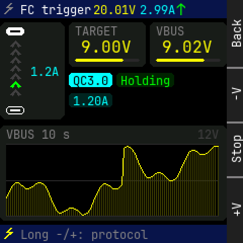

Panel: Back / -V / Stop / +V

```
    0123456789012345678901234567|
  0 * FC trigge20.01V2.99^      |
 12 ........                    |
 24          TARGET    VBUS     |
 36  ^       9.00V     9.02V    |
 48  ^                          |
 60  ^ 1.2A                     |
 72  ^       QC3.0Holding       |
 84  ^                          |
 96          1.20A              |
108 ........                    |
120 ............................|
132 VBUS 10 s               12V |
144                             |
156                             |
168 ~~~~~~~~~~~~~~~~~~~~~~~~~~~ |
180                             |
192                             |
204                             |
216 ............................|
228 * Long -/+: protocol        |
```

<details><summary>Element table</summary>

| element | kind | x | y | w | h | font / radius | token |
|---|---|---|---|---|---|---|---|
| status bar | rect | 0 | 0 | 224 | 18 | r0 | `bar` |
| icon bolt | icon | 4 | 3 | 12 | 12 | - | `dim` |
| title | text | 20 | 3 | 70 | 13 | 12px | `text` |
| mini V | text | 92 | 3 | 42 | 13 | 12px | `volt` |
| mini A | text | 138 | 3 | 35 | 13 | 12px | `amp` |
| mini flow | text | 174 | 1 | 10 | 17 | 16px | `flow` |
| flow diagram | rect | 0 | 22 | 64 | 96 | r6 | `surface` |
| top port (male) | rect | 6 | 27 | 18 | 8 | r3 | `text` |
| top port (male) slot | rect | 10 | 30 | 10 | 2 | r0 | `bg` |
| bottom port (female) | frame | 6 | 105 | 18 | 8 | r3 | `text` |
| bottom port (female) tongue | rect | 10 | 108 | 10 | 2 | r0 | `text` |
| diagram caption | text | 30 | 64 | 28 | 13 | 12px | `amp` |
| TARGET | rect | 68 | 22 | 76 | 44 | r5 | `surface` |
| 'TARGET' | text | 74 | 24 | 42 | 13 | 12px | `dim` |
| ' 9.00V' | text | 70 | 38 | 60 | 17 | 16px | `volt` |
| TARGET track | rect | 74 | 58 | 64 | 3 | r1 | `rule` |
| TARGET fill | rect | 74 | 58 | 48 | 3 | r1 | `volt` |
| VBUS | rect | 148 | 22 | 76 | 44 | r5 | `surface` |
| 'VBUS' | text | 154 | 24 | 28 | 13 | 12px | `dim` |
| ' 9.02V' | text | 150 | 38 | 60 | 17 | 16px | `volt` |
| VBUS track | rect | 154 | 58 | 64 | 3 | r1 | `rule` |
| VBUS fill | rect | 154 | 58 | 48 | 3 | r1 | `volt` |
| pill | rect | 68 | 72 | 43 | 14 | r3 | `amp` |
| pill text | text | 72 | 73 | 35 | 13 | 12px | `bg` |
| pill | rect | 115 | 72 | 57 | 14 | r3 | `ok_t` |
| pill text | text | 119 | 73 | 49 | 13 | 12px | `ok` |
| pill | rect | 68 | 92 | 43 | 14 | r3 | `amp_t` |
| pill text | text | 72 | 93 | 35 | 13 | 12px | `amp` |
| trace card | rect | 0 | 124 | 224 | 94 | r5 | `surface` |
| 'VBUS 10 s' | text | 6 | 126 | 63 | 13 | 12px | `dim` |
| '12V' | text | 195 | 126 | 21 | 13 | 12px | `faint` |
| VBUS trace 10 s | spark | 6 | 142 | 210 | 72 | - | `volt` |
| footer | rect | 0 | 222 | 224 | 18 | r0 | `bar` |
| icon bolt | icon | 4 | 225 | 12 | 12 | - | `volt` |
| footer text | text | 20 | 225 | 126 | 13 | 12px | `dim` |

</details>

## fc_scan

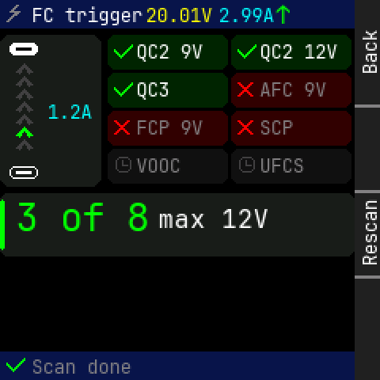

Panel: Back / (empty) / Rescan / (empty)

```
    0123456789012345678901234567|
  0 * FC trigge20.01V2.99^      |
 12 ........                    |
 24          *QC2 9V  * QC2 12V |
 36  ^                          |
 48  ^       *QC3     * AFC 9V  |
 60  ^ 1.2A                     |
 72  ^       *FCP 9V  * SCP     |
 84  ^                          |
 96          *VOOC    * UFCS    |
108 ........                    |
120                             |
132  3   o f   8max 12V         |
144                             |
156                             |
168                             |
180                             |
192                             |
204                             |
216                             |
228 * Scan done                 |
```

<details><summary>Element table</summary>

| element | kind | x | y | w | h | font / radius | token |
|---|---|---|---|---|---|---|---|
| status bar | rect | 0 | 0 | 224 | 18 | r0 | `bar` |
| icon bolt | icon | 4 | 3 | 12 | 12 | - | `dim` |
| title | text | 20 | 3 | 70 | 13 | 12px | `text` |
| mini V | text | 92 | 3 | 42 | 13 | 12px | `volt` |
| mini A | text | 138 | 3 | 35 | 13 | 12px | `amp` |
| mini flow | text | 174 | 1 | 10 | 17 | 16px | `flow` |
| flow diagram | rect | 0 | 22 | 64 | 96 | r6 | `surface` |
| top port (male) | rect | 6 | 27 | 18 | 8 | r3 | `text` |
| top port (male) slot | rect | 10 | 30 | 10 | 2 | r0 | `bg` |
| bottom port (female) | frame | 6 | 105 | 18 | 8 | r3 | `text` |
| bottom port (female) tongue | rect | 10 | 108 | 10 | 2 | r0 | `text` |
| diagram caption | text | 30 | 64 | 28 | 13 | 12px | `amp` |
| result tile | rect | 68 | 22 | 76 | 22 | r5 | `ok_t` |
| icon check | icon | 72 | 27 | 12 | 12 | - | `ok` |
| 'QC2 9V' | text | 86 | 26 | 42 | 13 | 12px | `text` |
| result tile | rect | 146 | 22 | 76 | 22 | r5 | `ok_t` |
| icon check | icon | 150 | 27 | 12 | 12 | - | `ok` |
| 'QC2 12V' | text | 164 | 26 | 49 | 13 | 12px | `text` |
| result tile | rect | 68 | 46 | 76 | 22 | r5 | `ok_t` |
| icon check | icon | 72 | 51 | 12 | 12 | - | `ok` |
| 'QC3' | text | 86 | 50 | 21 | 13 | 12px | `text` |
| result tile | rect | 146 | 46 | 76 | 22 | r5 | `error_t` |
| icon cross | icon | 150 | 51 | 12 | 12 | - | `error` |
| 'AFC 9V' | text | 164 | 50 | 42 | 13 | 12px | `dim` |
| result tile | rect | 68 | 70 | 76 | 22 | r5 | `error_t` |
| icon cross | icon | 72 | 75 | 12 | 12 | - | `error` |
| 'FCP 9V' | text | 86 | 74 | 42 | 13 | 12px | `dim` |
| result tile | rect | 146 | 70 | 76 | 22 | r5 | `error_t` |
| icon cross | icon | 150 | 75 | 12 | 12 | - | `error` |
| 'SCP' | text | 164 | 74 | 21 | 13 | 12px | `dim` |
| result tile | rect | 68 | 94 | 76 | 22 | r5 | `faint_t` |
| icon clock | icon | 72 | 99 | 12 | 12 | - | `faint` |
| 'VOOC' | text | 86 | 98 | 28 | 13 | 12px | `dim` |
| result tile | rect | 146 | 94 | 76 | 22 | r5 | `faint_t` |
| icon clock | icon | 150 | 99 | 12 | 12 | - | `faint` |
| 'UFCS' | text | 164 | 98 | 28 | 13 | 12px | `dim` |
| summary | rect | 0 | 122 | 224 | 40 | r5 | `surface` |
| summary accent | rect | 0 | 126 | 3 | 32 | r1 | `ok` |
| '3 of 8' | text | 10 | 124 | 84 | 26 | 24px | `ok` |
| 'max 12V' | text | 100 | 130 | 70 | 17 | 16px | `text` |
| footer | rect | 0 | 222 | 224 | 18 | r0 | `bar` |
| icon check | icon | 4 | 225 | 12 | 12 | - | `ok` |
| footer text | text | 20 | 225 | 63 | 13 | 12px | `dim` |

</details>

## fc_refused

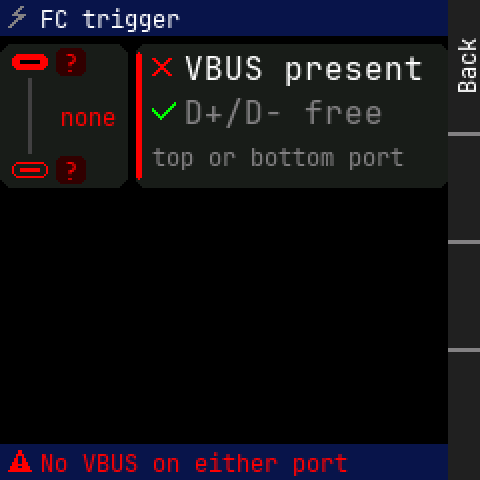

Panel: Back / (empty) / (empty) / (empty)

```
    0123456789012345678901234567|
  0 * FC trigger                |
 12 ........                    |
 24     ?    * VBUS present     |
 36                             |
 48    none  * D+/D- free       |
 60                             |
 72          top or bottom port |
 84 ....?...                    |
 96                             |
108                             |
120                             |
132                             |
144                             |
156                             |
168                             |
180                             |
192                             |
204                             |
216                             |
228 * No VBUS on either port    |
```

<details><summary>Element table</summary>

| element | kind | x | y | w | h | font / radius | token |
|---|---|---|---|---|---|---|---|
| status bar | rect | 0 | 0 | 224 | 18 | r0 | `bar` |
| icon bolt | icon | 4 | 3 | 12 | 12 | - | `dim` |
| title | text | 20 | 3 | 70 | 13 | 12px | `text` |
| flow diagram | rect | 0 | 22 | 64 | 72 | r6 | `surface` |
| top port (male) | rect | 6 | 27 | 18 | 8 | r3 | `error` |
| top port (male) slot | rect | 10 | 30 | 10 | 2 | r0 | `bg` |
| bottom port (female) | frame | 6 | 81 | 18 | 8 | r3 | `error` |
| bottom port (female) tongue | rect | 10 | 84 | 10 | 2 | r0 | `error` |
| top role | rect | 28 | 24 | 15 | 14 | r3 | `error_t` |
| top role text | text | 32 | 25 | 7 | 13 | 12px | `error` |
| bottom role | rect | 28 | 78 | 15 | 14 | r3 | `error_t` |
| bottom role text | text | 32 | 79 | 7 | 13 | 12px | `error` |
| no-flow line | rect | 14 | 39 | 2 | 38 | r0 | `faint` |
| diagram caption | text | 30 | 52 | 28 | 13 | 12px | `error` |
| checklist | rect | 68 | 22 | 156 | 72 | r5 | `surface` |
| checklist accent | rect | 68 | 26 | 3 | 64 | r1 | `error` |
| icon cross | icon | 76 | 28 | 12 | 12 | - | `error` |
| check text | text | 92 | 26 | 120 | 17 | 16px | `text` |
| icon check | icon | 76 | 50 | 12 | 12 | - | `ok` |
| check text | text | 92 | 48 | 100 | 17 | 16px | `dim` |
| 'top or bottom port' | text | 76 | 72 | 126 | 13 | 12px | `dim` |
| footer | rect | 0 | 222 | 224 | 18 | r0 | `bar` |
| icon warn | icon | 4 | 225 | 12 | 12 | - | `error` |
| footer text | text | 20 | 225 | 154 | 13 | 12px | `error` |

</details>

## pdt_list

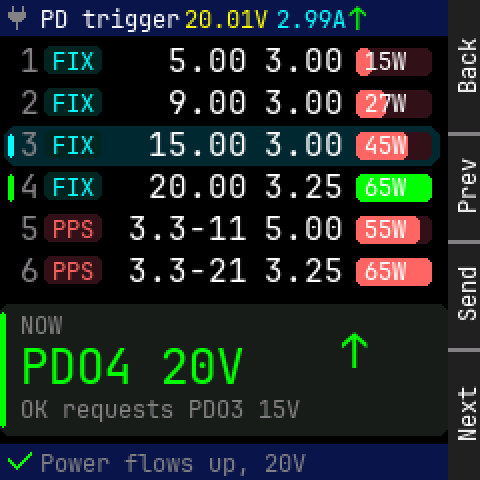

Panel: Back / Prev / Send / Next

```
    0123456789012345678901234567|
  0 * PD trigge20.01V2.99^      |
 12                             |
 24  1 FIX    5.00  3.00  15W   |
 36                             |
 48  2 FIX    9.00  3.00  27W   |
 60                             |
 72  3 FIX   15.00  3.00  45W   |
 84  4 FIX   20.00  3.25  65W   |
 96                             |
108  5 PPS  3.3-11  5.00  55W   |
120                             |
132  6 PPS  3.3-21  3.25  65W   |
144 ............................|
156  NOW                        |
168                      ^      |
180  P D O 4   2 0 V            |
192                             |
204  OK requests PDO3 15V       |
216 ............................|
228 * Power flows up, 20V       |
```

<details><summary>Element table</summary>

| element | kind | x | y | w | h | font / radius | token |
|---|---|---|---|---|---|---|---|
| status bar | rect | 0 | 0 | 224 | 18 | r0 | `bar` |
| icon plug | icon | 4 | 3 | 12 | 12 | - | `dim` |
| title | text | 20 | 3 | 70 | 13 | 12px | `text` |
| mini V | text | 92 | 3 | 42 | 13 | 12px | `volt` |
| mini A | text | 138 | 3 | 35 | 13 | 12px | `amp` |
| mini flow | text | 174 | 1 | 10 | 17 | 16px | `flow` |
| '1' | text | 10 | 22 | 10 | 17 | 16px | `dim` |
| type pill | rect | 22 | 23 | 29 | 14 | r3 | `amp_t` |
| type pill text | text | 26 | 24 | 21 | 13 | 12px | `amp` |
| V | text | 74 | 22 | 50 | 17 | 16px | `text` |
| A | text | 132 | 22 | 40 | 17 | 16px | `text` |
| W bar track | rect | 178 | 24 | 38 | 14 | r3 | `watt_t` |
| W bar | rect | 178 | 24 | 8 | 14 | r3 | `watt` |
| W | text | 182 | 24 | 21 | 13 | 12px | `text` |
| '2' | text | 10 | 43 | 10 | 17 | 16px | `dim` |
| type pill | rect | 22 | 44 | 29 | 14 | r3 | `amp_t` |
| type pill text | text | 26 | 45 | 21 | 13 | 12px | `amp` |
| V | text | 74 | 43 | 50 | 17 | 16px | `text` |
| A | text | 132 | 43 | 40 | 17 | 16px | `text` |
| W bar track | rect | 178 | 45 | 38 | 14 | r3 | `watt_t` |
| W bar | rect | 178 | 45 | 15 | 14 | r3 | `watt` |
| W | text | 182 | 45 | 21 | 13 | 12px | `text` |
| selected row | rect | 2 | 63 | 218 | 20 | r6 | `focus_t` |
| focus bar | rect | 4 | 67 | 3 | 12 | r1 | `focus` |
| '3' | text | 10 | 64 | 10 | 17 | 16px | `dim` |
| type pill | rect | 22 | 65 | 29 | 14 | r3 | `amp_t` |
| type pill text | text | 26 | 66 | 21 | 13 | 12px | `amp` |
| V | text | 74 | 64 | 50 | 17 | 16px | `text` |
| A | text | 132 | 64 | 40 | 17 | 16px | `text` |
| W bar track | rect | 178 | 66 | 38 | 14 | r3 | `watt_t` |
| W bar | rect | 178 | 66 | 26 | 14 | r3 | `watt` |
| W | text | 182 | 66 | 21 | 13 | 12px | `text` |
| active bar | rect | 4 | 87 | 3 | 14 | r1 | `energy` |
| '4' | text | 10 | 85 | 10 | 17 | 16px | `dim` |
| type pill | rect | 22 | 86 | 29 | 14 | r3 | `amp_t` |
| type pill text | text | 26 | 87 | 21 | 13 | 12px | `amp` |
| V | text | 74 | 85 | 50 | 17 | 16px | `text` |
| A | text | 132 | 85 | 40 | 17 | 16px | `text` |
| W bar track | rect | 178 | 87 | 38 | 14 | r3 | `energy_t` |
| W bar | rect | 178 | 87 | 38 | 14 | r3 | `energy` |
| W | text | 182 | 87 | 21 | 13 | 12px | `text` |
| '5' | text | 10 | 106 | 10 | 17 | 16px | `dim` |
| type pill | rect | 22 | 107 | 29 | 14 | r3 | `watt_t` |
| type pill text | text | 26 | 108 | 21 | 13 | 12px | `watt` |
| V | text | 64 | 106 | 60 | 17 | 16px | `text` |
| A | text | 132 | 106 | 40 | 17 | 16px | `text` |
| W bar track | rect | 178 | 108 | 38 | 14 | r3 | `watt_t` |
| W bar | rect | 178 | 108 | 32 | 14 | r3 | `watt` |
| W | text | 182 | 108 | 21 | 13 | 12px | `text` |
| '6' | text | 10 | 127 | 10 | 17 | 16px | `dim` |
| type pill | rect | 22 | 128 | 29 | 14 | r3 | `watt_t` |
| type pill text | text | 26 | 129 | 21 | 13 | 12px | `watt` |
| V | text | 64 | 127 | 60 | 17 | 16px | `text` |
| A | text | 132 | 127 | 40 | 17 | 16px | `text` |
| W bar track | rect | 178 | 129 | 38 | 14 | r3 | `watt_t` |
| W bar | rect | 178 | 129 | 38 | 14 | r3 | `watt` |
| W | text | 182 | 129 | 21 | 13 | 12px | `text` |
| contract card | rect | 0 | 152 | 224 | 66 | r5 | `surface` |
| contract card accent | rect | 0 | 156 | 3 | 58 | r1 | `energy` |
| 'NOW' | text | 10 | 156 | 21 | 13 | 12px | `dim` |
| 'PDO4 20V' | text | 10 | 170 | 112 | 26 | 24px | `energy` |
| 'OK requests PDO3 15V' | text | 10 | 198 | 140 | 13 | 12px | `dim` |
| '↑' | text | 170 | 162 | 14 | 26 | 24px | `flow` |
| footer | rect | 0 | 222 | 224 | 18 | r0 | `bar` |
| icon check | icon | 4 | 225 | 12 | 12 | - | `ok` |
| footer text | text | 20 | 225 | 133 | 13 | 12px | `dim` |

</details>

## pdt_adjust

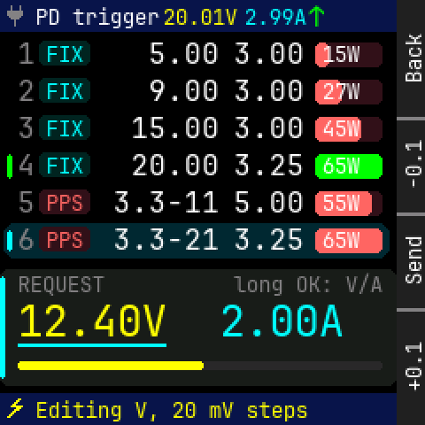

Panel: Back / -0.1 / Send / +0.1

```
    0123456789012345678901234567|
  0 * PD trigge20.01V2.99^      |
 12                             |
 24  1 FIX    5.00  3.00  15W   |
 36                             |
 48  2 FIX    9.00  3.00  27W   |
 60                             |
 72  3 FIX   15.00  3.00  45W   |
 84  4 FIX   20.00  3.25  65W   |
 96                             |
108  5 PPS  3.3-11  5.00  55W   |
120                             |
132  6 PPS  3.3-21  3.25  65W   |
144 ............................|
156  REQUEST        long OK: V/A|
168                             |
180  1 2 . 4 0 V   2 . 0 0 A    |
192                             |
204                             |
216 ............................|
228 * Editing V, 20 mV steps    |
```

<details><summary>Element table</summary>

| element | kind | x | y | w | h | font / radius | token |
|---|---|---|---|---|---|---|---|
| status bar | rect | 0 | 0 | 224 | 18 | r0 | `bar` |
| icon plug | icon | 4 | 3 | 12 | 12 | - | `dim` |
| title | text | 20 | 3 | 70 | 13 | 12px | `text` |
| mini V | text | 92 | 3 | 42 | 13 | 12px | `volt` |
| mini A | text | 138 | 3 | 35 | 13 | 12px | `amp` |
| mini flow | text | 174 | 1 | 10 | 17 | 16px | `flow` |
| '1' | text | 10 | 22 | 10 | 17 | 16px | `dim` |
| type pill | rect | 22 | 23 | 29 | 14 | r3 | `amp_t` |
| type pill text | text | 26 | 24 | 21 | 13 | 12px | `amp` |
| V | text | 74 | 22 | 50 | 17 | 16px | `text` |
| A | text | 132 | 22 | 40 | 17 | 16px | `text` |
| W bar track | rect | 178 | 24 | 38 | 14 | r3 | `watt_t` |
| W bar | rect | 178 | 24 | 8 | 14 | r3 | `watt` |
| W | text | 182 | 24 | 21 | 13 | 12px | `text` |
| '2' | text | 10 | 43 | 10 | 17 | 16px | `dim` |
| type pill | rect | 22 | 44 | 29 | 14 | r3 | `amp_t` |
| type pill text | text | 26 | 45 | 21 | 13 | 12px | `amp` |
| V | text | 74 | 43 | 50 | 17 | 16px | `text` |
| A | text | 132 | 43 | 40 | 17 | 16px | `text` |
| W bar track | rect | 178 | 45 | 38 | 14 | r3 | `watt_t` |
| W bar | rect | 178 | 45 | 15 | 14 | r3 | `watt` |
| W | text | 182 | 45 | 21 | 13 | 12px | `text` |
| '3' | text | 10 | 64 | 10 | 17 | 16px | `dim` |
| type pill | rect | 22 | 65 | 29 | 14 | r3 | `amp_t` |
| type pill text | text | 26 | 66 | 21 | 13 | 12px | `amp` |
| V | text | 74 | 64 | 50 | 17 | 16px | `text` |
| A | text | 132 | 64 | 40 | 17 | 16px | `text` |
| W bar track | rect | 178 | 66 | 38 | 14 | r3 | `watt_t` |
| W bar | rect | 178 | 66 | 26 | 14 | r3 | `watt` |
| W | text | 182 | 66 | 21 | 13 | 12px | `text` |
| active bar | rect | 4 | 87 | 3 | 14 | r1 | `energy` |
| '4' | text | 10 | 85 | 10 | 17 | 16px | `dim` |
| type pill | rect | 22 | 86 | 29 | 14 | r3 | `amp_t` |
| type pill text | text | 26 | 87 | 21 | 13 | 12px | `amp` |
| V | text | 74 | 85 | 50 | 17 | 16px | `text` |
| A | text | 132 | 85 | 40 | 17 | 16px | `text` |
| W bar track | rect | 178 | 87 | 38 | 14 | r3 | `energy_t` |
| W bar | rect | 178 | 87 | 38 | 14 | r3 | `energy` |
| W | text | 182 | 87 | 21 | 13 | 12px | `text` |
| '5' | text | 10 | 106 | 10 | 17 | 16px | `dim` |
| type pill | rect | 22 | 107 | 29 | 14 | r3 | `watt_t` |
| type pill text | text | 26 | 108 | 21 | 13 | 12px | `watt` |
| V | text | 64 | 106 | 60 | 17 | 16px | `text` |
| A | text | 132 | 106 | 40 | 17 | 16px | `text` |
| W bar track | rect | 178 | 108 | 38 | 14 | r3 | `watt_t` |
| W bar | rect | 178 | 108 | 32 | 14 | r3 | `watt` |
| W | text | 182 | 108 | 21 | 13 | 12px | `text` |
| selected row | rect | 2 | 126 | 218 | 20 | r6 | `focus_t` |
| focus bar | rect | 4 | 130 | 3 | 12 | r1 | `focus` |
| '6' | text | 10 | 127 | 10 | 17 | 16px | `dim` |
| type pill | rect | 22 | 128 | 29 | 14 | r3 | `watt_t` |
| type pill text | text | 26 | 129 | 21 | 13 | 12px | `watt` |
| V | text | 64 | 127 | 60 | 17 | 16px | `text` |
| A | text | 132 | 127 | 40 | 17 | 16px | `text` |
| W bar track | rect | 178 | 129 | 38 | 14 | r3 | `watt_t` |
| W bar | rect | 178 | 129 | 38 | 14 | r3 | `watt` |
| W | text | 182 | 129 | 21 | 13 | 12px | `text` |
| adjust card | rect | 0 | 152 | 224 | 66 | r5 | `surface` |
| adjust card accent | rect | 0 | 156 | 3 | 58 | r1 | `focus` |
| 'REQUEST' | text | 10 | 154 | 49 | 13 | 12px | `dim` |
| 'long OK: V/A' | text | 132 | 154 | 84 | 13 | 12px | `dim` |
| '12.40V' | text | 10 | 168 | 84 | 26 | 24px | `volt` |
| '2.00A' | text | 124 | 168 | 70 | 26 | 24px | `amp` |
| edit underline | rect | 10 | 194 | 84 | 2 | r1 | `focus` |
| range 3.3-21V track | rect | 10 | 204 | 206 | 5 | r1 | `rule` |
| range 3.3-21V fill | rect | 10 | 204 | 105 | 5 | r1 | `volt` |
| footer | rect | 0 | 222 | 224 | 18 | r0 | `bar` |
| icon bolt | icon | 4 | 225 | 12 | 12 | - | `volt` |
| footer text | text | 20 | 225 | 154 | 13 | 12px | `volt` |

</details>

## pdt_refused

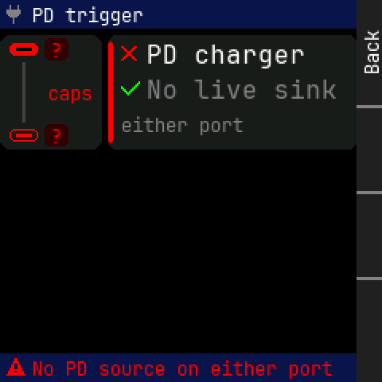

Panel: Back / (empty) / (empty) / (empty)

```
    0123456789012345678901234567|
  0 * PD trigger                |
 12 ........                    |
 24     ?    * PD charger       |
 36                             |
 48    caps  * No live sink     |
 60                             |
 72          either port        |
 84 ....?...                    |
 96                             |
108                             |
120                             |
132                             |
144                             |
156                             |
168                             |
180                             |
192                             |
204                             |
216                             |
228 * No PD source on either por|
```

<details><summary>Element table</summary>

| element | kind | x | y | w | h | font / radius | token |
|---|---|---|---|---|---|---|---|
| status bar | rect | 0 | 0 | 224 | 18 | r0 | `bar` |
| icon plug | icon | 4 | 3 | 12 | 12 | - | `dim` |
| title | text | 20 | 3 | 70 | 13 | 12px | `text` |
| flow diagram | rect | 0 | 22 | 64 | 72 | r6 | `surface` |
| top port (male) | rect | 6 | 27 | 18 | 8 | r3 | `error` |
| top port (male) slot | rect | 10 | 30 | 10 | 2 | r0 | `bg` |
| bottom port (female) | frame | 6 | 81 | 18 | 8 | r3 | `error` |
| bottom port (female) tongue | rect | 10 | 84 | 10 | 2 | r0 | `error` |
| top role | rect | 28 | 24 | 15 | 14 | r3 | `error_t` |
| top role text | text | 32 | 25 | 7 | 13 | 12px | `error` |
| bottom role | rect | 28 | 78 | 15 | 14 | r3 | `error_t` |
| bottom role text | text | 32 | 79 | 7 | 13 | 12px | `error` |
| no-flow line | rect | 14 | 39 | 2 | 38 | r0 | `faint` |
| diagram caption | text | 30 | 52 | 28 | 13 | 12px | `error` |
| checklist | rect | 68 | 22 | 156 | 72 | r5 | `surface` |
| checklist accent | rect | 68 | 26 | 3 | 64 | r1 | `error` |
| icon cross | icon | 76 | 28 | 12 | 12 | - | `error` |
| check text | text | 92 | 26 | 100 | 17 | 16px | `text` |
| icon check | icon | 76 | 50 | 12 | 12 | - | `ok` |
| check text | text | 92 | 48 | 120 | 17 | 16px | `dim` |
| 'either port' | text | 76 | 72 | 77 | 13 | 12px | `dim` |
| footer | rect | 0 | 222 | 224 | 18 | r0 | `bar` |
| icon warn | icon | 4 | 225 | 12 | 12 | - | `error` |
| footer text | text | 20 | 225 | 189 | 13 | 12px | `error` |

</details>

## cabler_setup

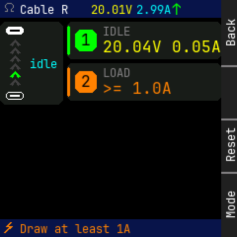

Panel: Back / (empty) / Reset / Mode

```
    0123456789012345678901234567|
  0 * Cable R  20.01V2.99^      |
 12 ........                    |
 24              IDLE           |
 36  ^        1  20.04V 0.05A   |
 48  ^                          |
 60  ^ idle                     |
 72  ^        2  LOAD           |
 84  ^           >= 1.0A        |
 96 ........                    |
108                             |
120                             |
132                             |
144                             |
156                             |
168                             |
180                             |
192                             |
204                             |
216                             |
228 * Draw at least 1A          |
```

<details><summary>Element table</summary>

| element | kind | x | y | w | h | font / radius | token |
|---|---|---|---|---|---|---|---|
| status bar | rect | 0 | 0 | 224 | 18 | r0 | `bar` |
| icon ohm | icon | 4 | 3 | 12 | 12 | - | `dim` |
| title | text | 20 | 3 | 49 | 13 | 12px | `text` |
| mini V | text | 92 | 3 | 42 | 13 | 12px | `volt` |
| mini A | text | 138 | 3 | 35 | 13 | 12px | `amp` |
| mini flow | text | 174 | 1 | 10 | 17 | 16px | `flow` |
| flow diagram | rect | 0 | 22 | 64 | 84 | r6 | `surface` |
| top port (male) | rect | 6 | 27 | 18 | 8 | r3 | `text` |
| top port (male) slot | rect | 10 | 30 | 10 | 2 | r0 | `bg` |
| bottom port (female) | frame | 6 | 93 | 18 | 8 | r3 | `text` |
| bottom port (female) tongue | rect | 10 | 96 | 10 | 2 | r0 | `text` |
| diagram caption | text | 30 | 58 | 28 | 13 | 12px | `amp` |
| IDLE | rect | 68 | 22 | 156 | 38 | r5 | `surface` |
| IDLE accent | rect | 68 | 26 | 3 | 30 | r1 | `ok` |
| step tile | rect | 76 | 30 | 22 | 22 | r6 | `ok` |
| '1' | text | 82 | 32 | 10 | 17 | 16px | `bg` |
| 'IDLE' | text | 104 | 25 | 28 | 13 | 12px | `dim` |
| '20.04V 0.05A' | text | 104 | 39 | 120 | 17 | 16px | `volt` |
| LOAD | rect | 68 | 64 | 156 | 38 | r5 | `surface` |
| LOAD accent | rect | 68 | 68 | 3 | 30 | r1 | `caution` |
| step tile | rect | 76 | 72 | 22 | 22 | r6 | `caution` |
| '2' | text | 82 | 74 | 10 | 17 | 16px | `bg` |
| 'LOAD' | text | 104 | 67 | 28 | 13 | 12px | `dim` |
| '>= 1.0A' | text | 104 | 81 | 70 | 17 | 16px | `caution` |
| footer | rect | 0 | 222 | 224 | 18 | r0 | `bar` |
| icon bolt | icon | 4 | 225 | 12 | 12 | - | `caution` |
| footer text | text | 20 | 225 | 112 | 13 | 12px | `caution` |

</details>

## cabler_result

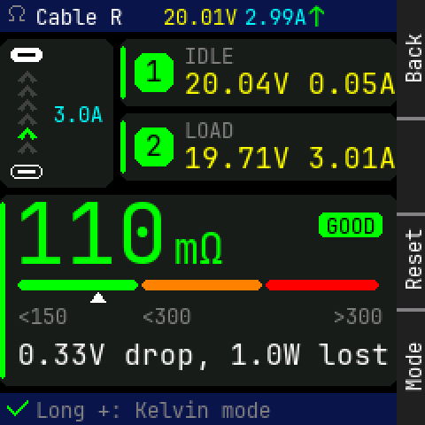

Panel: Back / (empty) / Reset / Mode

```
    0123456789012345678901234567|
  0 * Cable R  20.01V2.99^      |
 12 ........                    |
 24              IDLE           |
 36  ^        1  20.04V 0.05A   |
 48  ^                          |
 60  ^ 3.0A                     |
 72  ^        2  LOAD           |
 84  ^           19.71V 3.01A   |
 96 ........                    |
108 ............................|
120  1   1   0             GOOD |
132             m O             |
144                             |
156                             |
168  <150     <300         >300 |
180                             |
192  0.33V drop, 1.0W lost      |
204                             |
216 ............................|
228 * Long +: Kelvin mode       |
```

<details><summary>Element table</summary>

| element | kind | x | y | w | h | font / radius | token |
|---|---|---|---|---|---|---|---|
| status bar | rect | 0 | 0 | 224 | 18 | r0 | `bar` |
| icon ohm | icon | 4 | 3 | 12 | 12 | - | `dim` |
| title | text | 20 | 3 | 49 | 13 | 12px | `text` |
| mini V | text | 92 | 3 | 42 | 13 | 12px | `volt` |
| mini A | text | 138 | 3 | 35 | 13 | 12px | `amp` |
| mini flow | text | 174 | 1 | 10 | 17 | 16px | `flow` |
| flow diagram | rect | 0 | 22 | 64 | 84 | r6 | `surface` |
| top port (male) | rect | 6 | 27 | 18 | 8 | r3 | `text` |
| top port (male) slot | rect | 10 | 30 | 10 | 2 | r0 | `bg` |
| bottom port (female) | frame | 6 | 93 | 18 | 8 | r3 | `text` |
| bottom port (female) tongue | rect | 10 | 96 | 10 | 2 | r0 | `text` |
| diagram caption | text | 30 | 58 | 28 | 13 | 12px | `amp` |
| IDLE | rect | 68 | 22 | 156 | 38 | r5 | `surface` |
| IDLE accent | rect | 68 | 26 | 3 | 30 | r1 | `ok` |
| step tile | rect | 76 | 30 | 22 | 22 | r6 | `ok` |
| '1' | text | 82 | 32 | 10 | 17 | 16px | `bg` |
| 'IDLE' | text | 104 | 25 | 28 | 13 | 12px | `dim` |
| '20.04V 0.05A' | text | 104 | 39 | 120 | 17 | 16px | `volt` |
| LOAD | rect | 68 | 64 | 156 | 38 | r5 | `surface` |
| LOAD accent | rect | 68 | 68 | 3 | 30 | r1 | `ok` |
| step tile | rect | 76 | 72 | 22 | 22 | r6 | `ok` |
| '2' | text | 82 | 74 | 10 | 17 | 16px | `bg` |
| 'LOAD' | text | 104 | 67 | 28 | 13 | 12px | `dim` |
| '19.71V 3.01A' | text | 104 | 81 | 120 | 17 | 16px | `volt` |
| result card | rect | 0 | 110 | 224 | 108 | r5 | `surface` |
| result card accent | rect | 0 | 114 | 3 | 100 | r1 | `ok` |
| '110' | text | 8 | 114 | 87 | 35 | 48px | `energy` |
| 'mΩ' | text | 98 | 127 | 28 | 26 | 24px | `energy` |
| pill | rect | 180 | 120 | 36 | 14 | r3 | `ok` |
| pill text | text | 184 | 121 | 28 | 13 | 12px | `bg` |
| grade seg | rect | 10 | 158 | 68 | 6 | r2 | `ok` |
| grade seg | rect | 80 | 158 | 68 | 6 | r2 | `caution` |
| grade seg | rect | 150 | 158 | 64 | 6 | r2 | `error` |
| '<150' | text | 10 | 172 | 28 | 13 | 12px | `dim` |
| '<300' | text | 80 | 172 | 28 | 13 | 12px | `dim` |
| '>300' | text | 188 | 172 | 28 | 13 | 12px | `dim` |
| '0.33V drop, 1.0W lost' | text | 10 | 192 | 210 | 17 | 16px | `text` |
| footer | rect | 0 | 222 | 224 | 18 | r0 | `bar` |
| icon check | icon | 4 | 225 | 12 | 12 | - | `ok` |
| footer text | text | 20 | 225 | 133 | 13 | 12px | `dim` |

</details>

## cabler_error

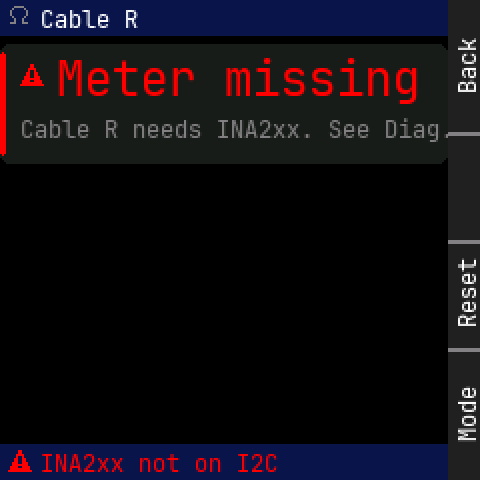

Panel: Back / (empty) / Reset / Mode

```
    0123456789012345678901234567|
  0 * Cable R                   |
 12 ............................|
 24                             |
 36  * M e t e r   m i s s i n g|
 48                             |
 60  Cable R needs INA2xx. See D|
 72 ............................|
 84                             |
 96                             |
108                             |
120                             |
132                             |
144                             |
156                             |
168                             |
180                             |
192                             |
204                             |
216                             |
228 * INA2xx not on I2C         |
```

<details><summary>Element table</summary>

| element | kind | x | y | w | h | font / radius | token |
|---|---|---|---|---|---|---|---|
| status bar | rect | 0 | 0 | 224 | 18 | r0 | `bar` |
| icon ohm | icon | 4 | 3 | 12 | 12 | - | `dim` |
| title | text | 20 | 3 | 49 | 13 | 12px | `text` |
| err card | rect | 0 | 22 | 224 | 60 | r5 | `surface` |
| err card accent | rect | 0 | 26 | 3 | 52 | r1 | `error` |
| icon warn | icon | 10 | 32 | 12 | 12 | - | `error` |
| 'Meter missing' | text | 28 | 26 | 182 | 26 | 24px | `error` |
| 'Cable R needs INA2xx. See Diag.' | text | 10 | 58 | 217 | 13 | 12px | `dim` |
| footer | rect | 0 | 222 | 224 | 18 | r0 | `bar` |
| icon warn | icon | 4 | 225 | 12 | 12 | - | `error` |
| footer text | text | 20 | 225 | 119 | 13 | 12px | `error` |

</details>
