# K2 UI mockups: generated screens

Generated by `render_mockups.py`; do not edit by hand. Grid cell = 8 x 12 px (column header =
x/8, row label = y). x/y/w/h are pixels in the 224 x 240 content area; the panel is x 224..239.

## home_live

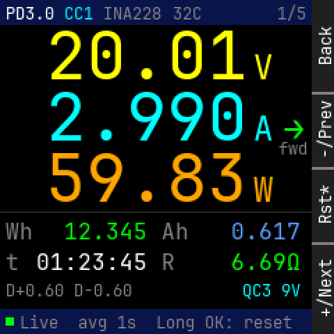

Panel: Back / -/Prev / Rst* / +/Next

```
    0123456789012345678901234567|
  0 PD3.0CC1 INA22832C      1/5 |
 12                             |
 24                             |
 36     2   0   .   0   1       |
 48                       V     |
 60                             |
 72     2   .   9   9   0       |
 84                       A  >  |
 96                          fwd|
108                             |
120     5   9   .   8   3       |
132                       W     |
144 ----------------------------|
156 Wh   12.345   Ah    0.617   |
168                             |
180 t  01:23:45   R     6.69O   |
192                             |
204 D+0.60 D-0.60        QC3 9V |
216                             |
228  Live  avg 1s  Long OK: rese|
```

<details><summary>Element table</summary>

| element | x | y | w | h | font | token |
|---|---|---|---|---|---|---|
| status bar | 0 | 0 | 224 | 18 | - | `bar` |
| PD rev | 4 | 3 | 35 | 13 | 12 | `text` |
| CC pin | 46 | 3 | 21 | 13 | 12 | `amp` |
| meter chip | 74 | 3 | 42 | 13 | 12 | `dim` |
| MCU temp | 124 | 3 | 21 | 13 | 12 | `dim` |
| page n/N | 199 | 3 | 21 | 13 | 12 | `dim` |
| V digits | 33 | 22 | 145 | 35 | 48 | `volt` |
| V unit | 182 | 35 | 14 | 26 | 24 | `volt` |
| A digits | 33 | 66 | 145 | 35 | 48 | `amp` |
| A unit | 182 | 79 | 14 | 26 | 24 | `amp` |
| W digits | 33 | 110 | 145 | 35 | 48 | `watt` |
| W unit | 182 | 123 | 14 | 26 | 24 | `watt` |
| flow arrow | 204 | 79 | 14 | 26 | 24 | `flow_fwd` |
| flow caption | 200 | 100 | 21 | 13 | 12 | `dim` |
| divider | 0 | 152 | 224 | 1 | - | `rule` |
| Wh label | 4 | 158 | 20 | 17 | 16 | `dim` |
| Wh | 46 | 158 | 60 | 17 | 16 | `energy` |
| Ah label | 116 | 158 | 20 | 17 | 16 | `dim` |
| Ah | 166 | 158 | 50 | 17 | 16 | `charge` |
| time label | 4 | 180 | 10 | 17 | 16 | `dim` |
| elapsed | 26 | 180 | 80 | 17 | 16 | `text` |
| load R label | 116 | 180 | 10 | 17 | 16 | `dim` |
| load R | 166 | 180 | 50 | 17 | 16 | `energy` |
| D lines | 4 | 202 | 91 | 13 | 12 | `dim` |
| FC protocol | 174 | 202 | 42 | 13 | 12 | `amp` |
| footer | 0 | 222 | 224 | 18 | - | `bar` |
| state dot | 4 | 228 | 6 | 6 | - | `ok` |
| footer text | 14 | 225 | 196 | 13 | 12 | `dim` |

</details>

## home_reverse

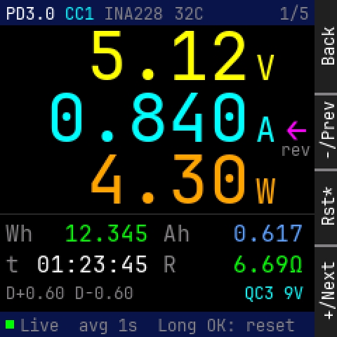

Panel: Back / -/Prev / Rst* / +/Next

```
    0123456789012345678901234567|
  0 PD3.0CC1 INA22832C      1/5 |
 12                             |
 24                             |
 36         5   .   1   2       |
 48                       V     |
 60                             |
 72     0   .   8   4   0       |
 84                       A  <  |
 96                          rev|
108                             |
120         4   .   3   0       |
132                       W     |
144 ----------------------------|
156 Wh   12.345   Ah    0.617   |
168                             |
180 t  01:23:45   R     6.69O   |
192                             |
204 D+0.60 D-0.60        QC3 9V |
216                             |
228  Live  avg 1s  Long OK: rese|
```

<details><summary>Element table</summary>

| element | x | y | w | h | font | token |
|---|---|---|---|---|---|---|
| status bar | 0 | 0 | 224 | 18 | - | `bar` |
| PD rev | 4 | 3 | 35 | 13 | 12 | `text` |
| CC pin | 46 | 3 | 21 | 13 | 12 | `amp` |
| meter chip | 74 | 3 | 42 | 13 | 12 | `dim` |
| MCU temp | 124 | 3 | 21 | 13 | 12 | `dim` |
| page n/N | 199 | 3 | 21 | 13 | 12 | `dim` |
| V digits | 33 | 22 | 145 | 35 | 48 | `volt` |
| V unit | 182 | 35 | 14 | 26 | 24 | `volt` |
| A digits | 33 | 66 | 145 | 35 | 48 | `amp` |
| A unit | 182 | 79 | 14 | 26 | 24 | `amp` |
| W digits | 33 | 110 | 145 | 35 | 48 | `watt` |
| W unit | 182 | 123 | 14 | 26 | 24 | `watt` |
| flow arrow | 204 | 79 | 14 | 26 | 24 | `flow_rev` |
| flow caption | 200 | 100 | 21 | 13 | 12 | `dim` |
| divider | 0 | 152 | 224 | 1 | - | `rule` |
| Wh label | 4 | 158 | 20 | 17 | 16 | `dim` |
| Wh | 46 | 158 | 60 | 17 | 16 | `energy` |
| Ah label | 116 | 158 | 20 | 17 | 16 | `dim` |
| Ah | 166 | 158 | 50 | 17 | 16 | `charge` |
| time label | 4 | 180 | 10 | 17 | 16 | `dim` |
| elapsed | 26 | 180 | 80 | 17 | 16 | `text` |
| load R label | 116 | 180 | 10 | 17 | 16 | `dim` |
| load R | 166 | 180 | 50 | 17 | 16 | `energy` |
| D lines | 4 | 202 | 91 | 13 | 12 | `dim` |
| FC protocol | 174 | 202 | 42 | 13 | 12 | `amp` |
| footer | 0 | 222 | 224 | 18 | - | `bar` |
| state dot | 4 | 228 | 6 | 6 | - | `ok` |
| footer text | 14 | 225 | 196 | 13 | 12 | `dim` |

</details>

## home_idle

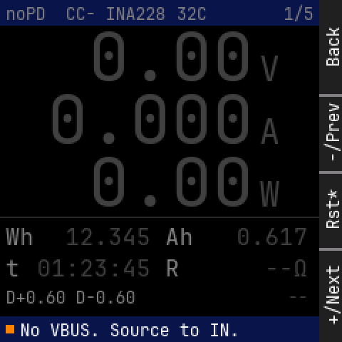

Panel: Back / -/Prev / Rst* / +/Next

```
    0123456789012345678901234567|
  0 noPD CC- INA22832C      1/5 |
 12                             |
 24                             |
 36         0   .   0   0       |
 48                       V     |
 60                             |
 72     0   .   0   0   0       |
 84                       A     |
 96                             |
108                             |
120         0   .   0   0       |
132                       W     |
144 ----------------------------|
156 Wh   12.345   Ah    0.617   |
168                             |
180 t  01:23:45   R        --O  |
192                             |
204 D+0.60 D-0.60            -- |
216                             |
228  No VBUS. Source to IN.     |
```

<details><summary>Element table</summary>

| element | x | y | w | h | font | token |
|---|---|---|---|---|---|---|
| status bar | 0 | 0 | 224 | 18 | - | `bar` |
| PD rev | 4 | 3 | 28 | 13 | 12 | `dim` |
| CC pin | 46 | 3 | 21 | 13 | 12 | `dim` |
| meter chip | 74 | 3 | 42 | 13 | 12 | `dim` |
| MCU temp | 124 | 3 | 21 | 13 | 12 | `dim` |
| page n/N | 199 | 3 | 21 | 13 | 12 | `dim` |
| V digits | 33 | 22 | 145 | 35 | 48 | `faint` |
| V unit | 182 | 35 | 14 | 26 | 24 | `faint` |
| A digits | 33 | 66 | 145 | 35 | 48 | `faint` |
| A unit | 182 | 79 | 14 | 26 | 24 | `faint` |
| W digits | 33 | 110 | 145 | 35 | 48 | `faint` |
| W unit | 182 | 123 | 14 | 26 | 24 | `faint` |
| divider | 0 | 152 | 224 | 1 | - | `rule` |
| Wh label | 4 | 158 | 20 | 17 | 16 | `dim` |
| Wh | 46 | 158 | 60 | 17 | 16 | `faint` |
| Ah label | 116 | 158 | 20 | 17 | 16 | `dim` |
| Ah | 166 | 158 | 50 | 17 | 16 | `faint` |
| time label | 4 | 180 | 10 | 17 | 16 | `dim` |
| elapsed | 26 | 180 | 80 | 17 | 16 | `faint` |
| load R label | 116 | 180 | 10 | 17 | 16 | `dim` |
| load R | 186 | 180 | 30 | 17 | 16 | `faint` |
| D lines | 4 | 202 | 91 | 13 | 12 | `dim` |
| FC protocol | 202 | 202 | 14 | 13 | 12 | `faint` |
| footer | 0 | 222 | 224 | 18 | - | `bar` |
| state dot | 4 | 228 | 6 | 6 | - | `caution` |
| footer text | 14 | 225 | 154 | 13 | 12 | `text` |

</details>

## home_stale

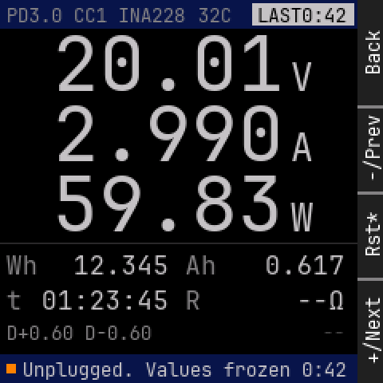

Panel: Back / -/Prev / Rst* / +/Next

```
    0123456789012345678901234567|
  0 PD3.0CC1 INA22832C  LAST0:42|
 12                             |
 24                             |
 36     2   0   .   0   1       |
 48                       V     |
 60                             |
 72     2   .   9   9   0       |
 84                       A     |
 96                             |
108                             |
120     5   9   .   8   3       |
132                       W     |
144 ----------------------------|
156 Wh   12.345   Ah    0.617   |
168                             |
180 t  01:23:45   R        --O  |
192                             |
204 D+0.60 D-0.60            -- |
216                             |
228  Unplugged. Values frozen 0:|
```

<details><summary>Element table</summary>

| element | x | y | w | h | font | token |
|---|---|---|---|---|---|---|
| status bar | 0 | 0 | 224 | 18 | - | `bar` |
| PD rev | 4 | 3 | 35 | 13 | 12 | `dim` |
| CC pin | 46 | 3 | 21 | 13 | 12 | `dim` |
| meter chip | 74 | 3 | 42 | 13 | 12 | `dim` |
| MCU temp | 124 | 3 | 21 | 13 | 12 | `dim` |
| LAST badge | 158 | 2 | 64 | 14 | - | `stale` |
| badge text | 161 | 3 | 56 | 13 | 12 | `bg` |
| V digits | 33 | 22 | 145 | 35 | 48 | `stale` |
| V unit | 182 | 35 | 14 | 26 | 24 | `stale` |
| A digits | 33 | 66 | 145 | 35 | 48 | `stale` |
| A unit | 182 | 79 | 14 | 26 | 24 | `stale` |
| W digits | 33 | 110 | 145 | 35 | 48 | `stale` |
| W unit | 182 | 123 | 14 | 26 | 24 | `stale` |
| divider | 0 | 152 | 224 | 1 | - | `rule` |
| Wh label | 4 | 158 | 20 | 17 | 16 | `dim` |
| Wh | 46 | 158 | 60 | 17 | 16 | `stale` |
| Ah label | 116 | 158 | 20 | 17 | 16 | `dim` |
| Ah | 166 | 158 | 50 | 17 | 16 | `stale` |
| time label | 4 | 180 | 10 | 17 | 16 | `dim` |
| elapsed | 26 | 180 | 80 | 17 | 16 | `stale` |
| load R label | 116 | 180 | 10 | 17 | 16 | `dim` |
| load R | 186 | 180 | 30 | 17 | 16 | `stale` |
| D lines | 4 | 202 | 91 | 13 | 12 | `dim` |
| FC protocol | 202 | 202 | 14 | 13 | 12 | `faint` |
| footer | 0 | 222 | 224 | 18 | - | `bar` |
| state dot | 4 | 228 | 6 | 6 | - | `caution` |
| footer text | 14 | 225 | 203 | 13 | 12 | `stale` |

</details>

## home_error

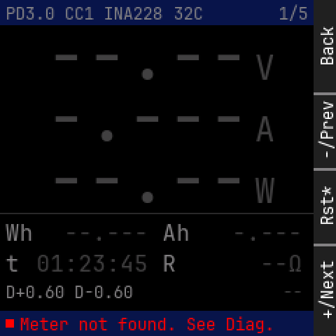

Panel: Back / -/Prev / Rst* / +/Next

```
    0123456789012345678901234567|
  0 PD3.0CC1 INA22832C      1/5 |
 12                             |
 24                             |
 36     -   -   .   -   -       |
 48                       V     |
 60                             |
 72     -   .   -   -   -       |
 84                       A     |
 96                             |
108                             |
120     -   -   .   -   -       |
132                       W     |
144 ----------------------------|
156 Wh   --.---   Ah    -.---   |
168                             |
180 t  01:23:45   R        --O  |
192                             |
204 D+0.60 D-0.60            -- |
216                             |
228  Meter not found. See Diag. |
```

<details><summary>Element table</summary>

| element | x | y | w | h | font | token |
|---|---|---|---|---|---|---|
| status bar | 0 | 0 | 224 | 18 | - | `bar` |
| PD rev | 4 | 3 | 35 | 13 | 12 | `dim` |
| CC pin | 46 | 3 | 21 | 13 | 12 | `dim` |
| meter chip | 74 | 3 | 42 | 13 | 12 | `dim` |
| MCU temp | 124 | 3 | 21 | 13 | 12 | `dim` |
| page n/N | 199 | 3 | 21 | 13 | 12 | `dim` |
| V digits | 33 | 22 | 145 | 35 | 48 | `faint` |
| V unit | 182 | 35 | 14 | 26 | 24 | `faint` |
| A digits | 33 | 66 | 145 | 35 | 48 | `faint` |
| A unit | 182 | 79 | 14 | 26 | 24 | `faint` |
| W digits | 33 | 110 | 145 | 35 | 48 | `faint` |
| W unit | 182 | 123 | 14 | 26 | 24 | `faint` |
| divider | 0 | 152 | 224 | 1 | - | `rule` |
| Wh label | 4 | 158 | 20 | 17 | 16 | `dim` |
| Wh | 46 | 158 | 60 | 17 | 16 | `faint` |
| Ah label | 116 | 158 | 20 | 17 | 16 | `dim` |
| Ah | 166 | 158 | 50 | 17 | 16 | `faint` |
| time label | 4 | 180 | 10 | 17 | 16 | `dim` |
| elapsed | 26 | 180 | 80 | 17 | 16 | `faint` |
| load R label | 116 | 180 | 10 | 17 | 16 | `dim` |
| load R | 186 | 180 | 30 | 17 | 16 | `faint` |
| D lines | 4 | 202 | 91 | 13 | 12 | `dim` |
| FC protocol | 202 | 202 | 14 | 13 | 12 | `faint` |
| footer | 0 | 222 | 224 | 18 | - | `bar` |
| state dot | 4 | 228 | 6 | 6 | - | `error` |
| footer text | 14 | 225 | 182 | 13 | 12 | `error` |

</details>

## home_reboot_hold

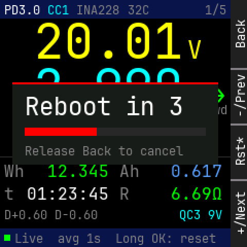

Panel: Back / -/Prev / Rst* / +/Next

```
    0123456789012345678901234567|
  0 PD3.0CC1 INA22832C      1/5 |
 12                             |
 24                             |
 36     2   0   .   0   1       |
 48                       V     |
 60                             |
 72  -------------------------  |
 84                       A  >  |
 96    R e b o o t   i n   3 fwd|
108                             |
120     5   9   .   8   3       |
132                       W     |
144 ---Release Back to cancel---|
156 Wh   12.345   Ah    0.617   |
168                             |
180 t  01:23:45   R     6.69O   |
192                             |
204 D+0.60 D-0.60        QC3 9V |
216                             |
228  Live  avg 1s  Long OK: rese|
```

<details><summary>Element table</summary>

| element | x | y | w | h | font | token |
|---|---|---|---|---|---|---|
| status bar | 0 | 0 | 224 | 18 | - | `bar` |
| PD rev | 4 | 3 | 35 | 13 | 12 | `text` |
| CC pin | 46 | 3 | 21 | 13 | 12 | `amp` |
| meter chip | 74 | 3 | 42 | 13 | 12 | `dim` |
| MCU temp | 124 | 3 | 21 | 13 | 12 | `dim` |
| page n/N | 199 | 3 | 21 | 13 | 12 | `dim` |
| V digits | 33 | 22 | 145 | 35 | 48 | `volt` |
| V unit | 182 | 35 | 14 | 26 | 24 | `volt` |
| A digits | 33 | 66 | 145 | 35 | 48 | `amp` |
| A unit | 182 | 79 | 14 | 26 | 24 | `amp` |
| W digits | 33 | 110 | 145 | 35 | 48 | `watt` |
| W unit | 182 | 123 | 14 | 26 | 24 | `watt` |
| flow arrow | 204 | 79 | 14 | 26 | 24 | `flow_fwd` |
| flow caption | 200 | 100 | 21 | 13 | 12 | `dim` |
| divider | 0 | 152 | 224 | 1 | - | `rule` |
| Wh label | 4 | 158 | 20 | 17 | 16 | `dim` |
| Wh | 46 | 158 | 60 | 17 | 16 | `energy` |
| Ah label | 116 | 158 | 20 | 17 | 16 | `dim` |
| Ah | 166 | 158 | 50 | 17 | 16 | `charge` |
| time label | 4 | 180 | 10 | 17 | 16 | `dim` |
| elapsed | 26 | 180 | 80 | 17 | 16 | `text` |
| load R label | 116 | 180 | 10 | 17 | 16 | `dim` |
| load R | 166 | 180 | 50 | 17 | 16 | `energy` |
| D lines | 4 | 202 | 91 | 13 | 12 | `dim` |
| FC protocol | 174 | 202 | 42 | 13 | 12 | `amp` |
| footer | 0 | 222 | 224 | 18 | - | `bar` |
| state dot | 4 | 228 | 6 | 6 | - | `ok` |
| footer text | 14 | 225 | 196 | 13 | 12 | `dim` |
| hold card | 12 | 80 | 200 | 80 | - | `surface` |
| card accent | 12 | 80 | 200 | 2 | - | `error` |
| countdown | 24 | 90 | 154 | 26 | 24 | `text` |
| hold track | 24 | 124 | 176 | 8 | - | `rule` |
| hold fill | 24 | 124 | 70 | 8 | - | `error` |
| "Release Back to cancel" | 24 | 140 | 154 | 13 | 12 | `dim` |

</details>

## pd_live

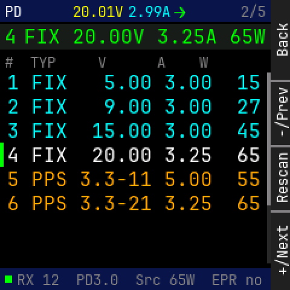

Panel: Back / -/Prev / Rescan / +/Next

```
    0123456789012345678901234567|
  0 PD     20.01V2.99A>     2/5 |
 12                             |
 24 4 FIX 20.00V 3.25A 65W      |
 36                             |
 48 #  TYP     V      A    W    |
 60 1 FIX   5.00 3.00  15       |
 72                             |
 84 2 FIX   9.00 3.00  27       |
 96                             |
108 3 FIX  15.00 3.00  45       |
120 4 FIX  20.00 3.25  65       |
132                             |
144 5 PPS 3.3-11 5.00  55       |
156                             |
168 6 PPS 3.3-21 3.25  65       |
180                             |
192                             |
204                             |
216                             |
228  RX 12  PD3.0  Src 65W  EPR |
```

<details><summary>Element table</summary>

| element | x | y | w | h | font | token |
|---|---|---|---|---|---|---|
| status bar | 0 | 0 | 224 | 18 | - | `bar` |
| title | 4 | 3 | 14 | 13 | 12 | `text` |
| mini V | 60 | 3 | 42 | 13 | 12 | `volt` |
| mini A | 106 | 3 | 35 | 13 | 12 | `amp` |
| mini flow | 144 | 2 | 10 | 17 | 16 | `flow_fwd` |
| page n/N | 199 | 3 | 21 | 13 | 12 | `dim` |
| contract strip | 0 | 20 | 224 | 21 | - | `surface` |
| contract index | 4 | 22 | 10 | 17 | 16 | `energy` |
| contract | 20 | 22 | 200 | 17 | 16 | `energy` |
| column head | 4 | 45 | 168 | 13 | 12 | `dim` |
| PDO 1 | 6 | 60 | 210 | 17 | 16 | `amp` |
| PDO 2 | 6 | 80 | 210 | 17 | 16 | `amp` |
| PDO 3 | 6 | 100 | 210 | 17 | 16 | `amp` |
| active marker | 0 | 118 | 3 | 20 | - | `energy` |
| PDO 4 | 6 | 120 | 210 | 17 | 16 | `text` |
| PDO 5 | 6 | 140 | 210 | 17 | 16 | `watt` |
| PDO 6 | 6 | 160 | 210 | 17 | 16 | `watt` |
| scroll track | 221 | 60 | 3 | 158 | - | `rule` |
| scroll thumb | 221 | 60 | 3 | 110 | - | `dim` |
| footer | 0 | 222 | 224 | 18 | - | `bar` |
| state dot | 4 | 228 | 6 | 6 | - | `ok` |
| footer text | 14 | 225 | 203 | 13 | 12 | `dim` |

</details>

## pd_wait

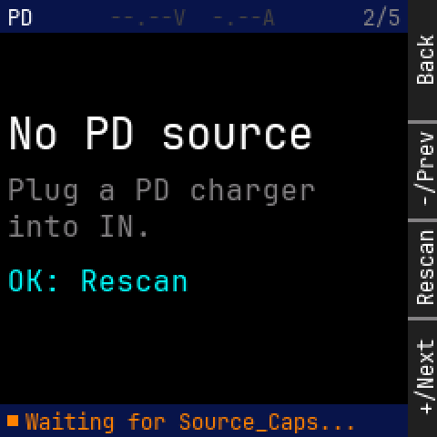

Panel: Back / -/Prev / Rescan / +/Next

```
    0123456789012345678901234567|
  0 PD     --.--V  -.--A    2/5 |
 12                             |
 24                             |
 36                             |
 48                             |
 60                             |
 72 N o   P D   s o u r c e     |
 84                             |
 96 Plug a PD charger           |
108                             |
120 into IN.                    |
132                             |
144 OK: Rescan                  |
156                             |
168                             |
180                             |
192                             |
204                             |
216                             |
228  Waiting for Source_Caps... |
```

<details><summary>Element table</summary>

| element | x | y | w | h | font | token |
|---|---|---|---|---|---|---|
| status bar | 0 | 0 | 224 | 18 | - | `bar` |
| title | 4 | 3 | 14 | 13 | 12 | `text` |
| mini readout (none) | 60 | 3 | 91 | 13 | 12 | `faint` |
| page n/N | 199 | 3 | 21 | 13 | 12 | `dim` |
| empty title | 4 | 60 | 168 | 26 | 24 | `text` |
| empty hint | 4 | 96 | 170 | 17 | 16 | `dim` |
| empty hint | 4 | 116 | 80 | 17 | 16 | `dim` |
| empty action | 4 | 146 | 100 | 17 | 16 | `amp` |
| footer | 0 | 222 | 224 | 18 | - | `bar` |
| state dot | 4 | 228 | 6 | 6 | - | `caution` |
| footer text | 14 | 225 | 182 | 13 | 12 | `caution` |

</details>

## pd_stale

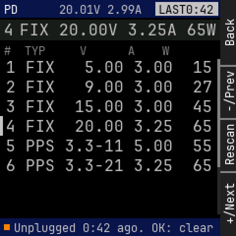

Panel: Back / -/Prev / Rescan / +/Next

```
    0123456789012345678901234567|
  0 PD     20.01V 2.99A LAST0:42|
 12                             |
 24 4 FIX 20.00V 3.25A 65W      |
 36                             |
 48 #  TYP     V      A    W    |
 60 1 FIX   5.00 3.00  15       |
 72                             |
 84 2 FIX   9.00 3.00  27       |
 96                             |
108 3 FIX  15.00 3.00  45       |
120 4 FIX  20.00 3.25  65       |
132                             |
144 5 PPS 3.3-11 5.00  55       |
156                             |
168 6 PPS 3.3-21 3.25  65       |
180                             |
192                             |
204                             |
216                             |
228  Unplugged 0:42 ago. OK: cle|
```

<details><summary>Element table</summary>

| element | x | y | w | h | font | token |
|---|---|---|---|---|---|---|
| status bar | 0 | 0 | 224 | 18 | - | `bar` |
| title | 4 | 3 | 14 | 13 | 12 | `text` |
| mini readout (stale) | 60 | 3 | 84 | 13 | 12 | `stale` |
| LAST badge | 158 | 2 | 64 | 14 | - | `stale` |
| badge text | 161 | 3 | 56 | 13 | 12 | `bg` |
| contract strip | 0 | 20 | 224 | 21 | - | `surface` |
| contract index | 4 | 22 | 10 | 17 | 16 | `stale` |
| contract | 20 | 22 | 200 | 17 | 16 | `stale` |
| column head | 4 | 45 | 168 | 13 | 12 | `dim` |
| PDO 1 | 6 | 60 | 210 | 17 | 16 | `stale` |
| PDO 2 | 6 | 80 | 210 | 17 | 16 | `stale` |
| PDO 3 | 6 | 100 | 210 | 17 | 16 | `stale` |
| active marker | 0 | 118 | 3 | 20 | - | `stale` |
| PDO 4 | 6 | 120 | 210 | 17 | 16 | `stale` |
| PDO 5 | 6 | 140 | 210 | 17 | 16 | `stale` |
| PDO 6 | 6 | 160 | 210 | 17 | 16 | `stale` |
| scroll track | 221 | 60 | 3 | 158 | - | `rule` |
| scroll thumb | 221 | 60 | 3 | 110 | - | `dim` |
| footer | 0 | 222 | 224 | 18 | - | `bar` |
| state dot | 4 | 228 | 6 | 6 | - | `caution` |
| footer text | 14 | 225 | 203 | 13 | 12 | `stale` |

</details>

## diag

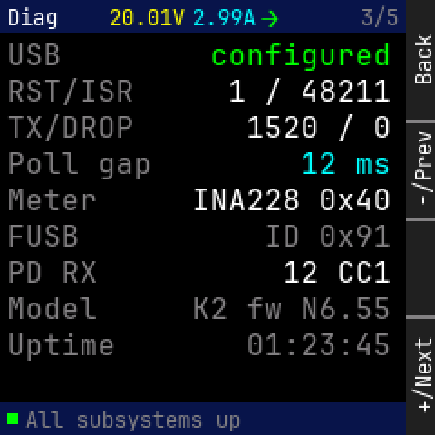

Panel: Back / -/Prev / (empty) / +/Next

```
    0123456789012345678901234567|
  0 Diag   20.01V2.99A>     3/5 |
 12                             |
 24 USB           configured    |
 36                             |
 48 RST/ISR        1 / 48211    |
 60 TX/DROP          1520 / 0   |
 72                             |
 84 Poll gap            12 ms   |
 96                             |
108 Meter        INA228 0x40    |
120 FUSB              ID 0x91   |
132                             |
144 PD RX              12 CC1   |
156                             |
168 Model        K2 fw N6.55    |
180 Uptime           01:23:45   |
192                             |
204                             |
216                             |
228  All subsystems up          |
```

<details><summary>Element table</summary>

| element | x | y | w | h | font | token |
|---|---|---|---|---|---|---|
| status bar | 0 | 0 | 224 | 18 | - | `bar` |
| title | 4 | 3 | 28 | 13 | 12 | `text` |
| mini V | 60 | 3 | 42 | 13 | 12 | `volt` |
| mini A | 106 | 3 | 35 | 13 | 12 | `amp` |
| mini flow | 144 | 2 | 10 | 17 | 16 | `flow_fwd` |
| page n/N | 199 | 3 | 21 | 13 | 12 | `dim` |
| key USB | 4 | 22 | 30 | 17 | 16 | `dim` |
| value USB | 116 | 22 | 100 | 17 | 16 | `energy` |
| key RST/ISR | 4 | 42 | 70 | 17 | 16 | `dim` |
| value RST/ISR | 126 | 42 | 90 | 17 | 16 | `text` |
| key TX/DROP | 4 | 62 | 70 | 17 | 16 | `dim` |
| value TX/DROP | 136 | 62 | 80 | 17 | 16 | `text` |
| key Poll gap | 4 | 82 | 80 | 17 | 16 | `dim` |
| value Poll gap | 166 | 82 | 50 | 17 | 16 | `amp` |
| key Meter | 4 | 102 | 50 | 17 | 16 | `dim` |
| value Meter | 106 | 102 | 110 | 17 | 16 | `text` |
| key FUSB | 4 | 122 | 40 | 17 | 16 | `dim` |
| value FUSB | 146 | 122 | 70 | 17 | 16 | `dim` |
| key PD RX | 4 | 142 | 50 | 17 | 16 | `dim` |
| value PD RX | 156 | 142 | 60 | 17 | 16 | `text` |
| key Model | 4 | 162 | 50 | 17 | 16 | `dim` |
| value Model | 106 | 162 | 110 | 17 | 16 | `dim` |
| key Uptime | 4 | 182 | 60 | 17 | 16 | `dim` |
| value Uptime | 136 | 182 | 80 | 17 | 16 | `dim` |
| footer | 0 | 222 | 224 | 18 | - | `bar` |
| state dot | 4 | 228 | 6 | 6 | - | `ok` |
| footer text | 14 | 225 | 119 | 13 | 12 | `dim` |

</details>

## lines

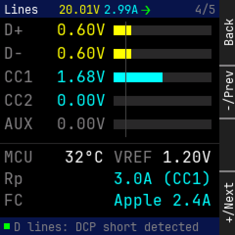

Panel: Back / -/Prev / (empty) / +/Next

```
    0123456789012345678901234567|
  0 Lines  20.01V2.99A>     4/5 |
 12                             |
 24 D+     0.60V                |
 36                             |
 48 D-     0.60V                |
 60                             |
 72 CC1    1.68V                |
 84                             |
 96 CC2    0.00V                |
108                             |
120 AUX    0.00V                |
132                             |
144 ----------------------------|
156 MCU     32oC  VREF  1.20V   |
168                             |
180 Rp            3.0A (CC1)    |
192                             |
204 FC            Apple 2.4A    |
216                             |
228  D lines: DCP short detected|
```

<details><summary>Element table</summary>

| element | x | y | w | h | font | token |
|---|---|---|---|---|---|---|
| status bar | 0 | 0 | 224 | 18 | - | `bar` |
| title | 4 | 3 | 35 | 13 | 12 | `text` |
| mini V | 60 | 3 | 42 | 13 | 12 | `volt` |
| mini A | 106 | 3 | 35 | 13 | 12 | `amp` |
| mini flow | 144 | 2 | 10 | 17 | 16 | `flow_fwd` |
| page n/N | 199 | 3 | 21 | 13 | 12 | `dim` |
| D+ label | 4 | 22 | 20 | 17 | 16 | `dim` |
| D+ value | 58 | 22 | 50 | 17 | 16 | `volt` |
| D+ bar track | 116 | 26 | 100 | 10 | - | `rule` |
| D+ bar fill | 116 | 26 | 18 | 10 | - | `volt` |
| D- label | 4 | 46 | 20 | 17 | 16 | `dim` |
| D- value | 58 | 46 | 50 | 17 | 16 | `volt` |
| D- bar track | 116 | 50 | 100 | 10 | - | `rule` |
| D- bar fill | 116 | 50 | 18 | 10 | - | `volt` |
| CC1 label | 4 | 70 | 30 | 17 | 16 | `dim` |
| CC1 value | 58 | 70 | 50 | 17 | 16 | `amp` |
| CC1 bar track | 116 | 74 | 100 | 10 | - | `rule` |
| CC1 bar fill | 116 | 74 | 50 | 10 | - | `amp` |
| CC2 label | 4 | 94 | 30 | 17 | 16 | `dim` |
| CC2 value | 58 | 94 | 50 | 17 | 16 | `amp` |
| CC2 bar track | 116 | 98 | 100 | 10 | - | `rule` |
| CC2 bar fill | 116 | 98 | 0 | 10 | - | `amp` |
| AUX label | 4 | 118 | 30 | 17 | 16 | `dim` |
| AUX value | 58 | 118 | 50 | 17 | 16 | `dim` |
| AUX bar track | 116 | 122 | 100 | 10 | - | `rule` |
| AUX bar fill | 116 | 122 | 0 | 10 | - | `dim` |
| 0.4V tick | 128 | 22 | 1 | 118 | - | `faint` |
| divider | 0 | 146 | 224 | 1 | - | `rule` |
| "MCU" | 4 | 152 | 30 | 17 | 16 | `dim` |
| "32°C" | 66 | 152 | 40 | 17 | 16 | `text` |
| "VREF" | 116 | 152 | 40 | 17 | 16 | `dim` |
| "1.20V" | 166 | 152 | 50 | 17 | 16 | `text` |
| "Rp" | 4 | 174 | 20 | 17 | 16 | `dim` |
| Rp advert | 116 | 174 | 100 | 17 | 16 | `amp` |
| "FC" | 4 | 196 | 20 | 17 | 16 | `dim` |
| FC guess | 116 | 196 | 100 | 17 | 16 | `amp` |
| footer | 0 | 222 | 224 | 18 | - | `bar` |
| state dot | 4 | 228 | 6 | 6 | - | `ok` |
| footer text | 14 | 225 | 189 | 13 | 12 | `dim` |

</details>

## tools_ready

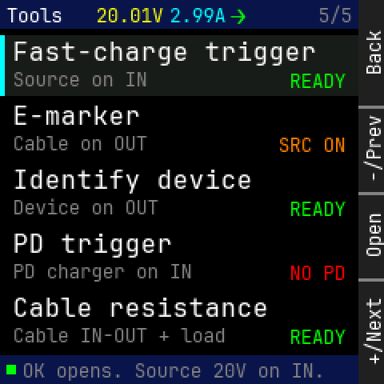

Panel: Back / -/Prev / Open / +/Next

```
    0123456789012345678901234567|
  0 Tools  20.01V2.99A>     5/5 |
 12                             |
 24  Fast-charge trigger        |
 36                             |
 48  Source on IN         READY |
 60                             |
 72  E-marker                   |
 84  Cable on OUT        SRC ON |
 96                             |
108  Identify device            |
120  Device on OUT        READY |
132                             |
144  PD trigger                 |
156                             |
168  PD charger on IN     NO PD |
180                             |
192  Cable resistance           |
204  Cable IN-OUT + load  READY |
216                             |
228  OK opens. Source 20V on IN.|
```

<details><summary>Element table</summary>

| element | x | y | w | h | font | token |
|---|---|---|---|---|---|---|
| status bar | 0 | 0 | 224 | 18 | - | `bar` |
| title | 4 | 3 | 35 | 13 | 12 | `text` |
| mini V | 60 | 3 | 42 | 13 | 12 | `volt` |
| mini A | 106 | 3 | 35 | 13 | 12 | `amp` |
| mini flow | 144 | 2 | 10 | 17 | 16 | `flow_fwd` |
| page n/N | 199 | 3 | 21 | 13 | 12 | `dim` |
| selected row | 0 | 22 | 224 | 38 | - | `surface` |
| focus bar | 0 | 22 | 3 | 38 | - | `focus` |
| tool 0 | 8 | 24 | 190 | 17 | 16 | `text` |
| setup hint 0 | 8 | 43 | 84 | 13 | 12 | `dim` |
| readiness 0 | 181 | 44 | 35 | 13 | 12 | `ok` |
| tool 1 | 8 | 64 | 80 | 17 | 16 | `text` |
| setup hint 1 | 8 | 83 | 84 | 13 | 12 | `dim` |
| readiness 1 | 174 | 84 | 42 | 13 | 12 | `caution` |
| tool 2 | 8 | 104 | 150 | 17 | 16 | `text` |
| setup hint 2 | 8 | 123 | 91 | 13 | 12 | `dim` |
| readiness 2 | 181 | 124 | 35 | 13 | 12 | `ok` |
| tool 3 | 8 | 144 | 100 | 17 | 16 | `text` |
| setup hint 3 | 8 | 163 | 112 | 13 | 12 | `dim` |
| readiness 3 | 181 | 164 | 35 | 13 | 12 | `error` |
| tool 4 | 8 | 184 | 160 | 17 | 16 | `text` |
| setup hint 4 | 8 | 203 | 133 | 13 | 12 | `dim` |
| readiness 4 | 181 | 204 | 35 | 13 | 12 | `ok` |
| footer | 0 | 222 | 224 | 18 | - | `bar` |
| state dot | 4 | 228 | 6 | 6 | - | `ok` |
| footer text | 14 | 225 | 189 | 13 | 12 | `dim` |

</details>

## tools_blocked

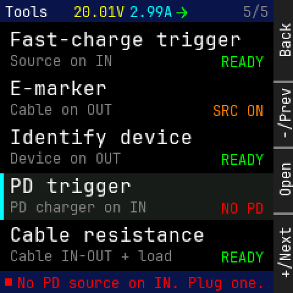

Panel: Back / -/Prev / Open / +/Next

```
    0123456789012345678901234567|
  0 Tools  20.01V2.99A>     5/5 |
 12                             |
 24  Fast-charge trigger        |
 36                             |
 48  Source on IN         READY |
 60                             |
 72  E-marker                   |
 84  Cable on OUT        SRC ON |
 96                             |
108  Identify device            |
120  Device on OUT        READY |
132                             |
144  PD trigger                 |
156                             |
168  PD charger on IN     NO PD |
180                             |
192  Cable resistance           |
204  Cable IN-OUT + load  READY |
216                             |
228  No PD source on IN. Plug on|
```

<details><summary>Element table</summary>

| element | x | y | w | h | font | token |
|---|---|---|---|---|---|---|
| status bar | 0 | 0 | 224 | 18 | - | `bar` |
| title | 4 | 3 | 35 | 13 | 12 | `text` |
| mini V | 60 | 3 | 42 | 13 | 12 | `volt` |
| mini A | 106 | 3 | 35 | 13 | 12 | `amp` |
| mini flow | 144 | 2 | 10 | 17 | 16 | `flow_fwd` |
| page n/N | 199 | 3 | 21 | 13 | 12 | `dim` |
| tool 0 | 8 | 24 | 190 | 17 | 16 | `text` |
| setup hint 0 | 8 | 43 | 84 | 13 | 12 | `dim` |
| readiness 0 | 181 | 44 | 35 | 13 | 12 | `ok` |
| tool 1 | 8 | 64 | 80 | 17 | 16 | `text` |
| setup hint 1 | 8 | 83 | 84 | 13 | 12 | `dim` |
| readiness 1 | 174 | 84 | 42 | 13 | 12 | `caution` |
| tool 2 | 8 | 104 | 150 | 17 | 16 | `text` |
| setup hint 2 | 8 | 123 | 91 | 13 | 12 | `dim` |
| readiness 2 | 181 | 124 | 35 | 13 | 12 | `ok` |
| selected row | 0 | 142 | 224 | 38 | - | `surface` |
| focus bar | 0 | 142 | 3 | 38 | - | `focus` |
| tool 3 | 8 | 144 | 100 | 17 | 16 | `text` |
| setup hint 3 | 8 | 163 | 112 | 13 | 12 | `dim` |
| readiness 3 | 181 | 164 | 35 | 13 | 12 | `error` |
| tool 4 | 8 | 184 | 160 | 17 | 16 | `text` |
| setup hint 4 | 8 | 203 | 133 | 13 | 12 | `dim` |
| readiness 4 | 181 | 204 | 35 | 13 | 12 | `ok` |
| footer | 0 | 222 | 224 | 18 | - | `bar` |
| state dot | 4 | 228 | 6 | 6 | - | `error` |
| footer text | 14 | 225 | 203 | 13 | 12 | `error` |

</details>

## tools_caution

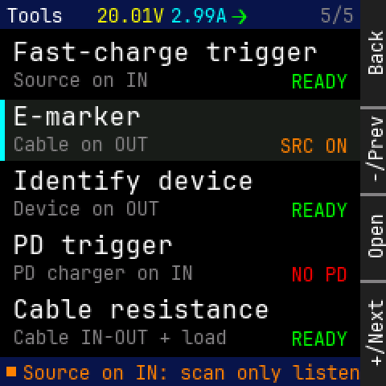

Panel: Back / -/Prev / Open / +/Next

```
    0123456789012345678901234567|
  0 Tools  20.01V2.99A>     5/5 |
 12                             |
 24  Fast-charge trigger        |
 36                             |
 48  Source on IN         READY |
 60                             |
 72  E-marker                   |
 84  Cable on OUT        SRC ON |
 96                             |
108  Identify device            |
120  Device on OUT        READY |
132                             |
144  PD trigger                 |
156                             |
168  PD charger on IN     NO PD |
180                             |
192  Cable resistance           |
204  Cable IN-OUT + load  READY |
216                             |
228  Source on IN: scan only lis|
```

<details><summary>Element table</summary>

| element | x | y | w | h | font | token |
|---|---|---|---|---|---|---|
| status bar | 0 | 0 | 224 | 18 | - | `bar` |
| title | 4 | 3 | 35 | 13 | 12 | `text` |
| mini V | 60 | 3 | 42 | 13 | 12 | `volt` |
| mini A | 106 | 3 | 35 | 13 | 12 | `amp` |
| mini flow | 144 | 2 | 10 | 17 | 16 | `flow_fwd` |
| page n/N | 199 | 3 | 21 | 13 | 12 | `dim` |
| tool 0 | 8 | 24 | 190 | 17 | 16 | `text` |
| setup hint 0 | 8 | 43 | 84 | 13 | 12 | `dim` |
| readiness 0 | 181 | 44 | 35 | 13 | 12 | `ok` |
| selected row | 0 | 62 | 224 | 38 | - | `surface` |
| focus bar | 0 | 62 | 3 | 38 | - | `focus` |
| tool 1 | 8 | 64 | 80 | 17 | 16 | `text` |
| setup hint 1 | 8 | 83 | 84 | 13 | 12 | `dim` |
| readiness 1 | 174 | 84 | 42 | 13 | 12 | `caution` |
| tool 2 | 8 | 104 | 150 | 17 | 16 | `text` |
| setup hint 2 | 8 | 123 | 91 | 13 | 12 | `dim` |
| readiness 2 | 181 | 124 | 35 | 13 | 12 | `ok` |
| tool 3 | 8 | 144 | 100 | 17 | 16 | `text` |
| setup hint 3 | 8 | 163 | 112 | 13 | 12 | `dim` |
| readiness 3 | 181 | 164 | 35 | 13 | 12 | `error` |
| tool 4 | 8 | 184 | 160 | 17 | 16 | `text` |
| setup hint 4 | 8 | 203 | 133 | 13 | 12 | `dim` |
| readiness 4 | 181 | 204 | 35 | 13 | 12 | `ok` |
| footer | 0 | 222 | 224 | 18 | - | `bar` |
| state dot | 4 | 228 | 6 | 6 | - | `caution` |
| footer text | 14 | 225 | 217 | 13 | 12 | `caution` |

</details>

## emarker_setup

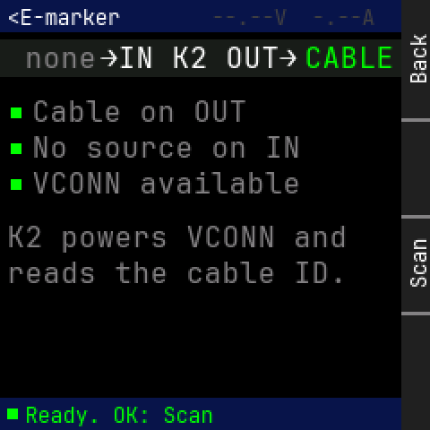

Panel: Back / (empty) / Scan / (empty)

```
    0123456789012345678901234567|
  0 <E-marker     --.--V  -.--A |
 12                             |
 24  none  >IN K2 OUT>   CABLE  |
 36                             |
 48                             |
 60   Cable on OUT              |
 72   No source on IN           |
 84                             |
 96   VCONN available           |
108                             |
120                             |
132 K2 powers VCONN and         |
144 reads the cable ID.         |
156                             |
168                             |
180                             |
192                             |
204                             |
216                             |
228  Ready. OK: Scan            |
```

<details><summary>Element table</summary>

| element | x | y | w | h | font | token |
|---|---|---|---|---|---|---|
| status bar | 0 | 0 | 224 | 18 | - | `bar` |
| title | 4 | 3 | 63 | 13 | 12 | `text` |
| mini readout (none) | 118 | 3 | 91 | 13 | 12 | `faint` |
| wiring strip | 0 | 22 | 224 | 21 | - | `surface` |
| IN side | 4 | 24 | 50 | 17 | 16 | `dim` |
| ports | 56 | 24 | 110 | 17 | 16 | `text` |
| OUT side | 170 | 24 | 50 | 17 | 16 | `ok` |
| check ok | 6 | 60 | 6 | 6 | - | `ok` |
| check text | 18 | 54 | 120 | 17 | 16 | `dim` |
| check ok | 6 | 80 | 6 | 6 | - | `ok` |
| check text | 18 | 74 | 150 | 17 | 16 | `dim` |
| check ok | 6 | 100 | 6 | 6 | - | `ok` |
| check text | 18 | 94 | 150 | 17 | 16 | `dim` |
| "K2 powers VCONN and" | 4 | 124 | 190 | 17 | 16 | `dim` |
| "reads the cable ID." | 4 | 144 | 190 | 17 | 16 | `dim` |
| footer | 0 | 222 | 224 | 18 | - | `bar` |
| state dot | 4 | 228 | 6 | 6 | - | `ok` |
| footer text | 14 | 225 | 105 | 13 | 12 | `ok` |

</details>

## emarker_sniff

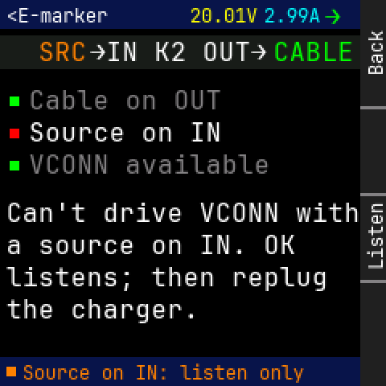

Panel: Back / (empty) / Listen / (empty)

```
    0123456789012345678901234567|
  0 <E-marker     20.01V2.99A>  |
 12                             |
 24   SRC  >IN K2 OUT>   CABLE  |
 36                             |
 48                             |
 60   Cable on OUT              |
 72   Source on IN              |
 84                             |
 96   VCONN available           |
108                             |
120                             |
132 Can't drive VCONN with      |
144 a source on IN. OK          |
156                             |
168 listens; then replug        |
180                             |
192 the charger.                |
204                             |
216                             |
228  Source on IN: listen only  |
```

<details><summary>Element table</summary>

| element | x | y | w | h | font | token |
|---|---|---|---|---|---|---|
| status bar | 0 | 0 | 224 | 18 | - | `bar` |
| title | 4 | 3 | 63 | 13 | 12 | `text` |
| mini V | 118 | 3 | 42 | 13 | 12 | `volt` |
| mini A | 164 | 3 | 35 | 13 | 12 | `amp` |
| mini flow | 202 | 2 | 10 | 17 | 16 | `flow_fwd` |
| wiring strip | 0 | 22 | 224 | 21 | - | `surface` |
| IN side | 4 | 24 | 50 | 17 | 16 | `caution` |
| ports | 56 | 24 | 110 | 17 | 16 | `text` |
| OUT side | 170 | 24 | 50 | 17 | 16 | `ok` |
| check ok | 6 | 60 | 6 | 6 | - | `ok` |
| check text | 18 | 54 | 120 | 17 | 16 | `dim` |
| check bad | 6 | 80 | 6 | 6 | - | `error` |
| check text | 18 | 74 | 120 | 17 | 16 | `text` |
| check ok | 6 | 100 | 6 | 6 | - | `ok` |
| check text | 18 | 94 | 150 | 17 | 16 | `dim` |
| "Can't drive VCONN with" | 4 | 124 | 220 | 17 | 16 | `text` |
| "a source on IN. OK" | 4 | 144 | 180 | 17 | 16 | `text` |
| "listens; then replug" | 4 | 164 | 200 | 17 | 16 | `text` |
| "the charger." | 4 | 184 | 120 | 17 | 16 | `text` |
| footer | 0 | 222 | 224 | 18 | - | `bar` |
| state dot | 4 | 228 | 6 | 6 | - | `caution` |
| footer text | 14 | 225 | 175 | 13 | 12 | `caution` |

</details>

## emarker_scan


Panel: Back / (empty) / (empty) / (empty)

```
    0123456789012345678901234567|
  0 <E-marker     --.--V  -.--A |
 12                             |
 24                             |
 36                             |
 48                             |
 60                             |
 72 S c a n n i n g . . .       |
 84                             |
 96                             |
108                             |
120 SOP' Discover Identity      |
132                             |
144                             |
156                             |
168                             |
180                             |
192                             |
204                             |
216                             |
228  Scanning 2/4. Back cancels |
```

<details><summary>Element table</summary>

| element | x | y | w | h | font | token |
|---|---|---|---|---|---|---|
| status bar | 0 | 0 | 224 | 18 | - | `bar` |
| title | 4 | 3 | 63 | 13 | 12 | `text` |
| mini readout (none) | 118 | 3 | 91 | 13 | 12 | `faint` |
| progress title | 4 | 60 | 154 | 26 | 24 | `volt` |
| progress track | 4 | 96 | 212 | 8 | - | `rule` |
| progress fill | 4 | 96 | 120 | 8 | - | `volt` |
| step | 4 | 112 | 220 | 17 | 16 | `dim` |
| footer | 0 | 222 | 224 | 18 | - | `bar` |
| state dot | 4 | 228 | 6 | 6 | - | `caution` |
| footer text | 14 | 225 | 182 | 13 | 12 | `volt` |

</details>

## emarker_result

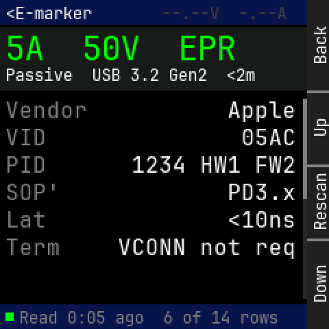

Panel: Back / Up / Rescan / Down

```
    0123456789012345678901234567|
  0 <E-marker     --.--V  -.--A |
 12                             |
 24 5 A     5 0 V     E P R     |
 36                             |
 48 Passive  USB 3.2 Gen2  <2m  |
 60                             |
 72 Vendor              Apple   |
 84                             |
 96 VID                   05AC  |
108                             |
120 PID         1234 HW1 FW2    |
132 SOP'                PD3.x   |
144                             |
156 Lat                 <10ns   |
168                             |
180 Term      VCONN not req     |
192                             |
204                             |
216                             |
228  Read 0:05 ago  6 of 14 rows|
```

<details><summary>Element table</summary>

| element | x | y | w | h | font | token |
|---|---|---|---|---|---|---|
| status bar | 0 | 0 | 224 | 18 | - | `bar` |
| title | 4 | 3 | 63 | 13 | 12 | `text` |
| mini readout (none) | 118 | 3 | 91 | 13 | 12 | `faint` |
| verdict card | 0 | 20 | 224 | 46 | - | `surface` |
| verdict | 4 | 22 | 168 | 26 | 24 | `energy` |
| verdict line 2 | 4 | 48 | 182 | 13 | 12 | `text` |
| "Vendor" | 4 | 72 | 60 | 17 | 16 | `dim` |
| "Apple" | 166 | 72 | 50 | 17 | 16 | `text` |
| "VID" | 4 | 92 | 30 | 17 | 16 | `dim` |
| "05AC" | 176 | 92 | 40 | 17 | 16 | `text` |
| "PID" | 4 | 112 | 30 | 17 | 16 | `dim` |
| "1234 HW1 FW2" | 96 | 112 | 120 | 17 | 16 | `text` |
| "SOP'" | 4 | 132 | 40 | 17 | 16 | `dim` |
| "PD3.x" | 166 | 132 | 50 | 17 | 16 | `text` |
| "Lat" | 4 | 152 | 30 | 17 | 16 | `dim` |
| "<10ns" | 166 | 152 | 50 | 17 | 16 | `text` |
| "Term" | 4 | 172 | 40 | 17 | 16 | `dim` |
| "VCONN not req" | 86 | 172 | 130 | 17 | 16 | `text` |
| scroll track | 221 | 72 | 3 | 146 | - | `rule` |
| scroll thumb | 221 | 72 | 3 | 73 | - | `dim` |
| footer | 0 | 222 | 224 | 18 | - | `bar` |
| state dot | 4 | 228 | 6 | 6 | - | `ok` |
| footer text | 14 | 225 | 189 | 13 | 12 | `dim` |

</details>

## emarker_none

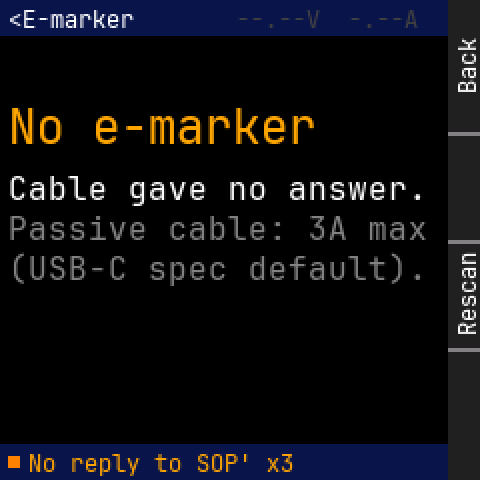

Panel: Back / (empty) / Rescan / (empty)

```
    0123456789012345678901234567|
  0 <E-marker     --.--V  -.--A |
 12                             |
 24                             |
 36                             |
 48                             |
 60 N o   e - m a r k e r       |
 72                             |
 84 Cable gave no answer.       |
 96                             |
108 Passive cable: 3A max       |
120                             |
132 (USB-C spec default).       |
144                             |
156                             |
168                             |
180                             |
192                             |
204                             |
216                             |
228  No reply to SOP' x3        |
```

<details><summary>Element table</summary>

| element | x | y | w | h | font | token |
|---|---|---|---|---|---|---|
| status bar | 0 | 0 | 224 | 18 | - | `bar` |
| title | 4 | 3 | 63 | 13 | 12 | `text` |
| mini readout (none) | 118 | 3 | 91 | 13 | 12 | `faint` |
| result title | 4 | 50 | 154 | 26 | 24 | `watt` |
| "Cable gave no answer." | 4 | 86 | 210 | 17 | 16 | `text` |
| "Passive cable: 3A max" | 4 | 106 | 210 | 17 | 16 | `dim` |
| "(USB-C spec default)." | 4 | 126 | 210 | 17 | 16 | `dim` |
| footer | 0 | 222 | 224 | 18 | - | `bar` |
| state dot | 4 | 228 | 6 | 6 | - | `caution` |
| footer text | 14 | 225 | 133 | 13 | 12 | `watt` |

</details>

## identify_setup

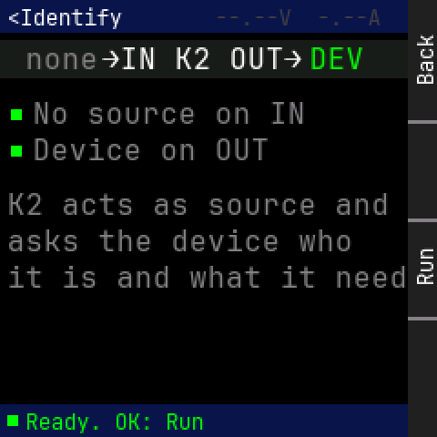

Panel: Back / (empty) / Run / (empty)

```
    0123456789012345678901234567|
  0 <Identify     --.--V  -.--A |
 12                             |
 24  none  >IN K2 OUT>   DEV    |
 36                             |
 48                             |
 60   No source on IN           |
 72   Device on OUT             |
 84                             |
 96                             |
108 K2 acts as source and       |
120                             |
132 asks the device who         |
144 it is and what it needs     |
156                             |
168                             |
180                             |
192                             |
204                             |
216                             |
228  Ready. OK: Run             |
```

<details><summary>Element table</summary>

| element | x | y | w | h | font | token |
|---|---|---|---|---|---|---|
| status bar | 0 | 0 | 224 | 18 | - | `bar` |
| title | 4 | 3 | 63 | 13 | 12 | `text` |
| mini readout (none) | 118 | 3 | 91 | 13 | 12 | `faint` |
| wiring strip | 0 | 22 | 224 | 21 | - | `surface` |
| IN side | 4 | 24 | 50 | 17 | 16 | `dim` |
| ports | 56 | 24 | 110 | 17 | 16 | `text` |
| OUT side | 170 | 24 | 50 | 17 | 16 | `ok` |
| check ok | 6 | 60 | 6 | 6 | - | `ok` |
| check text | 18 | 54 | 150 | 17 | 16 | `dim` |
| check ok | 6 | 80 | 6 | 6 | - | `ok` |
| check text | 18 | 74 | 130 | 17 | 16 | `dim` |
| "K2 acts as source and" | 4 | 104 | 210 | 17 | 16 | `dim` |
| "asks the device who" | 4 | 124 | 190 | 17 | 16 | `dim` |
| "it is and what it needs" | 4 | 144 | 230 | 17 | 16 | `dim` |
| footer | 0 | 222 | 224 | 18 | - | `bar` |
| state dot | 4 | 228 | 6 | 6 | - | `ok` |
| footer text | 14 | 225 | 98 | 13 | 12 | `ok` |

</details>

## identify_refused

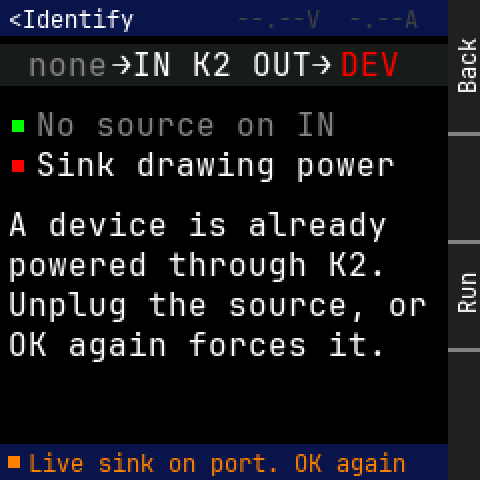

Panel: Back / (empty) / Run / (empty)

```
    0123456789012345678901234567|
  0 <Identify     --.--V  -.--A |
 12                             |
 24  none  >IN K2 OUT>   DEV    |
 36                             |
 48                             |
 60   No source on IN           |
 72   Sink drawing power        |
 84                             |
 96                             |
108 A device is already         |
120                             |
132 powered through K2.         |
144 Unplug the source, or       |
156                             |
168 OK again forces it.         |
180                             |
192                             |
204                             |
216                             |
228  Live sink on port. OK again|
```

<details><summary>Element table</summary>

| element | x | y | w | h | font | token |
|---|---|---|---|---|---|---|
| status bar | 0 | 0 | 224 | 18 | - | `bar` |
| title | 4 | 3 | 63 | 13 | 12 | `text` |
| mini readout (none) | 118 | 3 | 91 | 13 | 12 | `faint` |
| wiring strip | 0 | 22 | 224 | 21 | - | `surface` |
| IN side | 4 | 24 | 50 | 17 | 16 | `dim` |
| ports | 56 | 24 | 110 | 17 | 16 | `text` |
| OUT side | 170 | 24 | 50 | 17 | 16 | `error` |
| check ok | 6 | 60 | 6 | 6 | - | `ok` |
| check text | 18 | 54 | 150 | 17 | 16 | `dim` |
| check bad | 6 | 80 | 6 | 6 | - | `error` |
| check text | 18 | 74 | 180 | 17 | 16 | `text` |
| "A device is already" | 4 | 104 | 190 | 17 | 16 | `text` |
| "powered through K2." | 4 | 124 | 190 | 17 | 16 | `text` |
| "Unplug the source, or" | 4 | 144 | 210 | 17 | 16 | `text` |
| "OK again forces it." | 4 | 164 | 190 | 17 | 16 | `text` |
| footer | 0 | 222 | 224 | 18 | - | `bar` |
| state dot | 4 | 228 | 6 | 6 | - | `caution` |
| footer text | 14 | 225 | 189 | 13 | 12 | `caution` |

</details>

## identify_result

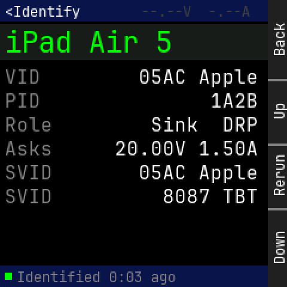

Panel: Back / Up / Rerun / Down

```
    0123456789012345678901234567|
  0 <Identify     --.--V  -.--A |
 12                             |
 24 i P a d   A i r   5         |
 36                             |
 48                             |
 60 VID           05AC Apple    |
 72                             |
 84 PID                   1A2B  |
 96 Role           Sink  DRP    |
108                             |
120 Asks        20.00V 1.50A    |
132                             |
144 SVID          05AC Apple    |
156 SVID             8087 TBT   |
168                             |
180                             |
192                             |
204                             |
216                             |
228  Identified 0:03 ago        |
```

<details><summary>Element table</summary>

| element | x | y | w | h | font | token |
|---|---|---|---|---|---|---|
| status bar | 0 | 0 | 224 | 18 | - | `bar` |
| title | 4 | 3 | 63 | 13 | 12 | `text` |
| mini readout (none) | 118 | 3 | 91 | 13 | 12 | `faint` |
| verdict card | 0 | 20 | 224 | 30 | - | `surface` |
| device | 4 | 22 | 140 | 26 | 24 | `energy` |
| "VID" | 4 | 56 | 30 | 17 | 16 | `dim` |
| "05AC Apple" | 116 | 56 | 100 | 17 | 16 | `text` |
| "PID" | 4 | 76 | 30 | 17 | 16 | `dim` |
| "1A2B" | 176 | 76 | 40 | 17 | 16 | `text` |
| "Role" | 4 | 96 | 40 | 17 | 16 | `dim` |
| "Sink  DRP" | 126 | 96 | 90 | 17 | 16 | `text` |
| "Asks" | 4 | 116 | 40 | 17 | 16 | `dim` |
| "20.00V 1.50A" | 96 | 116 | 120 | 17 | 16 | `text` |
| "SVID" | 4 | 136 | 40 | 17 | 16 | `dim` |
| "05AC Apple" | 116 | 136 | 100 | 17 | 16 | `text` |
| "SVID" | 4 | 156 | 40 | 17 | 16 | `dim` |
| "8087 TBT" | 136 | 156 | 80 | 17 | 16 | `text` |
| footer | 0 | 222 | 224 | 18 | - | `bar` |
| state dot | 4 | 228 | 6 | 6 | - | `ok` |
| footer text | 14 | 225 | 133 | 13 | 12 | `dim` |

</details>

## fc_setup

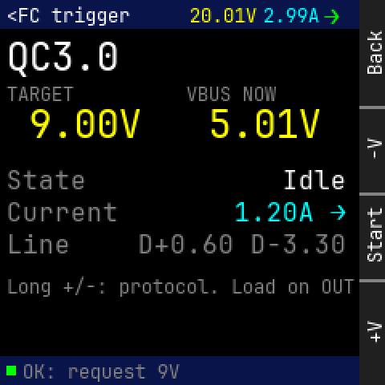

Panel: Back / -V / Start / +V

```
    0123456789012345678901234567|
  0 <FC trigger   20.01V2.99A>  |
 12                             |
 24 Q C 3 . 0                   |
 36                             |
 48 TARGET        VBUS NOW      |
 60                             |
 72   9 . 0 0 V     5 . 0 1 V   |
 84                             |
 96                             |
108 State                 Idle  |
120                             |
132 Current           1.20A >   |
144 Line      D+0.60 D-3.30     |
156                             |
168 Long +/-: protocol. Load on |
180                             |
192                             |
204                             |
216                             |
228  OK: request 9V             |
```

<details><summary>Element table</summary>

| element | x | y | w | h | font | token |
|---|---|---|---|---|---|---|
| status bar | 0 | 0 | 224 | 18 | - | `bar` |
| title | 4 | 3 | 77 | 13 | 12 | `text` |
| mini V | 118 | 3 | 42 | 13 | 12 | `volt` |
| mini A | 164 | 3 | 35 | 13 | 12 | `amp` |
| mini flow | 202 | 2 | 10 | 17 | 16 | `flow_fwd` |
| protocol | 4 | 22 | 70 | 26 | 24 | `text` |
| "TARGET" | 4 | 52 | 42 | 13 | 12 | `dim` |
| target | 4 | 64 | 84 | 26 | 24 | `volt` |
| "VBUS NOW" | 116 | 52 | 56 | 13 | 12 | `dim` |
| measured | 116 | 64 | 84 | 26 | 24 | `volt` |
| "State" | 4 | 104 | 50 | 17 | 16 | `dim` |
| "Idle" | 176 | 104 | 40 | 17 | 16 | `text` |
| "Current" | 4 | 124 | 70 | 17 | 16 | `dim` |
| "1.20A →" | 146 | 124 | 70 | 17 | 16 | `amp` |
| "Line" | 4 | 144 | 40 | 17 | 16 | `dim` |
| "D+0.60 D-3.30" | 86 | 144 | 130 | 17 | 16 | `dim` |
| hint | 4 | 172 | 238 | 13 | 12 | `dim` |
| footer | 0 | 222 | 224 | 18 | - | `bar` |
| state dot | 4 | 228 | 6 | 6 | - | `ok` |
| footer text | 14 | 225 | 98 | 13 | 12 | `dim` |

</details>

## fc_run

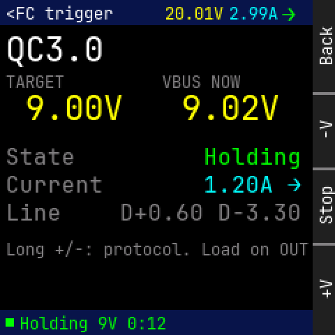

Panel: Back / -V / Stop / +V

```
    0123456789012345678901234567|
  0 <FC trigger   20.01V2.99A>  |
 12                             |
 24 Q C 3 . 0                   |
 36                             |
 48 TARGET        VBUS NOW      |
 60                             |
 72   9 . 0 0 V     9 . 0 2 V   |
 84                             |
 96                             |
108 State             Holding   |
120                             |
132 Current           1.20A >   |
144 Line      D+0.60 D-3.30     |
156                             |
168 Long +/-: protocol. Load on |
180                             |
192                             |
204                             |
216                             |
228  Holding 9V 0:12            |
```

<details><summary>Element table</summary>

| element | x | y | w | h | font | token |
|---|---|---|---|---|---|---|
| status bar | 0 | 0 | 224 | 18 | - | `bar` |
| title | 4 | 3 | 77 | 13 | 12 | `text` |
| mini V | 118 | 3 | 42 | 13 | 12 | `volt` |
| mini A | 164 | 3 | 35 | 13 | 12 | `amp` |
| mini flow | 202 | 2 | 10 | 17 | 16 | `flow_fwd` |
| protocol | 4 | 22 | 70 | 26 | 24 | `text` |
| "TARGET" | 4 | 52 | 42 | 13 | 12 | `dim` |
| target | 4 | 64 | 84 | 26 | 24 | `volt` |
| "VBUS NOW" | 116 | 52 | 56 | 13 | 12 | `dim` |
| measured | 116 | 64 | 84 | 26 | 24 | `volt` |
| "State" | 4 | 104 | 50 | 17 | 16 | `dim` |
| "Holding" | 146 | 104 | 70 | 17 | 16 | `energy` |
| "Current" | 4 | 124 | 70 | 17 | 16 | `dim` |
| "1.20A →" | 146 | 124 | 70 | 17 | 16 | `amp` |
| "Line" | 4 | 144 | 40 | 17 | 16 | `dim` |
| "D+0.60 D-3.30" | 86 | 144 | 130 | 17 | 16 | `dim` |
| hint | 4 | 172 | 238 | 13 | 12 | `dim` |
| footer | 0 | 222 | 224 | 18 | - | `bar` |
| state dot | 4 | 228 | 6 | 6 | - | `ok` |
| footer text | 14 | 225 | 105 | 13 | 12 | `energy` |

</details>

## fc_scan

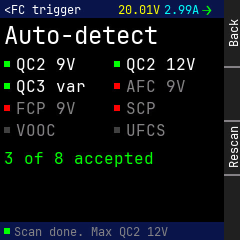

Panel: Back / (empty) / Rescan / (empty)

```
    0123456789012345678901234567|
  0 <FC trigger   20.01V2.99A>  |
 12                             |
 24 A u t o - d e t e c t       |
 36                             |
 48                             |
 60   QC2 9V       QC2 12V      |
 72                             |
 84   QC3 var      AFC 9V       |
 96                             |
108   FCP 9V       SCP          |
120   VOOC         UFCS         |
132                             |
144                             |
156 3 of 8 accepted             |
168                             |
180                             |
192                             |
204                             |
216                             |
228  Scan done. Max QC2 12V     |
```

<details><summary>Element table</summary>

| element | x | y | w | h | font | token |
|---|---|---|---|---|---|---|
| status bar | 0 | 0 | 224 | 18 | - | `bar` |
| title | 4 | 3 | 77 | 13 | 12 | `text` |
| mini V | 118 | 3 | 42 | 13 | 12 | `volt` |
| mini A | 164 | 3 | 35 | 13 | 12 | `amp` |
| mini flow | 202 | 2 | 10 | 17 | 16 | `flow_fwd` |
| protocol | 4 | 22 | 154 | 26 | 24 | `text` |
| result dot | 4 | 61 | 6 | 6 | - | `ok` |
| "QC2 9V" | 16 | 56 | 60 | 17 | 16 | `text` |
| result dot | 114 | 61 | 6 | 6 | - | `ok` |
| "QC2 12V" | 126 | 56 | 70 | 17 | 16 | `text` |
| result dot | 4 | 83 | 6 | 6 | - | `ok` |
| "QC3 var" | 16 | 78 | 70 | 17 | 16 | `text` |
| result dot | 114 | 83 | 6 | 6 | - | `error` |
| "AFC 9V" | 126 | 78 | 60 | 17 | 16 | `dim` |
| result dot | 4 | 105 | 6 | 6 | - | `error` |
| "FCP 9V" | 16 | 100 | 60 | 17 | 16 | `dim` |
| result dot | 114 | 105 | 6 | 6 | - | `error` |
| "SCP" | 126 | 100 | 30 | 17 | 16 | `dim` |
| result dot | 4 | 127 | 6 | 6 | - | `faint` |
| "VOOC" | 16 | 122 | 40 | 17 | 16 | `dim` |
| result dot | 114 | 127 | 6 | 6 | - | `faint` |
| "UFCS" | 126 | 122 | 40 | 17 | 16 | `dim` |
| summary | 4 | 150 | 150 | 17 | 16 | `energy` |
| footer | 0 | 222 | 224 | 18 | - | `bar` |
| state dot | 4 | 228 | 6 | 6 | - | `ok` |
| footer text | 14 | 225 | 154 | 13 | 12 | `dim` |

</details>

## fc_refused

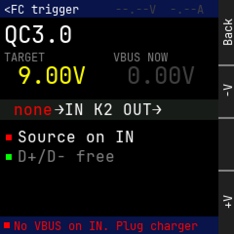

Panel: Back / -V / (empty) / +V

```
    0123456789012345678901234567|
  0 <FC trigger   --.--V  -.--A |
 12                             |
 24 Q C 3 . 0                   |
 36                             |
 48 TARGET        VBUS NOW      |
 60                             |
 72   9 . 0 0 V     0 . 0 0 V   |
 84                             |
 96                             |
108  none  >IN K2 OUT>          |
120                             |
132   Source on IN              |
144                             |
156   D+/D- free                |
168                             |
180                             |
192                             |
204                             |
216                             |
228  No VBUS on IN. Plug charger|
```

<details><summary>Element table</summary>

| element | x | y | w | h | font | token |
|---|---|---|---|---|---|---|
| status bar | 0 | 0 | 224 | 18 | - | `bar` |
| title | 4 | 3 | 77 | 13 | 12 | `text` |
| mini readout (none) | 118 | 3 | 91 | 13 | 12 | `faint` |
| protocol | 4 | 22 | 70 | 26 | 24 | `text` |
| "TARGET" | 4 | 52 | 42 | 13 | 12 | `dim` |
| target | 4 | 64 | 84 | 26 | 24 | `volt` |
| "VBUS NOW" | 116 | 52 | 56 | 13 | 12 | `dim` |
| measured | 116 | 64 | 84 | 26 | 24 | `faint` |
| wiring strip | 0 | 102 | 224 | 21 | - | `surface` |
| IN side | 4 | 104 | 50 | 17 | 16 | `error` |
| ports | 56 | 104 | 110 | 17 | 16 | `text` |
| OUT side | 170 | 104 | 50 | 17 | 16 | `dim` |
| check bad | 6 | 138 | 6 | 6 | - | `error` |
| check text | 18 | 132 | 120 | 17 | 16 | `text` |
| check ok | 6 | 158 | 6 | 6 | - | `ok` |
| check text | 18 | 152 | 100 | 17 | 16 | `dim` |
| footer | 0 | 222 | 224 | 18 | - | `bar` |
| state dot | 4 | 228 | 6 | 6 | - | `error` |
| footer text | 14 | 225 | 189 | 13 | 12 | `error` |

</details>

## pdt_list

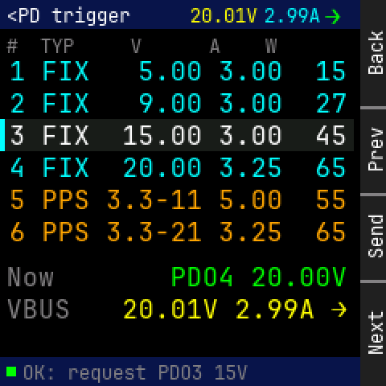

Panel: Back / Prev / Send / Next

```
    0123456789012345678901234567|
  0 <PD trigger   20.01V2.99A>  |
 12                             |
 24 #  TYP     V      A    W    |
 36 1 FIX   5.00 3.00  15       |
 48                             |
 60 2 FIX   9.00 3.00  27       |
 72                             |
 84 3 FIX  15.00 3.00  45       |
 96 4 FIX  20.00 3.25  65       |
108                             |
120 5 PPS 3.3-11 5.00  55       |
132                             |
144 6 PPS 3.3-21 3.25  65       |
156                             |
168 Now          PDO4 20.00V    |
180                             |
192 VBUS     20.01V 2.99A >     |
204                             |
216                             |
228  OK: request PDO3 15V       |
```

<details><summary>Element table</summary>

| element | x | y | w | h | font | token |
|---|---|---|---|---|---|---|
| status bar | 0 | 0 | 224 | 18 | - | `bar` |
| title | 4 | 3 | 77 | 13 | 12 | `text` |
| mini V | 118 | 3 | 42 | 13 | 12 | `volt` |
| mini A | 164 | 3 | 35 | 13 | 12 | `amp` |
| mini flow | 202 | 2 | 10 | 17 | 16 | `flow_fwd` |
| column head | 4 | 22 | 168 | 13 | 12 | `dim` |
| PDO 1 | 6 | 36 | 210 | 17 | 16 | `amp` |
| PDO 2 | 6 | 56 | 210 | 17 | 16 | `amp` |
| cursor row | 0 | 74 | 220 | 20 | - | `surface` |
| focus bar | 0 | 74 | 3 | 20 | - | `focus` |
| PDO 3 | 6 | 76 | 210 | 17 | 16 | `text` |
| PDO 4 | 6 | 96 | 210 | 17 | 16 | `amp` |
| PDO 5 | 6 | 116 | 210 | 17 | 16 | `watt` |
| PDO 6 | 6 | 136 | 210 | 17 | 16 | `watt` |
| "Now" | 4 | 164 | 30 | 17 | 16 | `dim` |
| "PDO4 20.00V" | 106 | 164 | 110 | 17 | 16 | `energy` |
| "VBUS" | 4 | 184 | 40 | 17 | 16 | `dim` |
| "20.01V 2.99A →" | 76 | 184 | 140 | 17 | 16 | `volt` |
| footer | 0 | 222 | 224 | 18 | - | `bar` |
| state dot | 4 | 228 | 6 | 6 | - | `ok` |
| footer text | 14 | 225 | 140 | 13 | 12 | `dim` |

</details>

## pdt_adjust

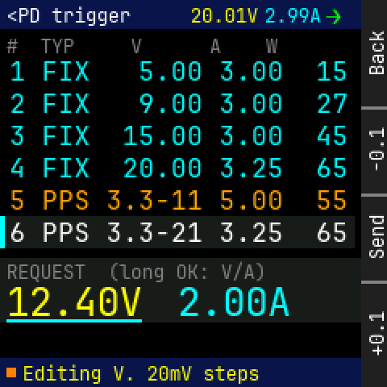

Panel: Back / -0.1 / Send / +0.1

```
    0123456789012345678901234567|
  0 <PD trigger   20.01V2.99A>  |
 12                             |
 24 #  TYP     V      A    W    |
 36 1 FIX   5.00 3.00  15       |
 48                             |
 60 2 FIX   9.00 3.00  27       |
 72                             |
 84 3 FIX  15.00 3.00  45       |
 96 4 FIX  20.00 3.25  65       |
108                             |
120 5 PPS 3.3-11 5.00  55       |
132                             |
144 6 PPS 3.3-21 3.25  65       |
156                             |
168 REQUEST  (long OK: V/A)     |
180 1 2 . 4 0 V  2 . 0 0 A      |
192 -----------                 |
204                             |
216                             |
228  Editing V. 20mV steps      |
```

<details><summary>Element table</summary>

| element | x | y | w | h | font | token |
|---|---|---|---|---|---|---|
| status bar | 0 | 0 | 224 | 18 | - | `bar` |
| title | 4 | 3 | 77 | 13 | 12 | `text` |
| mini V | 118 | 3 | 42 | 13 | 12 | `volt` |
| mini A | 164 | 3 | 35 | 13 | 12 | `amp` |
| mini flow | 202 | 2 | 10 | 17 | 16 | `flow_fwd` |
| column head | 4 | 22 | 168 | 13 | 12 | `dim` |
| PDO 1 | 6 | 36 | 210 | 17 | 16 | `amp` |
| PDO 2 | 6 | 56 | 210 | 17 | 16 | `amp` |
| PDO 3 | 6 | 76 | 210 | 17 | 16 | `amp` |
| PDO 4 | 6 | 96 | 210 | 17 | 16 | `amp` |
| PDO 5 | 6 | 116 | 210 | 17 | 16 | `watt` |
| cursor row | 0 | 134 | 220 | 20 | - | `surface` |
| focus bar | 0 | 134 | 3 | 20 | - | `focus` |
| PDO 6 | 6 | 136 | 210 | 17 | 16 | `text` |
| adjust card | 0 | 160 | 224 | 40 | - | `surface` |
| "REQUEST  (long OK: V/A)" | 4 | 162 | 161 | 13 | 12 | `dim` |
| req V | 4 | 174 | 84 | 26 | 24 | `volt` |
| req A | 110 | 174 | 70 | 26 | 24 | `amp` |
| edit underline | 4 | 198 | 84 | 2 | - | `focus` |
| footer | 0 | 222 | 224 | 18 | - | `bar` |
| state dot | 4 | 228 | 6 | 6 | - | `caution` |
| footer text | 14 | 225 | 147 | 13 | 12 | `volt` |

</details>

## pdt_refused

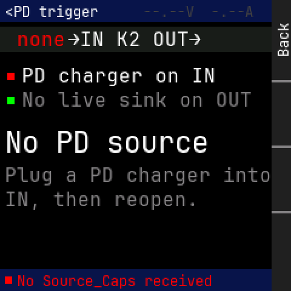

Panel: Back / (empty) / (empty) / (empty)

```
    0123456789012345678901234567|
  0 <PD trigger   --.--V  -.--A |
 12                             |
 24  none  >IN K2 OUT>          |
 36                             |
 48                             |
 60   PD charger on IN          |
 72   No live sink on OUT       |
 84                             |
 96                             |
108 N o   P D   s o u r c e     |
120                             |
132                             |
144 Plug a PD charger into      |
156 IN, then reopen.            |
168                             |
180                             |
192                             |
204                             |
216                             |
228  No Source_Caps received    |
```

<details><summary>Element table</summary>

| element | x | y | w | h | font | token |
|---|---|---|---|---|---|---|
| status bar | 0 | 0 | 224 | 18 | - | `bar` |
| title | 4 | 3 | 77 | 13 | 12 | `text` |
| mini readout (none) | 118 | 3 | 91 | 13 | 12 | `faint` |
| wiring strip | 0 | 22 | 224 | 21 | - | `surface` |
| IN side | 4 | 24 | 50 | 17 | 16 | `error` |
| ports | 56 | 24 | 110 | 17 | 16 | `text` |
| OUT side | 170 | 24 | 50 | 17 | 16 | `dim` |
| check bad | 6 | 60 | 6 | 6 | - | `error` |
| check text | 18 | 54 | 160 | 17 | 16 | `text` |
| check ok | 6 | 80 | 6 | 6 | - | `ok` |
| check text | 18 | 74 | 190 | 17 | 16 | `dim` |
| "No PD source" | 4 | 104 | 168 | 26 | 24 | `text` |
| "Plug a PD charger into" | 4 | 136 | 220 | 17 | 16 | `dim` |
| "IN, then reopen." | 4 | 156 | 160 | 17 | 16 | `dim` |
| footer | 0 | 222 | 224 | 18 | - | `bar` |
| state dot | 4 | 228 | 6 | 6 | - | `error` |
| footer text | 14 | 225 | 161 | 13 | 12 | `error` |

</details>

## cabler_setup

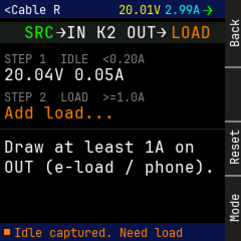

Panel: Back / (empty) / Reset / Mode

```
    0123456789012345678901234567|
  0 <Cable R      20.01V2.99A>  |
 12                             |
 24   SRC  >IN K2 OUT>   LOAD   |
 36                             |
 48 STEP 1  IDLE  <0.20A        |
 60                             |
 72 20.04V 0.05A                |
 84                             |
 96 STEP 2  LOAD  >=1.0A        |
108 Add load...                 |
120 ----------------------------|
132                             |
144 Draw at least 1A on         |
156 OUT (e-load / phone).       |
168                             |
180                             |
192                             |
204                             |
216                             |
228  Idle captured. Need load   |
```

<details><summary>Element table</summary>

| element | x | y | w | h | font | token |
|---|---|---|---|---|---|---|
| status bar | 0 | 0 | 224 | 18 | - | `bar` |
| title | 4 | 3 | 56 | 13 | 12 | `text` |
| mini V | 118 | 3 | 42 | 13 | 12 | `volt` |
| mini A | 164 | 3 | 35 | 13 | 12 | `amp` |
| mini flow | 202 | 2 | 10 | 17 | 16 | `flow_fwd` |
| wiring strip | 0 | 22 | 224 | 21 | - | `surface` |
| IN side | 4 | 24 | 50 | 17 | 16 | `ok` |
| ports | 56 | 24 | 110 | 17 | 16 | `text` |
| OUT side | 170 | 24 | 50 | 17 | 16 | `caution` |
| "STEP 1  IDLE  <0.20A" | 4 | 52 | 140 | 13 | 12 | `dim` |
| idle sample | 4 | 66 | 120 | 17 | 16 | `text` |
| "STEP 2  LOAD  >=1.0A" | 4 | 90 | 140 | 13 | 12 | `dim` |
| load sample | 4 | 104 | 110 | 17 | 16 | `caution` |
| "Draw at least 1A on" | 4 | 138 | 190 | 17 | 16 | `text` |
| "OUT (e-load / phone)." | 4 | 158 | 210 | 17 | 16 | `text` |
| footer | 0 | 222 | 224 | 18 | - | `bar` |
| state dot | 4 | 228 | 6 | 6 | - | `caution` |
| footer text | 14 | 225 | 168 | 13 | 12 | `caution` |

</details>

## cabler_result

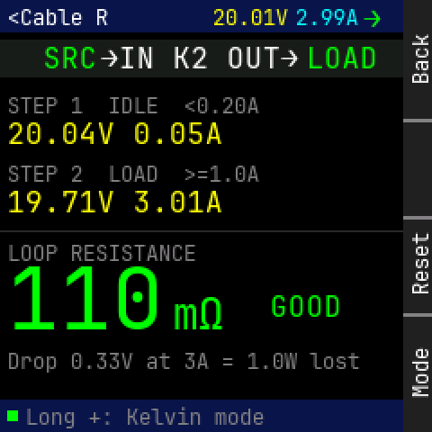

Panel: Back / (empty) / Reset / Mode

```
    0123456789012345678901234567|
  0 <Cable R      20.01V2.99A>  |
 12                             |
 24   SRC  >IN K2 OUT>   LOAD   |
 36                             |
 48 STEP 1  IDLE  <0.20A        |
 60                             |
 72 20.04V 0.05A                |
 84                             |
 96 STEP 2  LOAD  >=1.0A        |
108 19.71V 3.01A                |
120 ----------------------------|
132 LOOP RESISTANCE             |
144                             |
156 1   1   0                   |
168             m O   GOOD      |
180                             |
192 Drop 0.33V at 3A = 1.0W lost|
204                             |
216                             |
228  Long +: Kelvin mode        |
```

<details><summary>Element table</summary>

| element | x | y | w | h | font | token |
|---|---|---|---|---|---|---|
| status bar | 0 | 0 | 224 | 18 | - | `bar` |
| title | 4 | 3 | 56 | 13 | 12 | `text` |
| mini V | 118 | 3 | 42 | 13 | 12 | `volt` |
| mini A | 164 | 3 | 35 | 13 | 12 | `amp` |
| mini flow | 202 | 2 | 10 | 17 | 16 | `flow_fwd` |
| wiring strip | 0 | 22 | 224 | 21 | - | `surface` |
| IN side | 4 | 24 | 50 | 17 | 16 | `ok` |
| ports | 56 | 24 | 110 | 17 | 16 | `text` |
| OUT side | 170 | 24 | 50 | 17 | 16 | `ok` |
| "STEP 1  IDLE  <0.20A" | 4 | 52 | 140 | 13 | 12 | `dim` |
| idle sample | 4 | 66 | 120 | 17 | 16 | `volt` |
| "STEP 2  LOAD  >=1.0A" | 4 | 90 | 140 | 13 | 12 | `dim` |
| load sample | 4 | 104 | 120 | 17 | 16 | `volt` |
| "LOOP RESISTANCE" | 4 | 134 | 105 | 13 | 12 | `dim` |
| R digits | 4 | 148 | 87 | 35 | 48 | `energy` |
| unit | 96 | 161 | 28 | 26 | 24 | `energy` |
| grade | 150 | 162 | 40 | 17 | 16 | `ok` |
| "Drop 0.33V at 3A = 1.0W lost" | 4 | 194 | 196 | 13 | 12 | `dim` |
| footer | 0 | 222 | 224 | 18 | - | `bar` |
| state dot | 4 | 228 | 6 | 6 | - | `ok` |
| footer text | 14 | 225 | 133 | 13 | 12 | `dim` |

</details>

## cabler_error

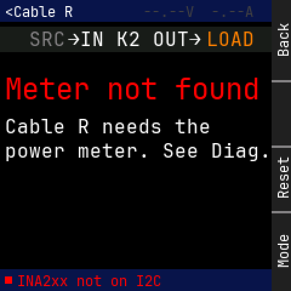

Panel: Back / (empty) / Reset / Mode

```
    0123456789012345678901234567|
  0 <Cable R      --.--V  -.--A |
 12                             |
 24   SRC  >IN K2 OUT>   LOAD   |
 36                             |
 48                             |
 60                             |
 72 M e t e r   n o t   f o u n |
 84                             |
 96 Cable R needs the           |
108                             |
120 power meter. See Diag.      |
132                             |
144                             |
156                             |
168                             |
180                             |
192                             |
204                             |
216                             |
228  INA2xx not on I2C          |
```

<details><summary>Element table</summary>

| element | x | y | w | h | font | token |
|---|---|---|---|---|---|---|
| status bar | 0 | 0 | 224 | 18 | - | `bar` |
| title | 4 | 3 | 56 | 13 | 12 | `text` |
| mini readout (none) | 118 | 3 | 91 | 13 | 12 | `faint` |
| wiring strip | 0 | 22 | 224 | 21 | - | `surface` |
| IN side | 4 | 24 | 50 | 17 | 16 | `dim` |
| ports | 56 | 24 | 110 | 17 | 16 | `text` |
| OUT side | 170 | 24 | 50 | 17 | 16 | `caution` |
| "Meter not found" | 4 | 60 | 210 | 26 | 24 | `error` |
| "Cable R needs the" | 4 | 96 | 170 | 17 | 16 | `text` |
| "power meter. See Diag." | 4 | 116 | 220 | 17 | 16 | `text` |
| footer | 0 | 222 | 224 | 18 | - | `bar` |
| state dot | 4 | 228 | 6 | 6 | - | `error` |
| footer text | 14 | 225 | 119 | 13 | 12 | `error` |

</details>
